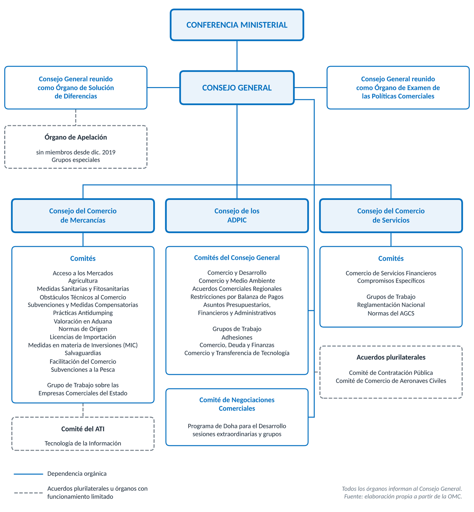

# 1. LA OMC Y LA ECONOMÍA MUNDIAL

## 1.1. El papel de la OMC en el comercio mundial

La **Organización Mundial del Comercio (OMC)** es la única organización internacional de alcance mundial que se ocupa de las normas del comercio entre países. Se creó el **1 de enero de 1995** como resultado de la Ronda Uruguay, heredó el acervo del GATT de 1947 y lo convirtió en una organización permanente, con personalidad jurídica propia y competencia sobre mercancías, servicios y propiedad intelectual. Cuenta con **166 miembros**, tras la incorporación de Comoras y Timor Oriental en 2024, que concentran en torno al **98 %** del comercio mundial. Otras 22 economías están en proceso de adhesión.

Su contribución descansa en tres funciones: un conjunto de normas que limita la arbitrariedad de los gobiernos, un foro de negociación para seguir liberalizando y un mecanismo para resolver diferencias sin represalias unilaterales. Desde 1995 el comercio de mercancías se ha multiplicado varias veces y el comercio Sur Sur ha pasado de menos de una décima parte a cerca de una cuarta parte del total.

## 1.2. La situación actual del comercio mundial

El comercio ha mostrado resiliencia. En 2025 el de mercancías creció un **4,6 %** en volumen y el de servicios un **5,3 %**. La OMC prevé para 2026 un crecimiento del comercio de mercancías del **3,9 %**, impulsado por la inversión en inteligencia artificial, y del 3,3 % en servicios, rebajado por el conflicto en Oriente Medio.

Este dinamismo convive con un deterioro de las reglas. Los aranceles generalizados de EEUU desde 2025, al margen de sus consolidaciones, han sido según la Directora General la mayor perturbación de las reglas comerciales en ochenta años. Aun así, en torno al **72 %** del comercio de mercancías se hace en condiciones de nación más favorecida y otro **16 %** en acuerdos preferenciales amparados por las normas de la OMC.

## 1.3. Los retos del sistema multilateral

La OMC afronta desafíos que afectan a sus tres funciones:

- Fragmentación en bloques por las tensiones geopolíticas, la seguridad económica y el uso creciente de políticas industriales y subvenciones
- Dificultad para negociar por consenso entre 166 miembros, como mostró la XIV Conferencia Ministerial de Yaundé (marzo de 2026), que terminó sin declaración ministerial
- Paralización del Órgano de Apelación desde diciembre de 2019
- Nuevos ámbitos como el comercio digital, el comercio y el medio ambiente o el trato especial y diferenciado de las grandes economías emergentes

Para la Unión Europea, que negocia en nombre de sus Estados miembros, y para España, cuyas exportaciones de bienes y servicios superan un tercio del PIB, defender un sistema multilateral basado en normas es una prioridad.

# 2. EL SISTEMA DE LA OMC

## 2.1. El sistema multilateral de comercio y sus acuerdos

Es un sistema abierto basado en normas negociadas por los miembros, generalmente por consenso, y ratificadas por sus parlamentos. Su base jurídica es el **Acuerdo de Marrakech**, firmado el **15 de abril de 1994**, con los demás acuerdos como anexos:

- **Anexo 1A.** Mercancías: GATT de 1994 y acuerdos que lo desarrollan, como agricultura, medidas sanitarias, obstáculos técnicos, antidumping, subvenciones o salvaguardias. Se añadieron Facilitación del Comercio (2017) y Subvenciones a la Pesca (septiembre de 2025)
- **Anexo 1B.** Acuerdo General sobre el Comercio de Servicios (AGCS)
- **Anexo 1C.** Acuerdo sobre los ADPIC, propiedad intelectual relacionada con el comercio
- **Anexo 2.** Entendimiento sobre Solución de Diferencias (ESD)
- **Anexo 3.** Mecanismo de Examen de las Políticas Comerciales (MEPC)
- **Anexo 4.** Acuerdos plurilaterales, que solo obligan a quienes los aceptan: Contratación Pública y Aeronaves Civiles

Los anexos 1 a 3 se aceptan en bloque. El Acuerdo sobre Tecnología de la Información (ATI) no forma parte del Anexo 4 y sus concesiones se extienden a todos los miembros.

## 2.2. Los principios del sistema

Todos los acuerdos se inspiran en unos pocos principios, heredados en su mayoría del GATT:

- **No discriminación**, con dos cláusulas. La de la **nación más favorecida** obliga a extender inmediata e incondicionalmente a todos los miembros la ventaja concedida a uno. El **trato nacional** impide tratar peor a los productos, servicios o titulares extranjeros que a los nacionales una vez dentro del mercado. Ambas admiten excepciones tasadas, como uniones aduaneras, zonas de libre comercio o preferencias a países en desarrollo
- **Liberalización progresiva** mediante negociaciones sucesivas, que abordan cada vez más los obstáculos no arancelarios
- **Previsibilidad**, por la consolidación de aranceles y compromisos en servicios, y **transparencia**, por la publicación de normas, la notificación de medidas y la vigilancia
- **Competencia leal**, con disciplinas sobre dumping y subvenciones y defensa comercial
- **Fomento del desarrollo**, con trato especial y diferenciado para países en desarrollo y países menos adelantados (PMA): plazos más largos, flexibilidad y asistencia técnica

# 3. OBJETIVO, FUNCIONES Y ESTRUCTURA DE LA OMC

## 3.1. Objetivo

Lo fija el preámbulo del Acuerdo de Marrakech. Las relaciones comerciales y económicas deben tender a **elevar los niveles de vida**, lograr el pleno empleo y un volumen creciente de ingresos reales y demanda efectiva, y acrecentar la producción y el comercio, con utilización óptima de los recursos conforme al **desarrollo sostenible**. Se añade proteger el medio ambiente, que los países en desarrollo obtengan una parte del comercio acorde con sus necesidades y celebrar acuerdos para reducir aranceles y eliminar el trato discriminatorio.

## 3.2. Funciones

El **artículo III** del Acuerdo de Marrakech le atribuye cinco funciones:

- Facilitar la aplicación, administración y funcionamiento de los acuerdos multilaterales y servir de marco a los plurilaterales
- Ser foro de negociación, sobre materias ya reguladas y nuevas
- Administrar el ESD
- Administrar el MEPC
- Cooperar con el Fondo Monetario Internacional y el Banco Mundial para lograr mayor coherencia de las políticas económicas globales

## 3.3. Miembros y adhesión

Pueden ser miembros los Estados y los territorios aduaneros con plena autonomía en sus relaciones comerciales exteriores, como Hong Kong (China) o el Taipéi Chino. La **Unión Europea** es miembro de pleno derecho junto a sus 27 Estados miembros, entre ellos España desde el 1 de enero de 1995. La Comisión Europea negocia en nombre de todos, por la competencia exclusiva de la Unión en política comercial común.

La adhesión se regula en el **artículo XII**. El candidato negocia las condiciones con un grupo de trabajo y sus compromisos de acceso a mercados de forma bilateral con los miembros interesados. Decide la Conferencia Ministerial, que puede hacerlo por mayoría de dos tercios, aunque desde 1995 se adopta por consenso. Las últimas han sido Comoras y Timor Oriental, aprobadas en la XIII Conferencia Ministerial de Abu Dabi (2024).

## 3.4. Estructura

Se establece en el **artículo IV** del Acuerdo de Marrakech. Todos los órganos están abiertos a todos los miembros, salvo el Órgano de Apelación, los grupos especiales y los comités de los acuerdos plurilaterales. Se organiza en niveles:

- **Conferencia Ministerial.** Órgano supremo, con representantes de todos los miembros, normalmente ministros de comercio. Se reúne al menos cada dos años y decide sobre cualquier cuestión de los acuerdos multilaterales. Se han celebrado catorce, la última en Yaundé (2026)
- **Consejo General.** Con embajadores en Ginebra, ejerce las funciones de la Conferencia entre reuniones y es el órgano de decisión ordinario. Se reúne también como:
  - **Órgano de Solución de Diferencias (OSD)**, que establece grupos especiales, adopta sus informes y los del Órgano de Apelación, vigila su aplicación y autoriza la suspensión de concesiones
  - **Órgano de Examen de las Políticas Comerciales (OEPC)**, que examina las políticas de los miembros
- **Consejos sectoriales**, que informan al Consejo General: el de Comercio de Mercancías (con los comités de cada acuerdo del Anexo 1A), el de Comercio de Servicios y el de los ADPIC
- **Comités horizontales** del Consejo General, como Comercio y Desarrollo o Comercio y Medio Ambiente
- **Comité de Negociaciones Comerciales**, presidido por el Director General, que dirige la Ronda de Doha
- **Comités de los acuerdos plurilaterales**, que informan al Consejo General

# 4. ADOPCIÓN DE DECISIONES

El **artículo IX** mantiene la práctica del **consenso** del GATT de 1947. Hay consenso cuando ningún miembro presente se opone formalmente a la decisión. No exige unanimidad expresa, pero da a cada miembro una capacidad de bloqueo. Su ventaja es la legitimidad de decisiones apoyadas por todos. Su inconveniente es la lentitud y que un solo miembro pueda paralizarlas, como con la moratoria del comercio electrónico.

Si no hay consenso, se vota, con **un voto por miembro**. La Unión Europea tiene tantos votos como Estados miembros que sean miembros de la OMC. Salvo disposición en contrario, basta la mayoría de los votos emitidos, pero hay mayorías reforzadas:

- **Interpretación de los acuerdos**, exclusiva de la Conferencia Ministerial y el Consejo General: tres cuartos
- **Exenciones (waivers)** de obligaciones en circunstancias excepcionales: tres cuartos
- **Enmiendas** (artículo X): con carácter general dos tercios, y solo obligan a quienes las aceptan. Algunas disposiciones esenciales, como la nación más favorecida o las reglas de votación, exigen la aceptación de todos
- **Adhesión** (artículo XII): dos tercios
- **Nuevo acuerdo plurilateral en el Anexo 4**: solo por consenso (artículo X.9)

En la práctica la votación casi no se usa. Rige además el **todo único (single undertaking)**. Al crear la OMC significó aceptar los acuerdos multilaterales en bloque. En la Ronda de Doha significa que nada está acordado hasta que todo lo está. Busca el equilibrio, pero ralentiza las negociaciones, por lo que desde Bali se avanza con resultados parciales y fórmulas plurilaterales.

# 5. LA SECRETARÍA DE LA OMC

Tiene sede en Ginebra y unos **620 funcionarios** de cerca de 90 nacionalidades. No tiene facultades de decisión, que son de los miembros, por lo que la OMC es una organización dirigida por sus miembros.

La dirige el **Director General**, nombrado por la Conferencia Ministerial, que fija sus facultades y mandato. En la práctica lo nombra el Consejo General por consenso, con un procedimiento de 2002. Él y el personal tienen carácter exclusivamente internacional y no reciben instrucciones de ningún gobierno (artículo VI). Desde el 1 de marzo de 2021 es **Ngozi Okonjo-Iweala**, séptima persona y primera mujer y africana en el cargo, que inició un segundo mandato el 1 de septiembre de 2025 hasta agosto de 2029. Le asisten cuatro Directores Generales Adjuntos.

Sus funciones principales son:

- Apoyo técnico y administrativo a consejos, comités y grupos de negociación
- Asistencia técnica y formación a países en desarrollo, en especial PMA
- Análisis del comercio, estudios económicos e informes del MEPC
- Asistencia jurídica a los grupos especiales y asesoramiento a los candidatos a la adhesión
- Organización de las Conferencias Ministeriales

El presupuesto se financia con contribuciones según la participación en el comercio. EEUU, mayor contribuyente, suspendió sus aportaciones en marzo de 2025.

# 6. LA SOLUCIÓN DE DIFERENCIAS EN LA OMC

## 6.1. Fundamentos del sistema

Es, según la propia OMC, su contribución más singular a la estabilidad de la economía mundial, porque sin un medio para hacer cumplir las normas el sistema perdería valor. Se basa en el **ESD** (Anexo 2). Desde 1995 se han presentado más de 630 diferencias. Sus rasgos son:

- **Carácter obligatorio y exclusivo**: los miembros no adoptan determinaciones unilaterales de infracción ni represalias propias (art. 23)
- **Consenso negativo**: el establecimiento de grupos especiales, la adopción de informes y la autorización de represalias solo se impiden si todos los miembros, incluido el ganador, se oponen. Son decisiones casi automáticas, a diferencia del GATT
- **Plazos estrictos**: orientativamente un año hasta la primera resolución, o unos quince meses con apelación, menos en casos urgentes como los perecederos
- **Preferencia por la solución negociada**: en cualquier fase cabe acuerdo, buenos oficios, conciliación o mediación, que puede ofrecer el Director General

El OSD es el propio Consejo General reunido en esa calidad.

## 6.2. Las etapas del procedimiento

- **Consultas.** El reclamante las solicita, el demandado responde en 10 días y las entabla en 30. Si en 60 días no hay solución, puede pedirse un grupo especial
- **Establecimiento del grupo especial.** El OSD lo establece, a más tardar, en la segunda reunión en que se incluya la petición, pues el demandado solo puede bloquearlo en la primera. Se compone normalmente de tres expertos independientes. Si en 20 días no hay acuerdo, los designa el Director General
- **Actuaciones.** Examina las comunicaciones de las partes y emite un informe provisional y otro definitivo. El plazo es de seis meses y no debe superar nueve
- **Adopción del informe.** El OSD lo adopta en 60 días, salvo apelación o consenso en contra
- **Apelación.** Ante el Órgano de Apelación, permanente, de siete miembros de los que tres examinan cada caso. Solo versa sobre cuestiones de derecho. Plazo de 60 días, máximo 90. El OSD adopta su informe en 30 días, salvo consenso en contra
- **Aplicación.** El demandado debe adecuar la medida, en un plazo prudencial acordado o fijado por arbitraje. Si se discute el cumplimiento, cabe un grupo especial de cumplimiento (art. 21.5)
- **Compensación y suspensión de concesiones.** Si no cumple, las partes pueden negociar una compensación. Sin acuerdo en 20 días, el reclamante pide autorización para suspender concesiones (art. 22), es decir, contramedidas. Se aplican primero en el mismo sector, luego en otro del mismo acuerdo y, en casos graves, en otro acuerdo (retorsión cruzada). Su nivel equivale al perjuicio y, si se discrepa, lo fija un árbitro (art. 22.6). Son temporales hasta el cumplimiento

## 6.3. Un ejemplo: las aceitunas negras españolas (DS577)

Ilustra todas las etapas y afecta a un sector exportador español. En 2018 EEUU impuso derechos antidumping y compensatorios a la aceituna negra española. Los compensatorios se basaban en que las ayudas de la PAC beneficiaban indirectamente a la aceituna transformada.

La Unión Europea pidió consultas en enero de 2019 y el informe, adoptado en diciembre de 2021, le dio la razón por incompatibilidad con el Acuerdo sobre Subvenciones y Medidas Compensatorias. Un grupo especial de cumplimiento confirmó en marzo de 2024 el incumplimiento. En octubre de 2025 un árbitro fijó las contramedidas en un máximo de **13,64 millones de dólares anuales**, autorizadas por el OSD en diciembre de 2025.

## 6.4. La crisis del Órgano de Apelación

Desde diciembre de 2019 está paralizado por el bloqueo de EEUU al nombramiento de sus miembros. Como el ESD no prevé alternativa, quien pierde ante un grupo especial puede apelar «al vacío» y la diferencia queda sin resolver.

Como respuesta, la Unión Europea y otros miembros crearon en 2020 el **MPIA**, procedimiento arbitral multipartito de apelación provisional basado en el art. 25 del ESD, que en 2026 reúne a 61 miembros y en torno al 60 % del comercio mundial, pero solo se aplica entre ellos. La Unión cuenta además con el **Reglamento (UE) 2021/167**, que permite adoptar contramedidas si un socio bloquea con una apelación al vacío. La reforma del sistema, que debía completarse en 2024, sigue pendiente.

# 7. EL MECANISMO DE EXAMEN DE LAS POLÍTICAS COMERCIALES

## 7.1. Objetivos

La transparencia se garantiza con la notificación de medidas y con los exámenes periódicos del **MEPC** (Anexo 3). Nació con carácter provisional en 1989 en el GATT, limitado a mercancías, y con la OMC se extendió a servicios y propiedad intelectual. Sus objetivos son:

- Aumentar la transparencia y la comprensión de las políticas y prácticas comerciales
- Mejorar la calidad del debate público e intergubernamental
- Permitir una evaluación multilateral de sus efectos sobre el sistema
- Contribuir a un mejor cumplimiento de normas y compromisos

El examen no sirve para hacer cumplir obligaciones concretas, ni para la solución de diferencias, ni para imponer nuevos compromisos. Es un examen entre pares que considera las necesidades de desarrollo y el entorno económico de cada miembro.

## 7.2. Procedimiento y periodicidad

Lo realiza el OEPC, el Consejo General reunido en esa calidad, con dos documentos:

- Un informe del gobierno examinado sobre su política comercial
- Un informe de la Secretaría, elaborado bajo su propia responsabilidad, sobre entorno económico, régimen y situación sectorial

Interviene un ponente a título personal y los informes se publican con el acta. Todos los miembros se examinan, con una periodicidad según su peso comercial desde 2019:

- Las cuatro primeras economías (Unión Europea, EEUU, China y Japón): cada **tres años**
- Las dieciséis siguientes: cada **cinco años**
- El resto: cada **siete años**, con intervalo posiblemente mayor para los PMA

La Unión Europea se examina como una sola entidad, de modo que la política comercial de España se analiza dentro de ese examen.

## 7.3. La vigilancia del comercio

Desde la crisis financiera de 2008 el MEPC se completa con informes de vigilancia del Director General sobre las medidas comerciales de todos los miembros, restrictivas y de facilitación, que la OMC elabora también con la OCDE y la UNCTAD para el G20. Con la proliferación de aranceles unilaterales son esenciales para conocer el alcance real del proteccionismo.

# 8. CONCLUSIÓN

La OMC sigue siendo la piedra angular del sistema multilateral. Sus miembros concentran casi todo el comercio mundial, sus acuerdos dan un marco común y la mayor parte de los intercambios se hace en condiciones de nación más favorecida. Afronta una crisis en sus tres funciones: la negociadora, limitada por el consenso entre 166 miembros, la judicial, mermada por la paralización del Órgano de Apelación y solo paliada por el MPIA, y la de vigilancia, que cobra importancia ante los aranceles unilaterales. La respuesta pasa por reformar la toma de decisiones, la solución de diferencias y el trato especial y diferenciado, y por fórmulas flexibles como los acuerdos plurilaterales. Para la Unión Europea y España, una OMC eficaz sigue siendo la mejor garantía de seguridad jurídica y acceso a mercados.
