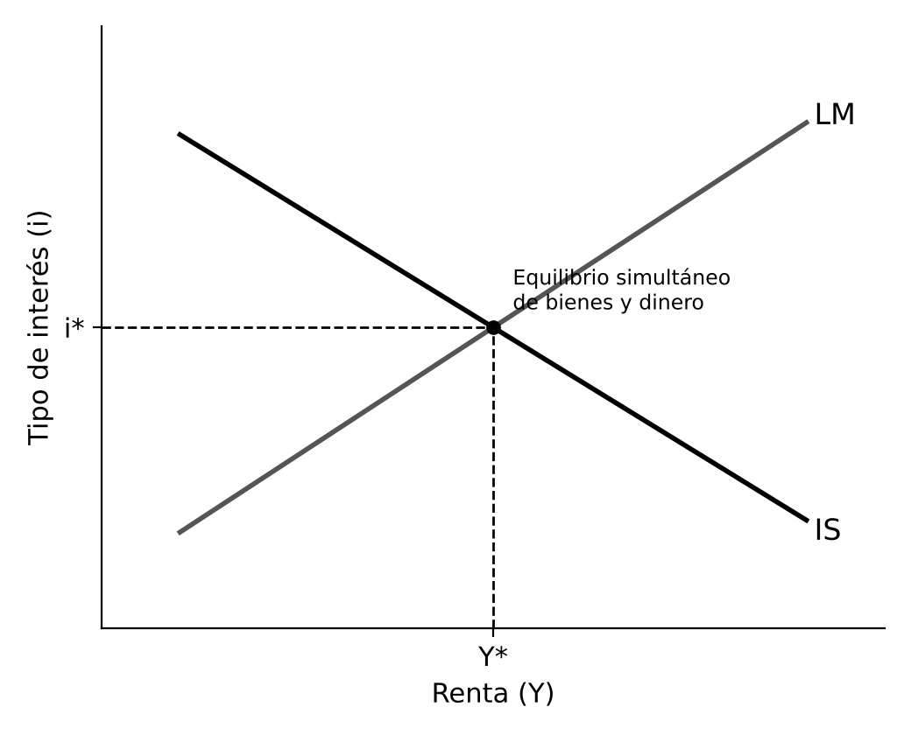

# 1. INTRODUCCIÓN

Hacia 1870 la economía clásica mostró sus límites: su teoría del valor trabajo explicaba mal los precios. Jevons, Menger y Walras propusieron el valor basado en la utilidad marginal, y de esa revolución marginalista nació la escuela neoclásica, núcleo de la microeconomía actual. La Gran Depresión puso en duda que los mercados vuelvan solos al pleno empleo, y Keynes respondió en 1936 con una teoría de la demanda agregada que originó la macroeconomía moderna. Desde entonces el pensamiento económico ha oscilado entre ambas visiones, hasta el nuevo consenso puesto a prueba por la crisis de 2008 y la inflación de 2021 a 2023.

# 2. LA REVOLUCIÓN MARGINALISTA

## 2.1. La utilidad marginal y los fundadores

En 1871 **Jevons** y **Menger** y en 1874 **Walras** llegaron por separado a la misma idea: el valor de un bien depende de la utilidad de la última unidad consumida, su **utilidad marginal**, y no del trabajo necesario para producirlo. Su antecedente fue Gossen (1854), con la ley de la utilidad marginal decreciente. Así se resolvió la paradoja del agua y el diamante: el agua es abundante y su utilidad marginal baja, el diamante es escaso y la suya alta, y el precio depende de la marginal y no de la total.

Los marginalistas concebían la utilidad como medible (cardinal) y partían del individualismo metodológico y el razonamiento en el margen. Surgieron tres escuelas:

- **Cambridge**, de Jevons y Marshall, que combinó la utilidad marginal con el análisis clásico de los costes
- **Austriaca**, de Menger, Böhm-Bawerk y Wieser, que rechazó las matemáticas y subrayó la subjetividad del valor, el tiempo y la incertidumbre
- **Lausana**, de Walras y Pareto, que desarrolló el análisis matemático del equilibrio general

Se centraron en la demanda y no explicaron los precios de los factores de producción.

## 2.2. La productividad marginal y la distribución

Una segunda generación (**Clark**, Wicksteed, Wicksell) aplicó el razonamiento marginal a la distribución. Cada factor se remunera según su **productividad marginal**: el salario iguala la del trabajo y el interés la del capital. Con rendimientos constantes a escala, los pagos a los factores agotan el producto total.

Para Ricardo el beneficio era un residuo, y para los neoclásicos ninguna renta lo es. Clark consideraba justo el reparto, tesis que muchos críticos discutieron. Böhm-Bawerk explicó el interés porque los métodos indirectos de producción son más productivos y se valoran más los bienes presentes que los futuros. Fisher (1930) lo explicó por la impaciencia de los consumidores y las oportunidades de inversión.

# 3. LOS GRANDES SISTEMAS NEOCLÁSICOS: MARSHALL Y WALRAS

## 3.1. Alfred Marshall (1842-1924) y el equilibrio parcial

Con Marshall el marginalismo se convierte en escuela neoclásica. Sus **Principios de economía** (1890) fueron el manual de referencia durante cuarenta años. Unió la teoría clásica de los costes y la marginalista de la utilidad, como las dos hojas de unas tijeras, y usó el **equilibrio parcial**: estudiar un solo mercado con el resto constante (ceteris paribus). Sus aportaciones:

- **Demanda.** De la utilidad marginal decreciente deduce la curva de demanda de pendiente negativa, e introduce la elasticidad
- **Excedente del consumidor.** Diferencia entre lo que estaría dispuesto a pagar y lo que paga, herramienta básica para medir el bienestar
- **Oferta y tiempo.** Su aportación más original. En el periodo de mercado la oferta es fija. En el corto plazo la empresa produce mientras cubra los costes variables. En el largo plazo ajusta su tamaño, con economías de escala internas y externas
- **Distribución.** Aplica oferta y demanda a los factores y acuña la **cuasirrenta**, ingreso de un factor con oferta fija a corto plazo que desaparece a largo plazo

## 3.2. Léon Walras (1834-1910) y el equilibrio general

Walras estudió todos los mercados a la vez, de bienes y de factores, en competencia perfecta. Los representó con un sistema de ecuaciones, una por mercado, con los precios en un bien de referencia o numerario. El equilibrio se alcanza mediante el **tanteo** (tâtonnement): un subastador sube los precios de los bienes con exceso de demanda y baja los de los bienes con exceso de oferta, sin intercambios hasta que todos los mercados se vacían.

La **ley de Walras** establece que la suma del valor de los excesos de demanda es cero, así que si todos los mercados menos uno están en equilibrio, el último también.

Pareto sustituyó la utilidad medible por la **utilidad ordinal** y definió el **óptimo de Pareto**: nadie puede mejorar sin que otro empeore. Arrow y Debreu demostraron la existencia del equilibrio general en 1954. Marshall prefiere el equilibrio parcial y la aplicación práctica, y Walras el general y la formalización matemática. La economía actual combina ambos.

## 3.3. La consolidación de la microeconomía neoclásica

Entre 1930 y 1960 la economía neoclásica se formalizó y se extendió:

- Hicks y Allen (1934) basaron la teoría del consumidor en las curvas de indiferencia, y Samuelson (1947) le dio su forma matemática moderna
- Robinson y Chamberlin (1933) estudiaron la competencia imperfecta y monopolística
- Pigou (1920) fundó la economía del bienestar y las externalidades, que justifican impuestos correctores
- Heckscher-Ohlin explica el comercio por la dotación de factores de cada país
- Solow (1956) explica el crecimiento por el capital, la población y el progreso técnico, con convergencia gradual a un estado estacionario

# 4. EL PENSAMIENTO ECONÓMICO DE KEYNES

## 4.1. La ruptura con la teoría clásica

Los clásicos sostenían que con precios y salarios flexibles se vuelve al pleno empleo y que, según la ley de Say, no hay insuficiencia general de demanda. En la **Teoría general** (1936) Keynes rechazó ambas ideas. Sus diferencias con los clásicos:

- Enfoque agregado y de corto plazo
- La producción y el empleo los determina la **demanda efectiva**, el gasto que los agentes desean realizar, y no la oferta
- Puede haber un equilibrio con desempleo involuntario, sin fuerzas automáticas hacia el pleno empleo
- La incertidumbre y las expectativas influyen de forma decisiva
- El dinero no es neutral, porque afecta al tipo de interés y, con él, a la producción

## 4.2. El sector del gasto: consumo, inversión y multiplicador

El consumo depende de la renta disponible. Según la ley psicológica fundamental, al subir la renta sube el consumo pero menos, porque una parte se ahorra: la propensión marginal a consumir está entre cero y uno. La inversión es el componente más inestable. Se realiza si la eficiencia marginal del capital, la rentabilidad esperada, supera el tipo de interés, y depende de expectativas inciertas, sujetas a los espíritus animales de los empresarios.

En el equilibrio la producción coincide con la demanda agregada, y lo que se ajusta es la renta: ahorro e inversión se igualan por cambios en ella. De ahí se derivan dos ideas:

- **Multiplicador** (Kahn, 1931). Un aumento del gasto eleva la renta en una cantidad mayor, porque quien lo recibe consume una parte, que es renta de otros. Es mayor cuanto mayor es la propensión marginal a consumir
- **Paradoja del ahorro.** Si todos ahorran más a la vez, cae el consumo y la renta, y el ahorro total puede no aumentar

## 4.3. El sector monetario: la preferencia por la liquidez

Para Keynes el dinero es también un depósito de valor. Se demanda liquidez por tres motivos:

- **Transacción** y **precaución**, para los pagos ordinarios y los imprevistos, según la renta
- **Especulación**, según el tipo de interés. Con tipos bajos y expectativa de subida, el precio de los bonos caerá y conviene mantener dinero, por lo que la demanda de dinero aumenta cuando baja el tipo

El tipo de interés es el precio que iguala la demanda de dinero con la oferta de la autoridad monetaria, y no iguala ahorro e inversión como pensaban los clásicos. Así Keynes rompe la dicotomía clásica entre el sector real y el monetario.

## 4.4. El mercado de trabajo y el desempleo involuntario

El empleo no lo determina el mercado de trabajo sino la demanda efectiva: las empresas contratan lo necesario para producir lo que esperan vender. Los trabajadores resisten las bajadas del salario nominal, aunque acepten caídas del salario real por la inflación (ilusión monetaria). Pero aunque los salarios bajaran, el desempleo no desaparecería, porque caerían la renta y el consumo de los trabajadores y con ellos la demanda. El **desempleo involuntario** se debe a la insuficiencia de demanda.

De ahí la oferta agregada keynesiana. Con recursos ociosos, más demanda eleva sobre todo producción y empleo. Al acercarse al pleno empleo, se traduce cada vez más en precios y salarios, y en el pleno empleo la oferta es vertical, como en el modelo clásico, que suponía la economía siempre en ese tramo.

## 4.5. Implicaciones de política económica

Si falta demanda, hay que estimularla:

- **Política monetaria.** Puede bajar el tipo de interés, pero Keynes duda de su eficacia en una depresión: la inversión puede reaccionar poco si las expectativas son pesimistas, y con tipos muy bajos se puede guardar todo el dinero adicional (trampa de la liquidez)
- **Política fiscal.** Tiene prioridad, en especial el gasto en obras públicas, con efecto directo y ampliado por el multiplicador

Keynes fue uno de los artífices de Bretton Woods (1944), que creó el FMI y el Banco Mundial. En los años treinta polemizó con **Hayek**, para quien las crisis nacen de una expansión excesiva del crédito que mantiene bajos los tipos y provoca inversiones insostenibles, de modo que estimular la demanda prolonga los desequilibrios. Hayek defendió también que los precios transmiten información dispersa que ningún planificador puede reunir.

# 5. LA SÍNTESIS NEOCLÁSICA

En 1937 **Hicks** resumió la Teoría general en el modelo **IS-LM**, difundido por Hansen, que integra el mercado de bienes y el de dinero con precios fijos. La IS recoge las combinaciones de tipo de interés y renta con equilibrio en el mercado de bienes, y tiene pendiente negativa porque un tipo menor estimula la inversión. La LM recoge las del mercado de dinero y tiene pendiente positiva, porque más renta aumenta la demanda de dinero y, con oferta monetaria dada, eleva el tipo. Su cruce determina la renta y el tipo de equilibrio.

La política fiscal desplaza la IS y la monetaria la LM. Con trampa de la liquidez la LM es horizontal y la política monetaria pierde eficacia, y si la inversión no reacciona al tipo la IS es vertical.

Desde los cincuenta, Samuelson, Modigliani, Tobin y Solow construyeron la **síntesis neoclásica**: a corto plazo, con precios y salarios rígidos, rige Keynes y la política de demanda es eficaz, y a largo plazo, con precios flexibles, rigen los neoclásicos. El efecto Pigou (una caída de precios eleva la riqueza real y el consumo) restablece en teoría el pleno empleo, aunque de forma lenta e incierta. La curva de Phillips (1958), relación inversa entre inflación y desempleo, hizo creer que se podía elegir entre ambos.

Limitaciones del IS-LM señaladas desde los sesenta:

- Estática comparativa, sin explicar el paso de un equilibrio a otro
- Precios fijos, por lo que no explica la inflación
- Conecta lo real y lo monetario solo por el tipo de interés, sin otros canales como el crédito o la riqueza
- Ignora las expectativas

Algunos autores criticaron que la síntesis traicionaba a Keynes. Los **poskeynesianos** (Robinson, Kaldor, Minsky) insistieron en la incertidumbre radical y la inestabilidad financiera. Los keynesianos del desequilibrio (Clower, Leijonhufvud, Barro y Grossman, Malinvaud) mostraron que, sin ajuste de precios, hay racionamiento de cantidades y el desempleo puede persistir.

# 6. EL MONETARISMO Y LA ESCUELA DE CHICAGO

En los setenta la estanflación, inflación y desempleo altos tras las crisis del petróleo, contradijo la curva de Phillips y abrió paso al monetarismo de **Milton Friedman** (1912-2006), figura de la escuela de Chicago. Sus ideas:

- **Teoría cuantitativa renovada** (1956). La demanda de dinero es función estable de pocas variables, así que la cantidad de dinero explica a corto plazo la producción y a largo plazo los precios: la inflación es siempre un fenómeno monetario
- **Gran Depresión como fallo monetario.** En la Historia monetaria de EEUU (1963), Friedman y Schwartz la atribuyeron a la contracción de la oferta monetaria que permitió la Reserva Federal
- **Tasa natural de desempleo** (Friedman y Phelps, 1967-1968). La curva de Phillips solo existe a corto plazo, mientras las expectativas de inflación, adaptativas (según la inflación pasada), no se ajustan. A largo plazo es vertical, y bajar el paro de su tasa natural solo genera inflación
- **Reglas frente a discrecionalidad.** Con retardos largos y variables, es mejor una regla de crecimiento constante del dinero. La política fiscal pierde eficacia por el efecto expulsión (crowding out): el gasto público eleva los tipos y desplaza la inversión privada

El monetarismo influyó en las políticas antiinflacionistas de Volcker y de Thatcher, pero la inestabilidad de la demanda de dinero en los ochenta, por la innovación financiera, llevó a los bancos centrales a abandonar los objetivos de cantidad de dinero. La escuela incluyó también a Stigler, sobre la captura de la regulación, a Becker, que extendió el análisis económico a la familia o la discriminación, y a Fama, de la hipótesis de los mercados eficientes.

Las ideas liberales inspiraron en parte el **Consenso de Washington** de los noventa: disciplina fiscal, liberalización comercial y financiera, privatización y desregulación, aplicadas por el FMI y el Banco Mundial a países en desarrollo, con resultados muy debatidos.

# 7. DE LA NUEVA MACROECONOMÍA CLÁSICA A LA ACTUALIDAD

## 7.1. La nueva macroeconomía clásica y el ciclo real

En los setenta Lucas, Sargent, Wallace y Barro llevaron más lejos la crítica a Keynes:

- **Expectativas racionales** (Muth, 1961). Los agentes usan toda la información y no cometen errores sistemáticos, por lo que una política anunciada se anticipa y solo las sorpresas tienen efectos reales
- **Fundamentos microeconómicos**: agentes que optimizan y mercados que se vacían
- **Crítica de Lucas** (1976). Los modelos keynesianos no sirven para evaluar políticas nuevas, porque sus parámetros cambian con la política
- **Equivalencia ricardiana** (Barro, 1974). Si se anticipa que la deuda de hoy son impuestos de mañana, el déficit no estimula la demanda

La **teoría del ciclo real** (Kydland y Prescott, 1982) atribuye las fluctuaciones a perturbaciones reales, sobre todo de productividad, y las ve como respuesta eficiente que no justifica intervenir. Mostraron también la inconsistencia temporal: el gobierno tiene incentivos a incumplir sus promesas, lo que justifica la independencia de los bancos centrales.

## 7.2. La nueva economía keynesiana

Desde los ochenta Mankiw, Akerlof, Stiglitz, Blanchard o Taylor aceptaron expectativas racionales y fundamentos microeconómicos, pero mostraron que con mercados imperfectos precios y salarios pueden ser rígidos por razones racionales:

- Costes de menú, con pequeñas rigideces individuales que causan grandes efectos agregados
- Contratos escalonados de Taylor y Calvo, con ajuste gradual
- Salarios de eficiencia, por encima del de equilibrio, que generan desempleo
- Fallos de información en el crédito, que provocan racionamiento

Con rigideces, la política monetaria vuelve a tener efectos reales a corto plazo.

## 7.3. El nuevo consenso

En los noventa ambas corrientes convergieron en una nueva síntesis neoclásica basada en modelos de equilibrio general dinámico y estocástico (**DSGE**), que combinan las expectativas racionales y los fundamentos microeconómicos con las rigideces de precios. De ella derivan:

- Bancos centrales independientes, con la estabilidad de precios como objetivo principal, a menudo con metas de inflación en torno al 2 %
- El tipo de interés como instrumento principal, según reglas como la **regla de Taylor** (1993)
- Papel secundario de la política fiscal en la estabilización

El Premio Nobel de 2026 a Robert Hall y Michael Woodford reconoce los modelos que hoy usan bancos centrales y gobiernos.

## 7.4. La crisis de 2008 y los debates actuales

La crisis de 2008 sorprendió a modelos que apenas daban papel al sistema financiero. Se recuperó a Minsky, y la respuesta combinó estímulos fiscales con políticas monetarias no convencionales: tipos cero o negativos, adquisición masiva de activos (expansión cuantitativa) y orientación sobre la política futura. Con los tipos en su límite inferior, la política fiscal recuperó protagonismo, y Summers planteó el estancamiento secular, una debilidad persistente de la demanda.

La pandemia de 2020 y la inflación de 2021 a 2023, la más alta en cuatro décadas, devolvieron la atención a la oferta, a las expectativas de inflación y a la coordinación entre política monetaria y fiscal. Hoy la investigación incorpora agentes heterogéneos, fricciones financieras y economía conductual, y el debate sigue abierto entre confiar en los mercados y defender una intervención activa del Estado.

# 8. CONCLUSIÓN

La revolución marginalista sustituyó el valor trabajo por la utilidad marginal, y Marshall con el equilibrio parcial y Walras con el general construyeron la microeconomía actual. Keynes mostró que una economía puede quedar atrapada en el desempleo por falta de demanda y fundó la macroeconomía. Desde entonces el debate ha oscilado entre quienes confían en que los mercados se autorregulen (monetarismo, nueva macroeconomía clásica) y quienes defienden la intervención (keynesianos), y el nuevo consenso combinó elementos de ambas.

La teoría responde a los problemas de cada época: la Gran Depresión dio la razón a Keynes, la estanflación a Friedman y Lucas, y las crisis recientes han devuelto el protagonismo a la demanda, al sistema financiero y a la política fiscal. Para España, que no controla su política monetaria, es clave la coordinación entre el BCE y las políticas fiscales nacionales.
