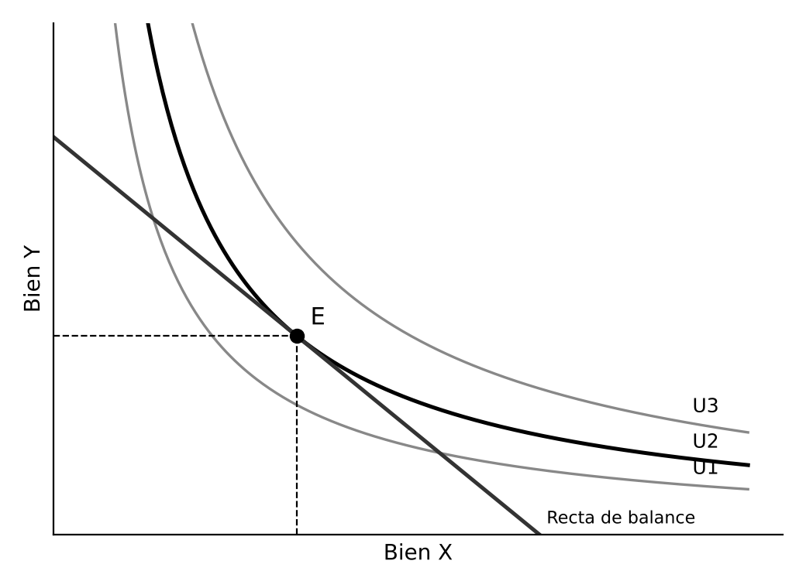
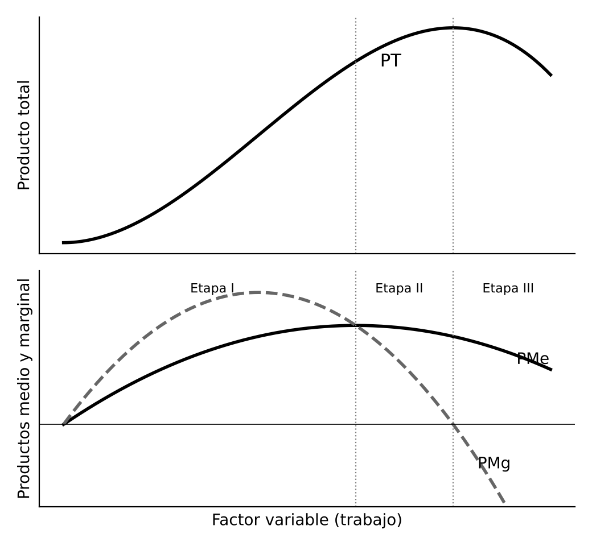
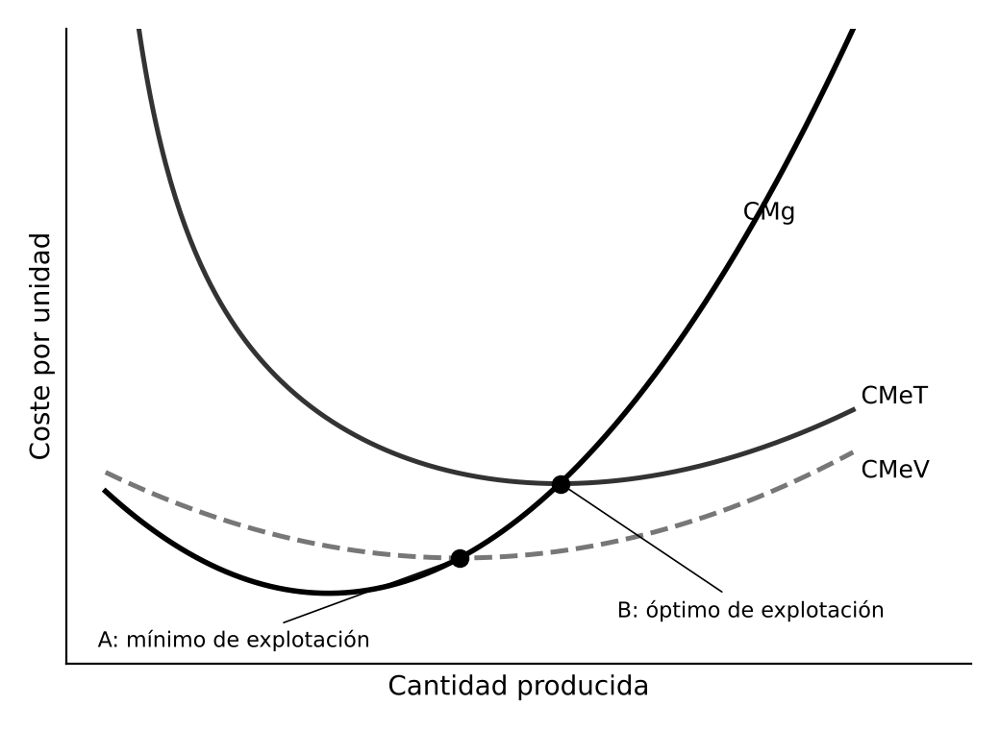

# 1. INTRODUCCIÓN

La microeconomía estudia cómo deciden los agentes individuales y cómo interactúan en los mercados para asignar recursos escasos. Las decisiones de los consumidores se estudian en la teoría de la demanda y las de las empresas, sujetas a restricciones técnicas (teoría de la producción), económicas (teoría de los costes) y de mercado (teoría de los mercados, ajena a este tema). Las tres teorías siguen el mismo esquema: un agente racional que optimiza sujeto a una restricción.

# 2. LA TEORÍA DE LA DEMANDA DEL CONSUMIDOR

La teoría responde a qué bienes y en qué cantidad adquirirá el consumidor dados los precios y su renta. La respuesta es la función de demanda, y el punto de partida es la utilidad, la satisfacción que proporcionan los bienes.

## 2.1. La teoría cardinal de la utilidad

Es el enfoque de los marginalistas del siglo XIX y supone que la utilidad puede medirse. Distingue la **utilidad total**, satisfacción del consumo de una cantidad de un bien, y la **utilidad marginal**, satisfacción de la última unidad. Según la ley de **Gossen** de la utilidad marginal decreciente, esta disminuye al consumir más. Cuando llega a cero, la utilidad total es máxima, el punto de saturación.

El consumidor está en equilibrio cuando la utilidad marginal por euro gastado es igual en todos los bienes. De ahí se deduce una curva de demanda de pendiente negativa. Limitaciones: exige medir la utilidad, algo poco realista, y suele suponer la utilidad de cada bien independiente, por lo que explica mal la sustitución y la complementariedad.

## 2.2. La teoría ordinal: preferencias y curvas de indiferencia

**Pareto**, y después **Hicks y Allen (1934)**, desarrollaron el enfoque ordinal, base de la teoría neoclásica actual. Basta con que el consumidor ordene las cestas de bienes, sin medir su satisfacción. Sus preferencias cumplen cinco supuestos: completitud, transitividad, no saturación (más es preferible a menos), convexidad (prefiere la variedad) y continuidad.

Con ellos las preferencias se representan mediante **curvas de indiferencia**, que reúnen las cestas con la misma satisfacción, de pendiente negativa y convexas. Su pendiente es la **relación marginal de sustitución (RMS)**, la cantidad de un bien a la que el consumidor renuncia a cambio de una unidad adicional del otro.

## 2.3. El equilibrio del consumidor

La restricción presupuestaria, la recta de balance, recoge las cestas que el consumidor puede adquirir con su renta, y su pendiente es el precio relativo de los bienes. El equilibrio está en el punto en que la recta de balance es tangente a la curva de indiferencia más alta posible. Allí la RMS, que mide cómo valora el consumidor un bien frente a otro, coincide con el precio relativo, que mide cómo los valora el mercado.

Si cambian la renta o los precios, el equilibrio se desplaza. La curva renta-consumo da las curvas de Engel y la curva precio-consumo, la demanda individual.

## 2.4. La función de demanda

Relaciona la cantidad demandada con el precio del bien, el de los demás bienes y la renta. Es homogénea de grado cero en precios y renta: si todos se multiplican por el mismo número, la cantidad no cambia, porque el consumidor no sufre ilusión monetaria.

**La renta y la demanda.** Los bienes normales aumentan su demanda con la renta, los de primera necesidad en menor proporción y los de lujo en mayor. Los inferiores la reducen.

**El precio y la demanda.** Cuando baja el precio de un bien actúan dos efectos, según **Slutsky y Hicks**:

- Efecto sustitución: el bien es relativamente más barato y se demanda más. Siempre actúa en sentido contrario al precio
- Efecto renta: aumenta la renta real. Refuerza al anterior si el bien es normal y lo contrarresta si es inferior

Por eso la demanda casi siempre baja al subir el precio, la ley de la demanda. La excepción teórica son los bienes Giffen, inferiores en los que el efecto renta supera al efecto sustitución y la demanda sube con el precio.

**Las elasticidades.** Miden en porcentaje la sensibilidad de la demanda:

- Elasticidad precio: la demanda es elástica si la cantidad varía más que el precio e inelástica si varía menos
- Elasticidad renta: distingue bienes de lujo, de primera necesidad e inferiores
- Elasticidad cruzada: positiva para bienes sustitutivos, como café y té, y negativa para complementarios, como coche y gasolina

La elasticidad precio es mayor cuantos más sustitutivos tiene el bien, cuanto más pesa en el presupuesto y cuanto más largo es el periodo. Si la demanda es inelástica, una subida del precio aumenta el ingreso de las empresas, y si es elástica lo reduce. La demanda de mercado suma las individuales, y el excedente del consumidor es la diferencia entre lo que estaría dispuesto a pagar y lo que paga.

## 2.5. Otros enfoques de la demanda

**Preferencia revelada.** **Samuelson (1938)** construye la teoría solo con lo observable, las cestas elegidas a unos precios y una renta. Si elige A pudiendo adquirir B, ha revelado que prefiere A (axioma débil). Con supuestos más débiles llega a las mismas conclusiones que la teoría ordinal, de modo que la confirma desde otra base.

**Características.** **Lancaster (1966)** sostiene que el consumidor desea las características de los bienes, no los bienes en sí. Explica la diferenciación de productos y la aparición de nuevos productos.

**Incertidumbre y economía conductual.** La utilidad esperada de **von Neumann y Morgenstern (1944)** supone que el consumidor maximiza la media de las utilidades ponderada por su probabilidad. **Kahneman y Tversky** han mostrado que las personas se desvían de forma sistemática de la racionalidad, por ejemplo sienten más las pérdidas que las ganancias equivalentes. Completan la teoría tradicional sin sustituirla.

# 3. LA TEORÍA DE LA PRODUCCIÓN

## 3.1. La empresa y la función de producción

La teoría neoclásica ve la empresa como una unidad que transforma factores en productos para maximizar su beneficio, una simplificación deliberada. La **función de producción** recoge la cantidad máxima de producto con cada combinación de factores, dada la tecnología, e incluye solo métodos técnicamente eficientes. Según la sustitución entre factores:

- Proporciones fijas o de Leontief: los factores se combinan siempre en la misma proporción
- Sustitutos perfectos: un factor reemplaza a otro en proporción constante
- Cobb-Douglas (1928): caso intermedio, con sustitución cada vez más difícil

Las **isocuantas** reúnen las combinaciones de factores con la misma producción, equivalentes a las curvas de indiferencia. Su pendiente es la **relación marginal de sustitución técnica (RMST)**, cuánto capital puede sustituirse por una unidad adicional de trabajo manteniendo la producción. La región económica es la de pendiente negativa y productividad marginal positiva de ambos factores.

Hay tres horizontes: el corto plazo, con algún factor fijo, el largo plazo, con todos variables y tecnología constante, y el muy largo plazo, en que la tecnología también cambia.

## 3.2. La producción a corto plazo: la ley de los rendimientos decrecientes

Con un factor fijo, se definen el producto total (PT), el medio (PMe) y el marginal (PMg). La **ley de los rendimientos decrecientes** establece que, al añadir un factor variable a uno fijo, a partir de cierto punto el producto marginal disminuye y puede hacerse cero o negativo, porque cada trabajador dispone de menos maquinaria.

- Etapa I: el producto medio crece y conviene seguir contratando
- Etapa II: el medio disminuye pero el marginal es positivo. Es la etapa racional
- Etapa III: el marginal es negativo y un trabajador más reduce la producción total

## 3.3. La producción a largo plazo: los rendimientos a escala

Indican cómo cambia la producción al aumentar todos los factores en la misma proporción:

- Constantes: la producción crece en la misma proporción
- Crecientes: crece en mayor proporción, por especialización o indivisibilidades técnicas
- Decrecientes: crece en menor proporción, por dificultades de coordinación en empresas muy grandes

No deben confundirse con los rendimientos decrecientes de un factor, que varía solo uno.

## 3.4. El muy largo plazo: el progreso técnico

Permite producir más con los mismos factores y desplaza las isocuantas hacia el origen. Según **Hicks** es neutral si eleva en igual proporción la productividad del trabajo y del capital, ahorrador de trabajo si eleva más la del capital, como la automatización, y ahorrador de capital si eleva más la del trabajo.

# 4. LA TEORÍA DE LOS COSTES

## 4.1. El coste económico y la elección de factores

La empresa elige, entre las combinaciones técnicamente eficientes, la de menor coste para cada producción. El coste económico incluye el coste de oportunidad de todos los recursos, por lo que supera al contable al recoger, por ejemplo, el rendimiento que el empresario obtendría en otro uso.

Las rectas **isocoste** reúnen las combinaciones de factores de igual coste, y su pendiente es el precio relativo de los factores, salario entre precio del capital. El coste mínimo está donde la isocoste es tangente a la isocuanta, donde la RMST iguala al precio relativo de los factores. Si sube el precio de un factor, la empresa lo sustituye en parte por otro más barato.

## 4.2. La función de costes y sus propiedades

Repitiendo la elección para cada producción se obtiene la **función de costes**, el coste mínimo de cada cantidad dados los precios de los factores. Es creciente en la cantidad, no decreciente en el precio de los factores, homogénea de grado uno en ellos y cóncava, porque la empresa sustituye el factor que se encarece. Producción y costes son dos caras de la misma moneda, la dualidad.

## 4.3. Los costes a corto plazo

Los costes fijos no dependen de la cantidad producida y los variables sí. De ellos salen el coste medio total (CMeT), el medio variable (CMeV) y el marginal (CMg), coste de una unidad más. Las curvas son en forma de U, reflejo de las de producto: el CMg baja mientras crece el producto marginal y sube cuando este cae, y el CMeV es mínimo donde el producto medio es máximo.

El CMg corta a los costes medios en su mínimo. Quedan dos puntos clave:

- Mínimo de explotación (A): mínimo del CMeV. Con un precio inferior conviene cerrar
- Óptimo de explotación (B): mínimo del CMeT, con el menor coste por unidad

Entre ambos produce con pérdidas pero le conviene seguir, porque cubre los costes variables y parte de los fijos. En competencia perfecta produce donde el precio iguala al CMg, por lo que su oferta a corto plazo es el tramo del CMg por encima del mínimo de explotación.

## 4.4. Los costes a largo plazo

Todos los costes son variables y la empresa elige el tamaño de planta. El coste medio a largo plazo es la envolvente de las curvas de coste medio a corto plazo, una por tamaño de planta, según **Viner y Wong**. La senda de expansión une las combinaciones de mínimo coste y da la función de costes a largo plazo. Su forma refleja los rendimientos a escala:

- Tramo descendente: economías de escala, por especialización, mejor uso de la maquinaria o mejores condiciones de compra
- Tramo ascendente: deseconomías de escala, por dificultades de dirección y coordinación
- Mínimo: escala óptima

Las economías de alcance aparecen cuando producir varios bienes juntos es más barato que por separado, por ejemplo al compartir instalaciones.

## 4.5. Críticas y nuevos enfoques

- **Flexibilidad.** **Stigler (1939)**: las empresas no siempre eligen la planta de menor coste sino una flexible, que se adapta a la demanda con poco sobrecoste
- **Costes en forma de L.** Muchas empresas tienen costes medios que bajan y luego se mantienen constantes, lo que da una dimensión mínima eficiente. Se suman las economías de aprendizaje
- **Ineficiencia X.** **Leibenstein (1966)**: sin competencia se relaja el esfuerzo y se despilfarran recursos
- **Objetivos de la empresa.** Con propiedad y dirección separadas, **Baumol (1959)** propuso que los directivos maximizan la cifra de negocio y **Marris** el crecimiento. **Simon** (Nobel en 1978) sostuvo que, por su racionalidad limitada, buscan un resultado satisfactorio
- **Costes de transacción.** **Coase (1937)**: usar el mercado tiene costes y la empresa existe para ahorrarlos. **Williamson** (Nobel en 2009) lo desarrolló

# 5. CONCLUSIÓN

Las tres teorías comparten un método: un agente racional que optimiza sujeto a una restricción, con herramientas paralelas (curvas de indiferencia e isocuantas, recta de balance e isocoste, RMS y RMST). Dan la curva de demanda y las curvas de costes, base de la oferta. Son idealizaciones potentes aunque simplificadas, que la preferencia revelada, Lancaster, la economía conductual y las críticas de Stigler, Leibenstein o Coase han ampliado y matizado.
