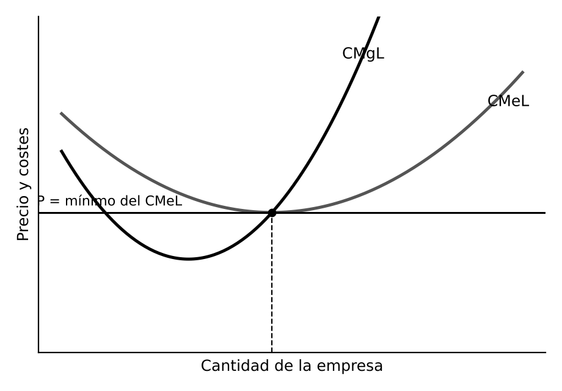
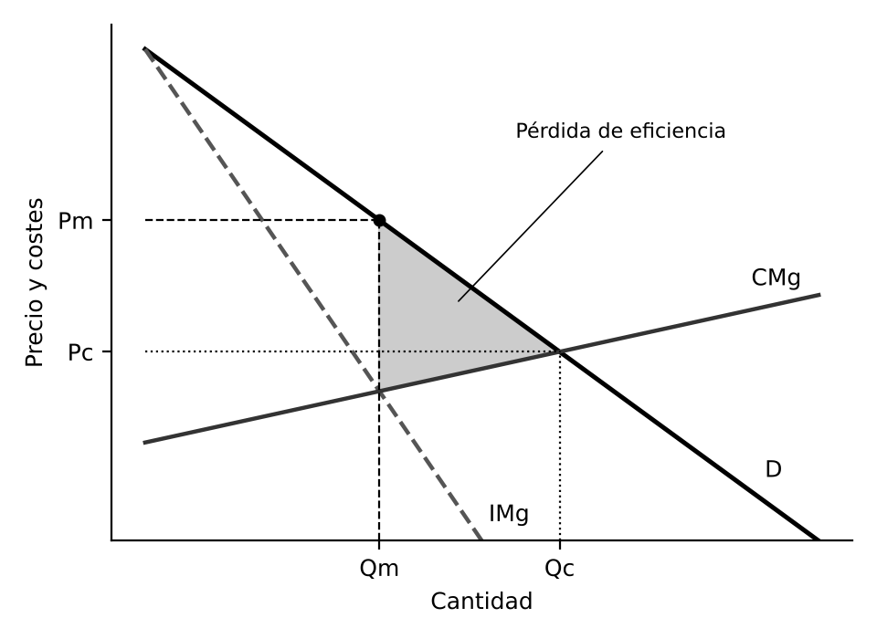
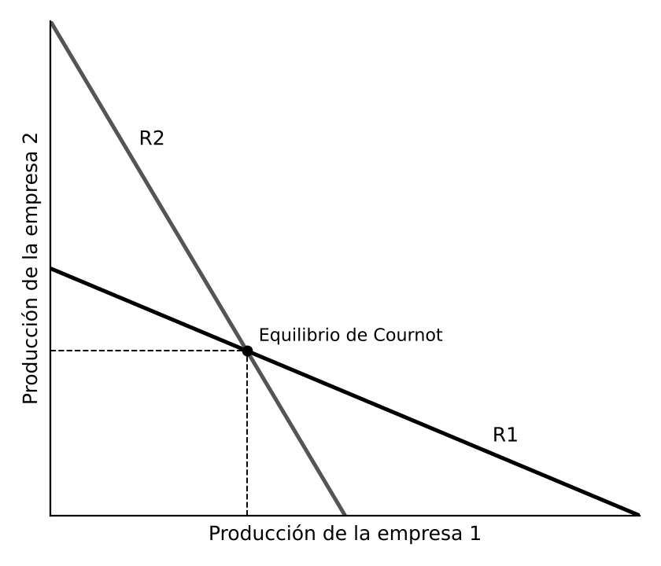

# 1. INTRODUCCIÓN

El **precio**, formado por la oferta y la demanda, coordina las decisiones de consumidores y empresas. El resultado depende de cuántas empresas compiten, de si sus productos son iguales o diferentes y de si otras pueden entrar. Hay dos formas puras, competencia perfecta y monopolio, y dos intermedias y más frecuentes, oligopolio y competencia monopolista. La competencia perfecta es la referencia, porque asigna los recursos de forma eficiente.

# 2. EL FUNCIONAMIENTO DEL MERCADO

## 2.1. Oferta, demanda y equilibrio

La **demanda** tiene pendiente negativa y la **oferta** suele tenerla positiva, porque un precio mayor cubre los costes de producir más. El **equilibrio** se da al precio con el que cantidad demandada y ofrecida coinciden. Si el precio es mayor hay exceso de oferta y baja, y si es menor hay exceso de demanda y sube.

- La demanda se desplaza si cambian la renta, los precios de bienes sustitutivos o complementarios o las preferencias
- La oferta se desplaza si cambian los precios de los factores, la tecnología o el número de empresas
- Un precio máximo por debajo del equilibrio, como un tope a los alquileres, produce escasez. Un mínimo por encima, como los precios de garantía agrícolas, produce excedentes

## 2.2. Las funciones de los precios

Los precios transmiten información sobre la escasez de forma descentralizada y gratuita, miden el valor que la sociedad concede a la última unidad si no hay efectos externos, y racionan el bien entre quienes más lo valoran orientando los recursos hacia las actividades más demandadas.

Bajo ciertas condiciones el equilibrio competitivo maximiza la suma de los excedentes del consumidor y del productor y es **eficiente en el sentido de Pareto**: no se puede mejorar a nadie sin empeorar a otro. Es el primer teorema de la economía del bienestar, versión moderna de la mano invisible de Smith.

# 3. LA COMPETENCIA PERFECTA

## 3.1. Supuestos del modelo

Formalizada por Marshall, exige producto homogéneo, gran número de compradores y vendedores sin influencia en el precio, libertad de entrada y salida, información perfecta y movilidad perfecta de los factores. Cada empresa es **precio aceptante**: vende todo lo que quiera al precio de mercado, por lo que su ingreso marginal es igual al precio.

## 3.2. El equilibrio a corto plazo

La empresa maximiza el beneficio produciendo donde el precio iguala al coste marginal. A corto plazo puede tener beneficios extraordinarios o pérdidas, y sigue produciendo mientras el precio cubra el coste medio variable, es decir, por encima del **mínimo de explotación**. Su oferta es el tramo del coste marginal por encima de ese mínimo, y la del mercado es la suma de las ofertas de las empresas.

En el **muy corto plazo** la cantidad ya está producida, la oferta es rígida y el precio solo raciona lo existente, como en una lonja de pescado.

## 3.3. El equilibrio a largo plazo

Los beneficios extraordinarios atraen empresas, la oferta aumenta y el precio baja. Las pérdidas provocan salidas y el precio sube. El proceso acaba cuando el beneficio extraordinario es nulo. Entonces el precio es igual al coste marginal y al mínimo del coste medio a largo plazo, y cada empresa produce en su escala óptima con el **beneficio normal**, que remunera los recursos del empresario a su coste de oportunidad.

Si los costes no cambian al crecer la industria, su oferta a largo plazo es horizontal. Si se encarecen los factores, tiene pendiente positiva.

## 3.4. Estática comparativa: costes e impuestos

- Un aumento de costes fijos o un impuesto de cuantía fija no altera el coste marginal, así que a corto plazo no cambia la producción. A largo plazo provoca pérdidas y salidas, y el precio sube y la cantidad baja
- Un aumento de costes variables o un impuesto por unidad eleva el coste marginal y reduce la producción ya a corto plazo
- La parte del impuesto que pagan los consumidores es mayor cuanto más rígida es la demanda y más elástica la oferta

## 3.5. Valoración

El resultado es eficiente: el precio, que refleja el valor de la última unidad, coincide con su coste, y cada empresa produce al mínimo coste. Pero no garantiza un reparto equitativo de la renta, que depende de la distribución inicial de los recursos. Sus supuestos rara vez se cumplen del todo, aunque algunos mercados agrícolas o financieros se aproximan, y sigue siendo la referencia para valorar los demás.

# 4. EL MONOPOLIO

## 4.1. Concepto y causas

El **monopolio** es un mercado con un único vendedor de un bien sin sustitutivos cercanos, protegido por barreras de entrada:

- Legales, como patentes, licencias o concesiones en exclusiva
- Control exclusivo de un recurso esencial
- Economías de escala tan grandes que una sola empresa abastece el mercado con menor coste que varias, o **monopolio natural**

## 4.2. El equilibrio del monopolista

El monopolista se enfrenta a toda la demanda y para vender una unidad más debe bajar el precio de todas, por lo que su ingreso marginal es menor que el precio. Produce donde el ingreso marginal iguala al coste marginal y cobra el precio máximo que los consumidores pagan por esa cantidad.

- Produce menos y cobra más que en competencia perfecta
- Como el precio supera el coste marginal, hay consumidores que valoran el bien por encima de su coste y no lo compran, lo que supone una **pérdida irrecuperable de eficiencia**
- Puede mantener beneficios extraordinarios a largo plazo, porque las barreras impiden la entrada

El **índice de Lerner** (Abba Lerner, 1934), diferencia entre precio y coste marginal dividida por el precio, mide el poder de mercado. En equilibrio es igual a la inversa de la elasticidad de la demanda, y el monopolista opera siempre en su tramo elástico, porque en el inelástico el ingreso marginal es negativo. Puede añadir ineficiencia X, por falta de presión competitiva, y gastos para mantener su posición.

## 4.3. Otras formas de monopolio

- El **monopolio multiplanta** reparte la producción para igualar el coste marginal de todas las plantas, y produce la cantidad con la que ese coste común iguala al ingreso marginal
- El **monopsonio** es un mercado con un único comprador, como la única empresa que contrata trabajadores en una comarca. Paga menos y compra menos que en competencia
- El **monopolio bilateral** enfrenta a un único vendedor con un único comprador. El resultado es indeterminado y depende del poder de negociación: puede imponerse uno de ellos, pactarse un reparto que maximice el beneficio conjunto o darse la integración vertical

## 4.4. La discriminación de precios

Consiste en cobrar precios distintos por el mismo bien sin que lo justifiquen diferencias de coste. Exige poder de mercado, distinguir consumidores e impedir la reventa. Según Pigou tiene tres grados:

- Primer grado o perfecta: se cobra a cada consumidor su máximo. Se apropia de todo el excedente del consumidor, pero produce la cantidad eficiente
- Segundo grado: el precio depende de la cantidad comprada, como los descuentos por volumen, y los consumidores se autoseleccionan
- Tercer grado: se divide a los consumidores en grupos y se cobra más al de demanda menos elástica

## 4.5. El monopolio natural y su regulación

En un monopolio natural los costes son subaditivos: una sola empresa produce lo que demanda el mercado con menor coste que varias. Es típico de las redes con grandes costes fijos, como electricidad, gas, agua o ferrocarril. Duplicarlas sería un despilfarro, pero dejar actuar al monopolio tampoco es deseable, por lo que se regula:

- Precio igual al coste marginal. Es eficiente, pero como el coste medio es mayor hay pérdidas y se necesita subvención
- Precio igual al coste medio. Cubre costes sin subvención, aunque produce algo menos que lo eficiente (óptimo de segundo orden)
- Tarifas en dos partes. Una cuota fija cubre los costes fijos y un precio por unidad igual al coste marginal permite el consumo eficiente
- Precios de Ramsey. Con varios productos, el margen es mayor en los de demanda más rígida
- Tarificación punta y valle. Precios más altos en los periodos de mayor demanda

Como el regulador conoce los costes peor que la empresa, se usan mecanismos con incentivos. La regulación de la tasa de rentabilidad limita el beneficio sobre el capital, pero induce el efecto Averch-Johnson (1962), un exceso de inversión. El **precio máximo o price cap**, fórmula IPC menos X aplicada en el Reino Unido desde los años ochenta, limita la subida anual de tarifas a la inflación menos un factor X de productividad, y la empresa se queda con las ganancias de reducir costes. Sus riesgos son el descuido de la calidad y un X mal fijado. La competencia por el mercado subasta la concesión del monopolio durante un periodo.

En España la regulación corresponde en gran parte a la Comisión Nacional de los Mercados y la Competencia (CNMC), creada por la Ley 3/2013.

# 5. EL OLIGOPOLIO

## 5.1. Rasgos del oligopolio

El **oligopolio** es un mercado con pocas empresas, que venden productos homogéneos, como cemento o acero, o diferenciados, como automóviles. Su rasgo esencial es la **interdependencia estratégica**: el resultado de cada empresa depende de lo que hagan las demás. Por eso no hay un único modelo y se estudia con la teoría de juegos de von Neumann y Morgenstern (1944) y Nash. En el **equilibrio de Nash** ninguna empresa mejora cambiando su estrategia, dadas las de las demás.

## 5.2. Los modelos clásicos

**Cournot (1838), cantidades.** Cada empresa decide cuánto producir suponiendo que la otra mantendrá su producción. Su función de reacción es su mejor respuesta a la producción rival, y el equilibrio está donde se cruzan. La producción total es mayor que la del monopolio y menor que la de competencia perfecta, y se acerca a esta cuantas más empresas hay.

**Bertrand (1883), precios.** Con productos idénticos, a cada empresa le conviene bajar algo el precio de la otra para quedarse con el mercado, y solo se detiene cuando el precio iguala el coste marginal. Es la paradoja de Bertrand: con dos empresas se alcanza el resultado competitivo. Desaparece con límites de capacidad (Edgeworth) o productos diferenciados.

**Stackelberg (1934), liderazgo.** Una líder decide primero su producción anticipando la reacción de la seguidora. Su ventaja exige que la decisión sea irreversible y creíble, por ejemplo por una inversión en capacidad.

## 5.3. La competencia a largo plazo: las decisiones estratégicas

El tamaño de la planta, la investigación o la publicidad alteran las condiciones de la competencia posterior. Si dos empresas eligen capacidad a la vez y luego compiten en precios, el resultado se parece al de Cournot (Kreps y Scheinkman, 1983). Si una decide primero con inversión irreversible, obtiene la ventaja de Stackelberg. La clave son los **costes hundidos**, que convierten una amenaza en un compromiso creíble.

## 5.4. La colusión

Los equilibrios anteriores no maximizan el beneficio conjunto, así que las empresas tienden a actuar como un monopolista:

- La **colusión explícita o cártel**, como la OPEP, fija precios o reparte cuotas, produciendo la cantidad de monopolio con, en principio, más producción para las de menor coste marginal. Es inestable, porque cada miembro tiene incentivos a producir más de lo pactado (dilema del prisionero)
- La **colusión tácita** surge sin acuerdo cuando compiten repetidamente y temen una guerra de precios. La demanda quebrada de Sweezy (1939) explica la rigidez de precios: los rivales siguen las bajadas pero no las subidas
- En el liderazgo en precios, una empresa dominante fija el precio y las demás lo aceptan

Los acuerdos colusorios están prohibidos por el art. 101 del Tratado de Funcionamiento de la Unión Europea y por la Ley 15/2007, de Defensa de la Competencia. Los programas de clemencia, que eximen de multa al primer miembro que denuncia el cártel, explotan su inestabilidad.

## 5.5. Barreras de entrada y mercados impugnables

Los beneficios extraordinarios solo se mantienen con **barreras de entrada**:

- Estructurales, derivadas de la tecnología y el mercado: economías de escala, ventajas absolutas de coste, grandes necesidades de capital o diferenciación del producto
- Estratégicas, creadas por las instaladas: el precio límite o la capacidad excedente que amenaza con una guerra de precios. Solo funcionan si la amenaza es creíble, por ejemplo por inversiones irrecuperables

La teoría de los **mercados impugnables** (Baumol, Panzar y Willig, 1982) muestra que importa menos cuántas empresas hay que si la entrada y la salida son libres y sin costes. En un mercado perfectamente impugnable incluso un monopolio cobra precios competitivos por la amenaza de entrada. La condición clave es la ausencia de costes hundidos.

# 6. LA COMPETENCIA MONOPOLISTA

## 6.1. La diferenciación de productos

Combina muchas empresas y libre entrada con productos diferenciados por marca, calidad, diseño o localización, lo que da a cada una cierto poder de mercado sobre su variedad, como en restaurantes o tiendas de ropa. La diferenciación es **horizontal**, si cada consumidor prefiere una variedad distinta, o **vertical**, si todos coinciden en que una es mejor, normalmente por su calidad, pero pagan cantidades distintas por ella.

Con el enfoque de Lancaster los consumidores demandan características y eligen la variedad más cercana a su ideal, lo que explica la fidelidad a la marca y el papel de la publicidad.

## 6.2. El modelo de Chamberlin

Edward Chamberlin (1933), al mismo tiempo que Joan Robinson con su competencia imperfecta, analizó este mercado:

- A corto plazo cada empresa es un pequeño monopolista ante la demanda de su variedad, de pendiente negativa pero bastante elástica por los muchos sustitutivos. Iguala ingreso marginal y coste marginal y puede tener beneficios o pérdidas
- A largo plazo los beneficios atraen empresas con variedades parecidas, que reducen la demanda de cada una hasta anular el beneficio extraordinario. El equilibrio se da cuando la demanda es tangente al coste medio

Entonces el precio iguala el coste medio pero supera el marginal, y cada empresa produce por debajo de su escala de mínimo coste. Hay **exceso de capacidad**, contrapartida de una mayor variedad que los consumidores valoran.

## 6.3. La competencia espacial y la preferencia por la variedad

Hotelling (1929) estudió la diferenciación por localización: dos vendedores en una playa tienden a situarse juntos en el centro (**principio de mínima diferenciación**). Si compiten también en precios, les conviene alejarse. El número de empresas es mayor cuanto menores son los costes fijos y mayores los costes de transporte.

Con preferencia por la variedad, el modelo de Dixit y Stiglitz (1977) muestra un equilibrio entre aprovechar las economías de escala y satisfacer el gusto por la variedad. Krugman (Nobel en 2008) lo aplicó al comercio internacional: países parecidos intercambian variedades de un mismo producto. Es el **comercio intraindustrial**, que explica buena parte del comercio entre países desarrollados y del español con la Unión Europea.

## 6.4. La diferenciación vertical

Todos prefieren más calidad pero pagan cantidades distintas, y las empresas se especializan en distintos niveles de calidad para no competir directamente. A diferencia de la horizontal, el número de empresas rentables puede ser reducido aunque el mercado crezca, porque las de mayor calidad atraen a la mayoría si el coste de la calidad recae sobre todo en costes fijos, como la investigación. En la práctica ambos tipos se mezclan, y la horizontal es la que más favorece el comercio intraindustrial.

# 7. CONCLUSIÓN

La estructura de un mercado condiciona su resultado. En competencia perfecta el precio iguala el coste marginal y la asignación es eficiente, y en el monopolio el precio lo supera y se genera una pérdida de eficiencia. El oligopolio se sitúa entre ambos según cómo compitan las empresas y si coluden, y la competencia monopolista cambia algo de eficiencia por más variedad. Estas teorías fundamentan la política de competencia: los arts. 101 y 102 del Tratado de Funcionamiento prohíben los acuerdos colusorios y el abuso de posición dominante, y en España los aplica la CNMC con la Ley 15/2007. Por los efectos de red de las grandes plataformas, la Unión Europea aprobó el Reglamento (UE) 2022/1925, de Mercados Digitales.
