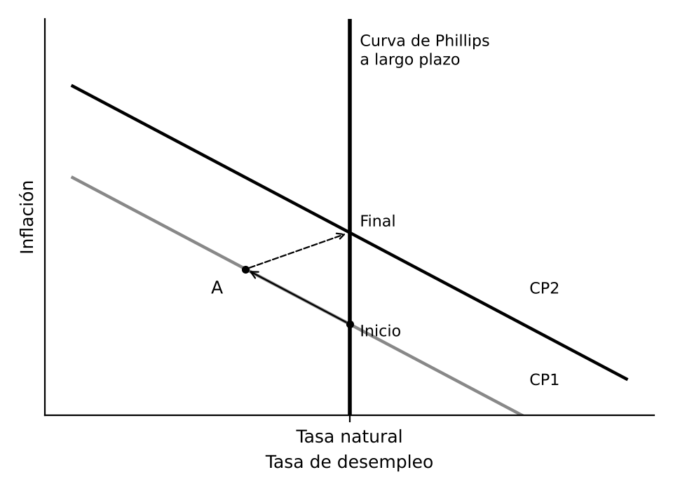
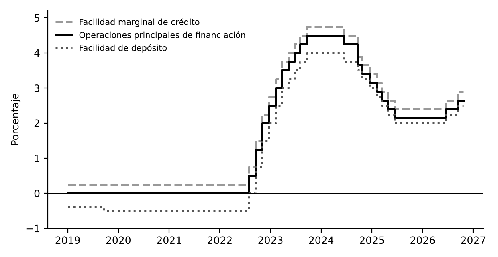

# 1. INTRODUCCIÓN

La política monetaria es el conjunto de decisiones del banco central sobre el precio del dinero (los tipos de interés) y la liquidez, para alcanzar la estabilidad de precios y, en muchos casos, también el empleo y la estabilidad financiera. Desde los noventa la mayoría de los bancos centrales son independientes y tienen objetivos explícitos de inflación, y las crisis recientes obligaron a usar instrumentos no convencionales. En España decide desde 1999 el BCE para toda la zona del euro, con el Banco de España en el Eurosistema.

# 2. EL DINERO Y SU CREACIÓN

## 2.1. El dinero y sus funciones

**Dinero.** Activo generalmente aceptado como medio de pago y para cancelar deudas. Sus funciones son medio de cambio (la esencial), unidad de cuenta y depósito de valor. Hoy es fiduciario: se acepta por la confianza en el banco central que lo emite. La mayor parte son depósitos bancarios, y la digitalización ha abierto el debate sobre el euro digital.

## 2.2. Los agregados monetarios

- **Base monetaria**: lo que crea directamente el banco central, efectivo en manos del público más reservas de los bancos
- **Oferta monetaria**: añade los depósitos bancarios. En la zona del euro, M1 es efectivo y depósitos a la vista, M2 añade depósitos a plazo hasta dos años y con preaviso hasta tres meses, y M3 añade algunos instrumentos negociables

## 2.3. La creación de dinero

El banco central crea base monetaria al comprar activos o prestar a los bancos, y la reduce al venderlos o recuperar préstamos. Los bancos comerciales crean dinero bancario: al conceder un préstamo abonan su importe en la cuenta del cliente, lo que crea un depósito, y como solo parte se retira o se reserva, el resto puede volver a prestarse. Así la oferta monetaria es un múltiplo de la base. Con reservas del 10 % y sin retirada de efectivo, un depósito de 100 euros genera depósitos por 1.000.

El enfoque actual lo matiza: los bancos conceden créditos según la demanda solvente y obtienen después las reservas del banco central al tipo que este fija. Por eso el banco central controla el precio del dinero más que su cantidad, en gran medida endógena.

# 3. LA INSTRUMENTACIÓN DE LA POLÍTICA MONETARIA

## 3.1. Objetivos, instrumentos y variables intermedias

El esquema tradicional encadena cuatro niveles: los instrumentos guían la variable operativa (reservas o tipo interbancario a un día), esta influye en el objetivo intermedio (un agregado monetario o el tipo de cambio) y este en el final (estabilidad de precios y, según el banco, empleo, crecimiento o tipo de cambio).

Tiene problemas. El control es imperfecto por los retardos y por lo mal conocido del mecanismo de transmisión. A menudo se le ha pedido más de lo que puede dar, como reducir el paro de forma permanente. Y hay un problema de incentivos: los beneficios de una política expansiva llegan pronto y sus costes después, lo que tienta a usarla con fines electorales. De ahí los objetivos directos de inflación y la independencia de los bancos centrales.

## 3.2. Los instrumentos convencionales

- **Operaciones de mercado abierto**: por iniciativa del banco central, que compra o vende activos o presta contra colateral. En el Eurosistema destacan las operaciones principales de financiación, semanales, y las de plazo más largo, a tres meses
- **Facilidades permanentes**: a un día y por iniciativa de los bancos. La facilidad marginal de crédito marca el techo de los tipos interbancarios y la de depósito su suelo, y juntas forman el corredor de tipos
- **Coeficiente de caja**: reservas mínimas en proporción a los depósitos. Estabiliza los tipos a corto. En el Eurosistema es del **1 %** desde 2012 y desde septiembre de 2023 no se remunera

Desde 2024 el BCE usa un sistema de suelo: con liquidez abundante el tipo de mercado se sitúa cerca del de la facilidad de depósito, que es el que señala su política. Desde septiembre de 2024 el diferencial con las operaciones principales es de **0,15 puntos**.

## 3.3. Los instrumentos no convencionales

Con los tipos cerca de cero tras 2008 se recurrió a:

- **Tipos negativos** en la facilidad de depósito, aplicados por el BCE entre 2014 y 2022
- **Compras masivas de activos** (expansión cuantitativa) para bajar los tipos largos, como el APP desde 2015 y el PEPP de 2020
- **Préstamos a largo plazo a los bancos** condicionados a que concedan crédito, como las TLTRO
- **Forward guidance**: anuncios sobre los tipos futuros para influir en las expectativas
- **Instrumentos contra la fragmentación**, como el TPI de 2022, que permite comprar deuda de un país cuyo coste de financiación se dispare sin justificación económica

# 4. LAS ESTRATEGIAS DE POLÍTICA MONETARIA

## 4.1. Del objetivo monetario al objetivo de inflación

- **Objetivo de crecimiento monetario**: de inspiración monetarista, fija el crecimiento de un agregado coherente con la inflación deseada. Lo aplicó con éxito el Bundesbank, pero en los años ochenta la innovación financiera hizo inestable la demanda de dinero
- **Objetivo directo de inflación**: adoptado por Nueva Zelanda en 1990 y después por Reino Unido, Canadá o Suecia. Se basa en un objetivo numérico público, en la previsión de inflación a uno o dos años como guía y en la transparencia. En la práctica es flexible, para no provocar fluctuaciones excesivas de la producción

## 4.2. Las reglas de política monetaria

La **regla de Taylor (1993)** indica que el tipo debe subir cuando la inflación supera su objetivo y la brecha de producción es positiva, y bajar en el caso contrario. Incorpora el **principio de Taylor**: ante más inflación, el tipo nominal sube más que proporcionalmente, para que suba el real. Los bancos centrales la usan como referencia, no de forma mecánica.

## 4.3. Credibilidad, independencia e inconsistencia temporal

**Kydland y Prescott (1977)** y **Barro y Gordon (1983)** mostraron la inconsistencia temporal: un gobierno anuncia inflación baja, pero una vez fijados salarios y precios tiene la tentación de crear inflación por sorpresa para reducir el paro. Los agentes lo anticipan y el resultado es más inflación sin menos paro. La solución es un banco central independiente, con mandato claro y dirigido por un banquero conservador (**Rogoff, 1985**), hoy la norma en los países desarrollados.

## 4.4. La estrategia del BCE y de la Reserva Federal

Según el **art. 127 del TFUE**, el objetivo principal del Eurosistema es la estabilidad de precios y, sin perjuicio de ello, apoyar las políticas económicas generales de la Unión. El BCE es plenamente independiente. Su estrategia ha evolucionado:

- 1998: inflación inferior al 2 % a medio plazo, con análisis económico y análisis monetario
- 2003: inferior pero próxima al 2 %
- 2021: objetivo simétrico del **2 %** a medio plazo, con incorporación del cambio climático y la estabilidad financiera
- Junio de 2025: lo confirma, responderá con actuaciones contundentes o persistentes ante desviaciones grandes y duraderas, y fija la próxima revisión en 2030

La **Reserva Federal** tiene mandato dual, estabilidad de precios y máximo empleo, con objetivo del 2 %. Abandonó en 2025 el objetivo de inflación media de 2020 y volvió a uno flexible. La diferencia con el BCE es más formal que real, pues este también atiende a la actividad.

# 5. LOS EFECTOS DE LA POLÍTICA MONETARIA SOBRE LA ACTIVIDAD Y LA INFLACIÓN

## 5.1. Los hechos estilizados

- **A largo plazo**, la correlación entre dinero e inflación es cercana a uno y no hay relación con la producción real (McCandless y Weber, 1995). Los tipos nominales suben con la inflación (ecuación de Fisher: tipo nominal ≈ tipo real + inflación esperada)
- **A corto plazo**, dinero y tipos se adelantan a la producción. Una política restrictiva reduce la producción con un retraso máximo de uno o dos años y la inflación más tarde y más gradualmente

## 5.2. La neutralidad del dinero

La **teoría cuantitativa**, base del pensamiento clásico, dice que dinero por velocidad de circulación es igual al valor de la producción. Con velocidad estable y producción real determinada por factores reales, más dinero solo eleva los precios: el dinero es neutral. Hoy se acepta que lo es a largo plazo pero no a corto, porque precios y salarios tardan en ajustarse. La política monetaria influye temporalmente en la producción, pero a largo plazo solo determina la inflación.

## 5.3. Keynes y la síntesis neoclásica

Para **Keynes**, más dinero baja el tipo de interés y estimula inversión y demanda, con efectos reales por la rigidez de los salarios nominales. Dudaba de su eficacia en una depresión, por la trampa de la liquidez. La **síntesis neoclásica** la veía eficaz a corto plazo, pero menos potente que la fiscal, y con la curva de Phillips creía que el gobierno podía elegir entre más inflación y menos paro.

## 5.4. El monetarismo y la tasa natural de paro

**Friedman** recuperó la teoría cuantitativa: la inflación es siempre un fenómeno monetario y, por los retardos largos y variables, debe seguirse una regla de crecimiento constante del dinero. **Friedman y Phelps** introdujeron la tasa natural de paro, determinada por factores reales. Una política expansiva solo la reduce mientras los trabajadores no ajustan sus expectativas de inflación. Cuando las ajustan, el paro vuelve a su tasa natural con más inflación. A largo plazo la curva de Phillips es vertical, y mantener el paro por debajo de su tasa natural exige una inflación cada vez mayor (hipótesis aceleracionista).

## 5.5. La nueva macroeconomía clásica

Con expectativas racionales, **Lucas, Sargent y Wallace** sostienen que los cambios anticipados de la política monetaria no tienen efectos reales, ni siquiera a corto plazo. Solo las sorpresas afectan a la producción. En el modelo de información imperfecta de Lucas, el productor ve su precio pero no el nivel general y, ante la duda, produce algo más, de modo que una expansión imprevista eleva temporalmente la producción y una anunciada solo sube los precios. La política monetaria debe limitarse a garantizar la estabilidad de precios con reglas sencillas y creíbles. La experiencia mostró que las desinflaciones sí tienen costes, lo que refuerza la credibilidad.

## 5.6. La nueva economía keynesiana y la nueva síntesis

La **nueva economía keynesiana** mostró que la política monetaria tiene efectos reales aun con expectativas racionales, porque precios y salarios se fijan por contratos de varios periodos (**Fischer, 1977**, y **Taylor, 1980**) o porque cambiarlos tiene costes. Ante una perturbación imprevista, quienes tienen contratos vigentes no pueden reaccionar pero el banco central sí, por lo que una política activa puede estabilizar.

La **nueva síntesis neoclásica** integra estas ideas en los modelos de equilibrio general dinámico que usan los bancos centrales. Concluye que:

- La política actúa a través del tipo de interés real: con precios rígidos, subir el nominal sube el real y reduce la demanda
- La inflación depende de la brecha de producción y, sobre todo, de las expectativas, por lo que comunicación y credibilidad son decisivas
- Para que el sistema sea estable, el tipo debe responder más que proporcionalmente a la inflación

# 6. LOS CANALES DE TRANSMISIÓN

- **Tipos de interés**: una bajada del tipo oficial reduce el euríbor y el coste de los préstamos, y aumenta inversión, vivienda y demanda. En España, con muchas hipotecas a tipo variable referenciadas al euríbor, llega a las familias más rápido que donde predomina el tipo fijo
- **Tipo de cambio**: con tipos más bajos la moneda se deprecia, las exportaciones se abaratan y las importaciones se encarecen, lo que eleva los precios de los productos importados
- **Precio de los activos y riqueza**: sube el precio de acciones y vivienda, los hogares consumen más (efecto riqueza) y las empresas invierten más porque el valor de mercado de sus activos supera su coste de reposición (q de Tobin)
- **Crédito**: afecta a la cantidad de crédito y no solo a su precio, vía la capacidad de los bancos para prestar y vía la prima de financiación de las empresas, que en recesión amplifica la caída (acelerador financiero de Bernanke, Gertler y Gilchrist). Es especialmente relevante en la zona del euro, por la dependencia de los préstamos bancarios
- **Expectativas**: anuncios y decisiones influyen en lo que se espera sobre tipos e inflación, y con ello en tipos largos, salarios y precios. Lo explotan la forward guidance y los objetivos de inflación
- **Toma de riesgos**: tipos muy bajos durante mucho tiempo llevan a asumir más riesgos en busca de rentabilidad, con riesgo para la estabilidad financiera

# 7. LA POLÍTICA MONETARIA DEL BCE EN LA PRÁCTICA

- Tras 2008 y la crisis de deuda soberana, tipos a cero y facilidad de depósito negativa. En 2012 Draghi anunció que haría lo necesario para preservar el euro, y en 2015 llegó la expansión cuantitativa ante el riesgo de deflación
- En la pandemia, PEPP y nuevas operaciones a largo plazo para mantener el crédito
- Ante la inflación de 2021 a 2023, que superó el 10 % a finales de 2022, la subida más rápida de su historia entre julio de 2022 y septiembre de 2023, con la facilidad de depósito del −0,50 % al **4 %**, y reducción del balance
- Bajadas entre junio de 2024 y junio de 2025, hasta el 2 %
- En 2026, ante un nuevo repunte de la inflación ligado en parte a la energía, subidas en junio y septiembre. Desde el 16 de septiembre de 2026: facilidad de depósito **2,50 %**, operaciones principales **2,65 %** y facilidad marginal de crédito **2,90 %**

La experiencia muestra la potencia de la política monetaria y sus límites: actúa con retardos, no compensa por sí sola perturbaciones de oferta como las energéticas sin sacrificar actividad, y en una unión monetaria con tantas políticas fiscales como Estados debe vigilar la fragmentación financiera. Su eficacia depende además de la coordinación con la fiscal: con déficits elevados el banco central puede verse presionado a mantener tipos bajos (dominancia fiscal). Por eso el Tratado prohíbe al BCE financiar directamente a los Estados y las reglas fiscales europeas buscan evitar ese riesgo.

# 8. CONCLUSIÓN

La política monetaria actúa hoy sobre todo a través de los tipos de interés y las expectativas. A largo plazo el dinero es neutral y solo determina la inflación, pero a corto plazo, por la rigidez de precios y salarios, también influye en producción y empleo. De ahí el consenso actual: banco central independiente, objetivo de inflación explícito alrededor del 2 % y política transparente y creíble, con una estrategia flexible que atiende a la actividad. Las crisis recientes han añadido instrumentos y mostrado la importancia de la estabilidad financiera.

Para España, la política monetaria única aporta la credibilidad del BCE y elimina el riesgo de tipo de cambio con los socios del euro, principales destinos de sus exportaciones. Pero el ajuste ante perturbaciones propias recae en la política fiscal, la competitividad y la flexibilidad de la economía.
