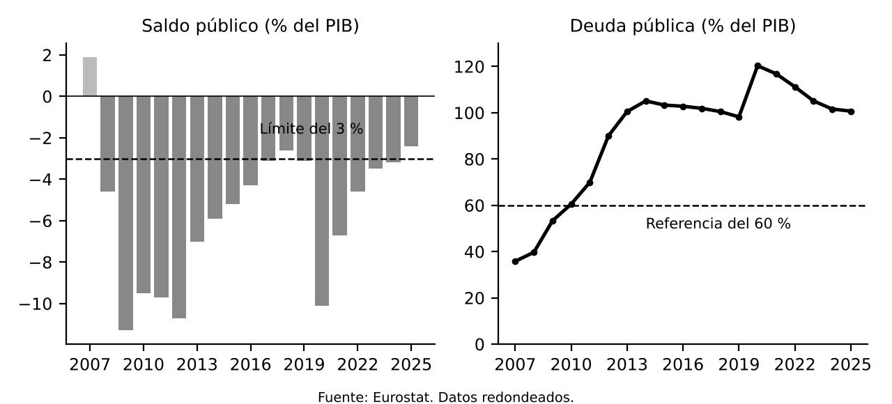

# 1. INTRODUCCIÓN

**Política fiscal.** Uso que hace el sector público de sus ingresos y gastos para influir en la actividad, el empleo, los precios y el reparto de la renta. Con la política monetaria forma las dos grandes herramientas macroeconómicas.

Desde 1999 el BCE decide la política monetaria del euro, así que la política fiscal es el principal instrumento nacional ante perturbaciones propias, limitado por reglas europeas y nacionales. En 2024 entró en vigor un nuevo marco europeo y en 2025 España redujo su déficit al **2,4 % del PIB**, el más bajo desde 2007, con una deuda próxima al 100 %.

# 2. LA POLÍTICA FISCAL: FUNCIONES E INSTRUMENTOS

## 2.1. Las funciones del sector público

Según **Musgrave (1959)**, el sector público cumple tres funciones:

- Asignación: proporciona bienes y servicios que el mercado no ofrece en cantidad suficiente y corrige fallos de mercado como las externalidades
- Distribución: corrige la desigualdad de la renta con impuestos progresivos, transferencias y gasto social
- Estabilización: suaviza las fluctuaciones para mantener empleo y precios estables. Es la función propia de la política fiscal como política macroeconómica

## 2.2. Los instrumentos y el tipo de política

El **gasto público** forma parte directa de la demanda agregada. Los **impuestos y transferencias** influyen de forma indirecta, al modificar la renta disponible y con ella el consumo y la inversión. La política es **expansiva** si aumenta el gasto o reduce impuestos para estimular la demanda en una recesión, y **restrictiva** en el caso contrario, para frenar una demanda que genera inflación.

Los **estabilizadores automáticos** actúan sin decisiones nuevas: en una recesión cae la recaudación y suben las prestaciones por desempleo, de modo que el déficit sostiene la demanda. En España son importantes. La **política discrecional** son medidas deliberadas, como un plan de inversión o una rebaja de impuestos. El **saldo estructural**, corregido de ciclo y de medidas temporales, indica la orientación de fondo, aunque su cálculo es incierto porque exige estimar la producción potencial.

## 2.3. La eficacia de la política fiscal

En el modelo keynesiano el gasto eleva la renta más de lo gastado por el **multiplicador**. Sus límites:

- **Efecto expulsión**: el mayor déficit puede subir los tipos y desplazar inversión privada
- **Equivalencia ricardiana**: si se anticipan impuestos futuros, se ahorra más y el estímulo pierde eficacia
- **Retardos**: la medida puede llegar cuando ya no es necesaria
- **Economía abierta**: parte del estímulo se filtra por las importaciones

Tras 2008 se vio que los multiplicadores son mayores en recesión y con tipos en cero (FMI, 2013), por lo que la austeridad en plena recesión costó más actividad de lo previsto.

# 3. LA POLÍTICA FISCAL EN ESPAÑA

## 3.1. Los principios constitucionales

El **art. 31** de la Constitución exige contribuir al gasto público según la capacidad económica, con un sistema tributario justo basado en igualdad y progresividad y sin alcance confiscatorio. Los tributos solo se establecen por ley. Su régimen general es la **Ley 58/2003**, General Tributaria.

## 3.2. La evolución reciente

- **Descentralización autonómica**: las comunidades gestionan buena parte del gasto en sanidad y educación y parte de los impuestos
- **Ingreso en la Comunidad Europea (1986)**: IVA, arancel exterior común y fondos europeos
- **Convergencia hacia el euro**: déficit del 7 % en 1995, consolidación posterior y entrada en el euro en 1999. Superávit entre 2005 y 2007
- **Crisis de 2008**: se hundió la recaudación ligada a la burbuja inmobiliaria. Déficit superior al 11 % en 2009 y deuda del 36 % del PIB en 2007 a más del 100 % en 2014, con un intenso ajuste desde 2010
- **Reformas tributarias**: la del IRPF de 1998 y la de 2014, que bajó el tipo general de Sociedades del 30 % al 25 %
- **Pandemia de 2020**: déficit superior al 10 % y deuda superior al 120 %. La UE creó Next Generation EU, con el Mecanismo de Recuperación y Resiliencia como componente principal
- **Recuperación**: déficit del **2,4 %** en 2025, en parte afectado por el gasto de la DANA, y deuda del **100,7 %**

La presión fiscal ha aumentado pero sigue algunos puntos por debajo de la media de la UE, que en 2024 fue del 40,4 % del PIB. El Estado funciona con presupuestos prorrogados.

## 3.3. Las reglas fiscales españolas

- **Art. 135 de la Constitución** (septiembre de 2011): consagra la estabilidad presupuestaria. Déficit estructural dentro del límite europeo, deuda dentro del valor de referencia y prioridad absoluta del pago de la deuda. Solo se superan los límites por catástrofes, recesión o emergencia, apreciadas por mayoría absoluta del Congreso
- **Ley Orgánica 2/2012**: equilibrio estructural, deuda del 60 % del PIB (Administración Central 44 %, comunidades 13 %, corporaciones locales 3 %) y regla de gasto ligada al crecimiento a medio plazo. Prevé planes de reequilibrio y medidas correctoras
- **AIReF**, creada por la Ley Orgánica 6/2013: vigila las reglas y evalúa de forma independiente previsiones y cuentas

Las reglas se suspendieron entre 2020 y 2023, como las europeas, y volvieron en 2024.

# 4. LA DISCIPLINA FISCAL EN LA UNIÓN EUROPEA

## 4.1. Por qué hace falta disciplina fiscal en una unión monetaria

La autonomía fiscal se justifica porque cada país sufre perturbaciones asimétricas y no tiene política monetaria ni tipo de cambio propios. La disciplina, porque un país con finanzas insostenibles puede subir los tipos de toda la unión, contagiar una crisis de deuda o presionar al banco central, y porque existe riesgo moral ante un posible rescate. Por eso el Tratado prohíbe la financiación monetaria de los Estados (**art. 123 TFUE**) y excluye que la Unión asuma sus compromisos (**art. 125**).

## 4.2. Los criterios de Maastricht y el Pacto de Estabilidad y Crecimiento

El **Tratado de Maastricht (1992)** fijó los criterios para entrar en el euro:

- Déficit no superior al **3 %** del PIB
- Deuda no superior al **60 %** del PIB, o aproximándose a un ritmo satisfactorio
- Inflación a no más de 1,5 puntos de los tres mejores Estados
- Tipos a largo plazo a no más de 2 puntos de esos Estados
- Dos años en el mecanismo de tipos de cambio sin tensiones graves

España cumplió en 1998. El **Pacto de Estabilidad y Crecimiento (1997)** tiene dos vertientes. La **preventiva** exige un objetivo a medio plazo próximo al equilibrio estructural y un programa de estabilidad anual. La **correctora** es el **procedimiento de déficit excesivo**, que se abre si el déficit supera el 3 % o la deuda el 60 % sin reducirse lo suficiente, y puede acabar en depósito de hasta el 0,2 % del PIB, multas de hasta el 0,5 % y suspensión de fondos. No es excesivo un déficit excepcional y temporal. Se aplicó con flexibilidad: Alemania y Francia incumplieron en 2003 sin sanción y el Pacto se reformó en 2005.

## 4.3. Las reformas tras la crisis de 2008

- **Six-pack (2011)**: seis normas que reforzaron ambas vertientes, automatizaron sanciones, exigieron marcos presupuestarios nacionales (Directiva 2011/85/UE) y crearon el procedimiento de desequilibrios macroeconómicos
- **Tratado de Estabilidad, Coordinación y Gobernanza (2012)**: obliga a incorporar el equilibrio estructural al derecho nacional, preferiblemente constitucional
- **Two-pack (2013)**: supervisión de los presupuestos del euro, con planes enviados a la Comisión cada otoño
- **Semestre Europeo**: ciclo anual de examen y recomendaciones específicas a cada país

En marzo de 2020 se activó por primera vez la cláusula general de salvaguardia, mantenida hasta finales de 2023.

## 4.4. El nuevo marco de gobernanza económica de 2024

Las reglas previas eran complejas, usaban variables difíciles de medir y eran a menudo procíclicas. En abril de 2024 se aprobaron el **Reglamento (UE) 2024/1263** (vertiente preventiva), el **Reglamento (UE) 2024/1264** (déficit excesivo) y la **Directiva (UE) 2024/1265** (marcos nacionales).

- Se mantienen el 3 % de déficit y el 60 % de deuda
- **Plan fiscal y estructural** a medio plazo de cuatro años, ampliable a siete con reformas e inversiones
- Indicador único: **gasto primario neto**, sin intereses ni medidas cíclicas de desempleo y descontando medidas discrecionales de ingresos. Lo controla el gobierno y deja actuar a los estabilizadores
- La senda de gasto parte de un análisis de sostenibilidad de la deuda. Salvaguardias: reducción mínima de la deuda de un punto anual si supera el 90 % del PIB y de medio punto entre el 60 % y el 90 %
- El déficit excesivo puede abrirse también por desviarse de la senda con deuda superior al 60 %. Multas menores pero más aplicables, hasta el 0,05 % del PIB cada seis meses
- Cláusula general de salvaguardia para graves recesiones y cláusulas nacionales para circunstancias excepcionales. En 2025 se permitió activarlas para defensa

El debate sigue abierto: tras Next Generation EU, primera emisión de deuda común a gran escala, algunos defienden una capacidad fiscal permanente y otros se oponen por el riesgo de transferencias permanentes. España presentó el **Plan Fiscal y Estructural de Medio Plazo 2025-2028**, validado en noviembre de 2024, con gasto primario neto creciendo un 3,4 % anual y deuda por debajo del 100 % en 2027.

# 5. LA FINANCIACIÓN DEL DÉFICIT PÚBLICO

## 5.1. La restricción presupuestaria del sector público

El gasto más los intereses de la deuda debe financiarse con impuestos, dinero o deuda. Por eso la forma de financiar el déficit tiene consecuencias monetarias.

## 5.2. Las formas de financiación

- **Impuestos**: no generan deuda pero pueden distorsionar las decisiones de trabajar, ahorrar e invertir. Más gasto con impuestos sigue siendo expansivo (teorema de Haavelmo o del presupuesto equilibrado)
- **Emisión de dinero**: si es sistemática genera inflación, un impuesto inflacionario (señoreaje). La UE prohíbe la financiación monetaria directa. Las compras del BCE en el mercado secundario no se consideran tal, aunque han suscitado debate jurídico
- **Deuda pública**: la vía principal. La emite el Tesoro en letras (corto plazo) y bonos y obligaciones (medio y largo). Comunidades y ayuntamientos se financian en los mercados o con mecanismos como el Fondo de Liquidez Autonómico

## 5.3. Las consecuencias de financiar el déficit con deuda

- **Efecto expulsión**: puede subir los tipos y reducir la inversión privada. Es menor con recursos ociosos
- **Equivalencia ricardiana** (**Barro, 1974**): si se anticipan los impuestos futuros, deuda e impuestos equivalen. Se cumple solo en parte
- **Generaciones futuras**: soportan costes si la deuda reduce el capital heredado o se paga a acreedores extranjeros. Si financia inversión productiva, dejan también activos
- **Riesgo de financiación**: una deuda elevada hace vulnerable a subidas de tipos y a cambios de confianza, como en 2010 a 2012. La **prima de riesgo**, diferencial con el bono alemán, lo mide

# 6. LA SOSTENIBILIDAD DEL DÉFICIT PÚBLICO

## 6.1. El concepto de sostenibilidad

Una política fiscal es **sostenible** si puede mantenerse sin que la deuda crezca sin límite respecto a la economía, es decir, sin ajuste brusco, impago ni financiación monetaria. Formalmente, el valor actual de los superávits primarios futuros iguala la deuda actual.

Importa la deuda en proporción al PIB, que depende del saldo primario, del tipo de interés medio (la hace crecer) y del crecimiento nominal del PIB (reduce su peso). Según **Domar (1944)**, con crecimiento un déficit constante sobre el PIB estabiliza la deuda en un nivel finito. Si el tipo es menor que el crecimiento nominal, basta un pequeño déficit primario. Si es mayor, hace falta superávit primario. Este diferencial **r menos g** explica por qué la deuda fue más manejable con tipos bajos y por qué la subida desde 2022 presiona a los más endeudados. **Blanchard (2019)** sostuvo que con tipos tan bajos el coste fiscal era menor de lo pensado, aunque podía cambiar.

**Sargent y Wallace (1981)**: si la política fiscal no es sostenible, el banco central puede verse obligado a financiar al Estado creando dinero, con inflación. La credibilidad monetaria depende de la disciplina fiscal.

## 6.2. La sostenibilidad a corto, medio y largo plazo

- **Corto plazo**: límites anuales de déficit como el 3 %. Un límite rígido puede forzar políticas procíclicas, crítica central al Pacto y motivo del marco basado en la senda de gasto
- **Medio plazo**: la Comisión, el FMI y la AIReF proyectan la deuda en distintos escenarios de crecimiento, tipos y saldo primario
- **Largo plazo**: el reto es el envejecimiento, que eleva el gasto en pensiones, sanidad y dependencia. Con cotización del 25 % y pensión del 50 % del salario hacen falta dos cotizantes por pensionista. Con 1,5 las cotizaciones cubren el 75 % del gasto. Estos compromisos son una **deuda implícita** ausente de la deuda oficial

## 6.3. Las medidas para garantizar la sostenibilidad

- **Pensiones**: retraso de la edad efectiva de jubilación, más cotizaciones (mecanismo de equidad intergeneracional) y revisión de la fórmula de cálculo, evaluada por la AIReF
- **Crecimiento potencial**: productividad, menos paro estructural, más actividad e inmigración ordenada
- **Sistema tributario eficiente** que combata el fraude
- **Calidad del gasto**: evaluación de políticas y orientación hacia educación, investigación e inversión pública
- **Instituciones fiscales sólidas**: reglas creíbles y organismos independientes como la AIReF

# 7. CONCLUSIÓN

La política fiscal es el principal instrumento de estabilización de los países del euro, condicionado por la sostenibilidad. La disciplina previa permitió a España entrar en el euro, la crisis de 2008 elevó la deuda por encima del 100 % del PIB y la pandemia exigió una respuesta sin precedentes, posible por la suspensión de reglas y el apoyo europeo.

El marco de 2024 busca reglas más sencillas, centradas en el gasto controlable y compatibles con inversión y reformas, y su éxito depende de su credibilidad. España, con déficit por debajo del 3 % y deuda próxima al 100 %, afronta el envejecimiento y necesita consolidación gradual y reformas que eleven la productividad.
