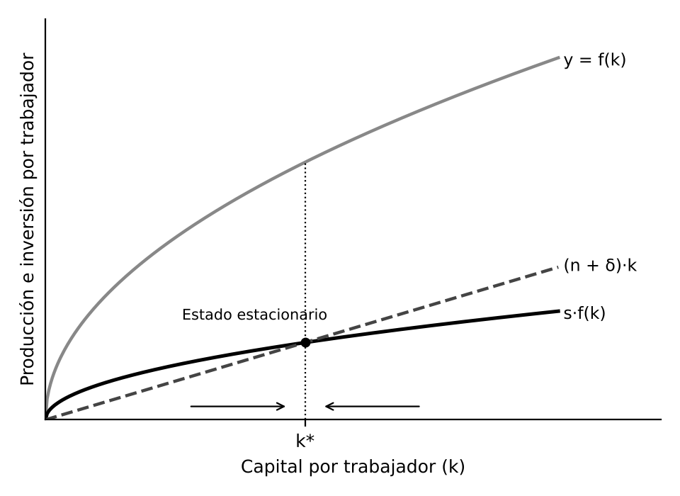

# 1. INTRODUCCIÓN

El **ciclo económico** son las fluctuaciones de la actividad a corto plazo. El **crecimiento económico** es el aumento sostenido de la producción y de la renta por habitante a largo plazo, y es mucho más importante para el bienestar: con un crecimiento del 2 % anual la renta se duplica en unos 35 años, con uno del 1 % tarda 70. El crecimiento sostenido es reciente y arrancó con la Revolución Industrial, lo que dio lugar a la Gran Divergencia entre economías ricas y pobres.

**Crecimiento y desarrollo.** El crecimiento es el aumento cuantitativo de la producción. El desarrollo es un concepto más amplio que incluye salud, educación, reducción de la pobreza y libertad de las personas.

# 2. LA TEORÍA DEL CRECIMIENTO: EVOLUCIÓN Y HECHOS ESTILIZADOS

## 2.1. La evolución de la teoría

- **Clásicos.** Smith explicó el crecimiento por la división del trabajo y la acumulación de capital. Ricardo y Malthus advirtieron que los rendimientos decrecientes de la tierra conducirían a un estado estacionario
- **Schumpeter (1911).** Destrucción creativa, por la que nuevas tecnologías y empresas sustituyen a las antiguas. Ramsey (1928) estudió cuánto debe ahorrar una sociedad y Young (1928) los rendimientos crecientes ligados al mercado
- **Harrod y Domar.** Tras la Segunda Guerra Mundial extendieron el análisis keynesiano al largo plazo
- **Solow y Swan (1956).** Modelo neoclásico, que sigue siendo el marco de referencia
- **Crecimiento endógeno.** Romer (1986) y Lucas (1988) explican el progreso técnico dentro del modelo. Romer recibió el Nobel en 2018, y Mokyr, Aghion y Howitt en 2025

## 2.2. La medición del crecimiento

Se mide por la tasa de variación del **PIB real por habitante**, sin inflación ni aumento de población. Para comparar países se usa la paridad de poder adquisitivo. La **regla del 70** dice que 70 dividido entre la tasa anual da los años que tarda en duplicarse la renta. Según Maddison, desde 1820 la renta por habitante mundial se ha multiplicado más de diez veces, de forma muy desigual.

## 2.3. Los hechos estilizados del crecimiento

Kaldor (1961) resumió las regularidades que toda teoría debe explicar en los países desarrollados:

- La producción por trabajador crece a una tasa aproximadamente constante y el capital por trabajador crece de forma continua
- El rendimiento del capital y la relación capital-producción son más o menos estables
- Las participaciones del trabajo y del capital en la renta son bastante estables

Además, las diferencias de renta entre países son enormes, algunos se han acercado a los más ricos (Japón, Corea del Sur, España tras 1960) y otros se han quedado atrás.

# 3. EL MODELO DE HARROD-DOMAR

Harrod (1939) y Domar (1946) extendieron al largo plazo el análisis de Keynes. Parten del **doble papel de la inversión**: aumenta la demanda agregada por el multiplicador y aumenta la capacidad productiva. Para un crecimiento equilibrado ambas deben crecer al mismo ritmo. Si la demanda crece menos aparecen capacidad ociosa y paro, y si crece más, tensiones inflacionistas.

El modelo supone una relación fija entre capital y producción, sin sustitución entre factores, y la tasa de crecimiento depende del ahorro dividido por esa relación. Harrod distingue tres tasas:

- **Efectiva**, la que registra la economía
- **Garantizada**, la que satisface a los empresarios, determinada por el ahorro y la relación capital-producto
- **Natural**, la máxima que permiten la población activa y el progreso técnico, con pleno empleo

Solo por casualidad coinciden y el equilibrio es inestable: si la economía se aparta de la tasa garantizada se aleja cada vez más, es el **filo de la navaja**. De ahí que el capitalismo sea inestable y requiera la intervención del Estado, que debe contrarrestar perturbaciones, suplir la inversión privada y influir sobre el ahorro.

Influyó en la planificación del desarrollo de los años cincuenta y sesenta, pero sus proporciones fijas son poco realistas y no explica la convergencia ni los determinantes del crecimiento a largo plazo.

# 4. EL MODELO NEOCLÁSICO DE CRECIMIENTO

## 4.1. El modelo de Solow

Solow y Swan (1956) resolvieron la inestabilidad de Harrod-Domar con dos ideas: los factores se pueden sustituir y el capital tiene rendimientos decrecientes. Los supuestos son una función de producción neoclásica con rendimientos constantes a escala, una tasa de ahorro constante que se invierte entera, población y depreciación con tasas constantes y un progreso técnico exógeno, es decir, no explicado por el modelo.

El capital por trabajador aumenta si la inversión por trabajador, igual al ahorro, supera la necesaria para reponer el capital depreciado y equipar a los nuevos trabajadores. Cuando se igualan, la economía alcanza su **estado estacionario** (k*).

Un mayor ahorro desplaza la curva de inversión hacia arriba y lleva a un estado estacionario con más capital y renta por habitante. Un mayor crecimiento de la población o de la depreciación lo reduce. El estado estacionario es estable: con poco capital la inversión supera la reposición y el capital crece, con mucho ocurre lo contrario. Desaparece así el filo de la navaja y la economía tiende sola a un crecimiento equilibrado.

## 4.2. Las conclusiones del modelo de Solow

- **Progreso técnico.** Sin él no hay crecimiento sostenido de la renta por habitante, porque la acumulación de capital se agota por los rendimientos decrecientes. Un mayor ahorro eleva el nivel de renta, pero no su tasa de crecimiento a largo plazo
- **Convergencia.** Los países con menos capital por trabajador tienen mayor rendimiento del capital y crecen más deprisa. El modelo predice convergencia condicional entre países con igual ahorro, población y tecnología, no convergencia absoluta
- **Evidencia empírica.** Barro y Sala-i-Martín confirman la convergencia condicional, a un ritmo de en torno al 2 % anual hacia el estado estacionario. Se observa entre regiones de un país, entre Estados de EEUU o entre regiones europeas, pero no entre todos los países, donde algunos forman clubes de convergencia
- **Contabilidad del crecimiento.** Solow (1957) descompuso el crecimiento de EEUU en capital, trabajo y un residuo, la productividad total de los factores. La mayor parte del crecimiento por hora trabajada se debía a ese residuo, atribuido al progreso técnico y llamado la medida de nuestra ignorancia

## 4.3. La regla de oro y otras extensiones

Phelps (1961) mostró que no conviene ahorrar todo lo posible, porque el bienestar depende del consumo. La **regla de oro** define el capital por trabajador que maximiza el consumo en el estado estacionario. Mankiw, Romer y Weil (1992) añadieron el capital humano y así el modelo explica bastante bien las diferencias de renta entre países.

## 4.4. El modelo de Ramsey-Cass-Koopmans

Ramsey (1928) planteó cuánto debe ahorrar una sociedad para maximizar el bienestar en el tiempo, y Cass y Koopmans (1965) lo incorporaron al modelo de crecimiento. La tasa de ahorro deja de ser fija: las familias maximizan su utilidad a lo largo de la vida y las empresas sus beneficios. Se mantienen el estado estacionario estable y la convergencia condicional, con una base microeconómica más sólida, y es la base de buena parte de la macroeconomía moderna.

## 4.5. Valoración del modelo neoclásico

Frente a Harrod-Domar, la economía de mercado no es inestable por naturaleza y tiende al crecimiento equilibrado, por lo que la intervención del Estado no es imprescindible. Apoya reformas que mejoren los mercados y políticas que estimulen ahorro e inversión para ayudar a converger a los países atrasados. Su gran limitación es que el progreso técnico es exógeno, y muchos países pobres no convergen. Esto dio origen al crecimiento endógeno.

# 5. LOS MODELOS DE CRECIMIENTO ENDÓGENO

## 5.1. La idea central

Explican el crecimiento a largo plazo dentro del propio modelo, evitando que los rendimientos decrecientes lo agoten: con capital humano y conocimiento, con externalidades o con el progreso técnico como resultado de la investigación. Las políticas pueden afectar a la tasa de crecimiento a largo plazo y no solo al nivel de renta. Como el mercado no siempre produce la cantidad óptima de conocimiento o educación, se abre espacio para la intervención del Estado.

## 5.2. Las características del conocimiento

- **No rival.** Muchas personas lo usan a la vez sin agotarlo y transmitirlo cuesta casi nada, por lo que genera rendimientos crecientes
- **Parcialmente excluible.** Quien lo crea solo se apropia de parte de los beneficios, según los derechos de propiedad como las patentes

Por ello el mercado invierte en conocimiento menos de lo socialmente deseable. Lo crean la investigación básica, financiada por el Estado o fundaciones, la investigación privada, que exige patentes, las personas con talento y el aprendizaje de la propia producción.

## 5.3. Los principales modelos

- **Aprendizaje y externalidades.** Arrow (1962) mostró que la productividad crece con la experiencia. Romer (1986) supuso que la inversión de cada empresa genera conocimiento que beneficia a las demás, de modo que el conjunto de la economía no tiene rendimientos decrecientes
- **Modelo AK.** Rebelo (1991) supone que el capital en sentido amplio no tiene rendimientos decrecientes, y un mayor ahorro eleva el crecimiento de forma permanente
- **Capital humano.** Lucas (1988) lo explica por la acumulación de capital humano, que es rival y excluible. Los países pobres no tienen dificultades para acceder a la tecnología sino para usarla, por falta de trabajadores cualificados
- **I+D.** Romer (1990) presenta empresas que invierten en I+D atraídas por el monopolio temporal de las patentes, y el conocimiento acumulado facilita nuevas innovaciones. Grossman y Helpman (1991) desarrollaron ideas similares
- **Modelo schumpeteriano.** Aghion y Howitt (1992) recuperan la destrucción creativa: cada innovación deja obsoletos los productos anteriores y se apropia de los beneficios de las empresas desplazadas. El crecimiento puede ser menor o mayor del deseable. Destaca la competencia y las políticas que faciliten la entrada de nuevas empresas

## 5.4. Valoración

Explican el progreso técnico y refuerzan el papel de educación, investigación, patentes y competencia, lo que justifica la financiación pública de la investigación básica, las ayudas a la I+D y la inversión en educación. Se les critica que algunos modelos predicen efectos de escala no observados (Jones, 1995) y que modelizan de forma muy simple la creación de conocimiento, cuando los avances se producen a saltos.
# 6. EL DESARROLLO ECONÓMICO

## 6.1. Crecimiento y desarrollo

El crecimiento es necesario para el desarrollo pero no suficiente. El **Índice de Desarrollo Humano** (PNUD, desde 1990) combina renta, esperanza de vida y educación y se inspira en Amartya Sen (Nobel 1998), para quien desarrollo es ampliar las capacidades y libertades. La pobreza se mide por el porcentaje de población bajo un umbral de renta, y el Banco Mundial fija una línea de pobreza extrema. Ha caído mucho desde 1990, sobre todo por China e India, aunque el progreso se ha frenado y la pobreza se concentra en el África subsahariana.

## 6.2. Las teorías del desarrollo

- **Etapas.** Rostow (1960): todos los países pasan por cinco etapas, desde la sociedad tradicional hasta el consumo de masas, y el despegue exige una fuerte subida de la inversión
- **Cambio estructural.** Lewis (1954, Nobel 1979): traslado de trabajadores de un sector agrícola con exceso de mano de obra a otro industrial.
- **Gran impulso y círculo vicioso.** Rosenstein-Rodan (1943) defendió una inversión coordinada en muchos sectores a la vez. Nurkse: renta baja, sin ahorro, sin inversión y renta baja. Hirschman propuso un crecimiento desequilibrado, con inversión en los sectores con más eslabonamientos
- **Estructuralismo latinoamericano.** Prebisch y Singer (1950), desde la CEPAL, sostuvieron que la relación real de intercambio de los exportadores de materias primas empeora frente a las manufacturas y propusieron la industrialización por sustitución de importaciones. La teoría de la dependencia lo radicalizó

## 6.3. De la sustitución de importaciones al consenso actual

- **Resultados dispares.** La sustitución de importaciones acumuló ineficiencias y crisis de deuda en los ochenta, mientras Corea del Sur y Taiwán crecieron con estrategias exportadoras, Estado activo, alto ahorro y educación
- **Consenso de Washington.** Williamson (1989): disciplina fiscal, liberalización, privatizaciones y desregulación, con resultados desiguales
- **Instituciones.** Acemoglu, Johnson y Robinson (Nobel 2024): prosperan los países con instituciones inclusivas y se estancan los de instituciones extractivas. Banerjee, Duflo y Kremer (Nobel 2019) evalúan con experimentos aleatorizados qué políticas funcionan
- **Agenda 2030.** Aprobada en 2015, con diecisiete Objetivos de Desarrollo Sostenible
- **Financiación.** Objetivo del 0,7 % de la renta nacional en ayuda oficial, que pocos cumplen. En Sevilla (2025) se aprobó el Compromiso de Sevilla

# 7. CONCLUSIÓN

Harrod y Domar destacaron la inversión y la inestabilidad, Solow mostró que la acumulación de capital no basta y que el motor es el progreso técnico, y el crecimiento endógeno lo explicó por innovación, conocimiento y capital humano. La economía del desarrollo ha pasado de recetas generales a reconocer las instituciones y evaluar políticas.

En España, el crecimiento desde los años sesenta se basó en acumulación de capital, apertura exterior e integración europea, pero la productividad ha crecido poco en las últimas décadas. I+D, educación, tamaño y competitividad de las empresas e instituciones son claves para mantener la convergencia.
