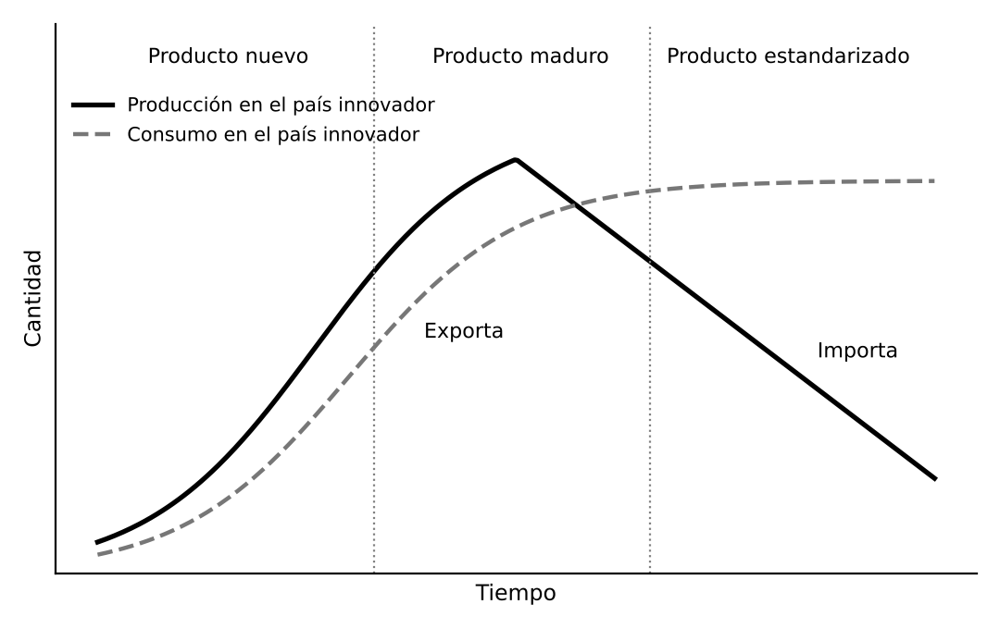
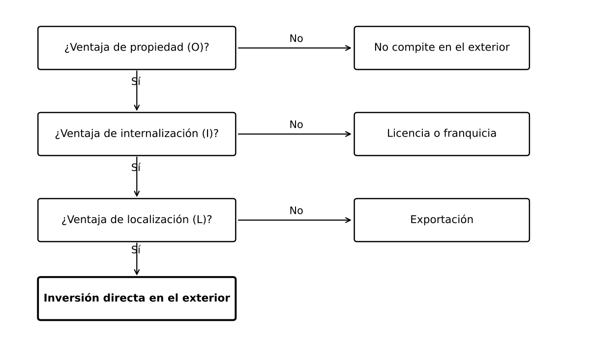

# 1. INTRODUCCIÓN

**Globalización.** Creciente integración de las economías nacionales en un mercado mundial, a través de los flujos de mercancías, servicios, capitales, tecnología, información y personas. La impulsan los gobiernos, que han liberalizado comercio y capital, y sobre todo las multinacionales. Ha elevado el comercio y la renta mundiales, pero genera perdedores y exposición a las crisis. Desde 2008, y tras la pandemia, la rivalidad entre EEUU y China y los aranceles de 2025, entra en una fase de fragmentación en la que la seguridad de los suministros pesa tanto como la eficiencia.

# 2. LA GLOBALIZACIÓN DE LA ECONOMÍA

## 2.1. Los factores de la globalización

- **Impulso político**: GATT y, desde 1995, OMC, acuerdos regionales como la Unión Europea, liberalización de capitales e incorporación al mercado de China (desde 1978) y de los antiguos países socialistas (tras 1989)
- **Menores costes de transporte y comunicación**: contenedor, transporte multimodal e internet
- **Cambio tecnológico y concentración empresarial**: en farmacia, automóvil o electrónica el coste de desarrollo solo se recupera a escala mundial, lo que impulsa fusiones y cooperación
- **Globalización financiera**: un mercado abierto las veinticuatro horas, con tipos y cotizaciones muy relacionados y crisis que se transmiten con rapidez
- **Estrategias empresariales**: la producción se divide en fases localizadas según ventajas, lo que crea las **cadenas globales de valor**, donde gran parte del comercio es de bienes intermedios

## 2.2. La medición de la globalización

Se mide con la **apertura comercial** (exportaciones más importaciones sobre el PIB), el peso de la IED recibida y emitida, los flujos financieros y la participación en las cadenas globales de valor. La OCDE y la OMC elaboran estadísticas de comercio en valor añadido, que muestran dónde se genera el valor.

## 2.3. Los efectos de la globalización

Efectos positivos: especialización y economías de escala, más variedad a menores precios, difusión de la tecnología y crecimiento de los emergentes. Costes: pérdidas de empleo y salarios en sectores expuestos a las importaciones, concentradas en ciertas regiones, más volatilidad financiera y presión a la baja sobre los impuestos de sociedades.

**Trilema de Rodrik.** No se pueden tener a la vez integración económica profunda, plena soberanía nacional y una democracia que responda a los ciudadanos. Hay que renunciar en parte a alguno de los tres.

## 2.4. De la hiperglobalización a la fragmentación

Entre 1990 y 2008 el comercio creció mucho más que la producción (**hiperglobalización**). Tras 2008 el ritmo se moderó (**slowbalization**). Lo han acentuado la pandemia, la rivalidad entre EEUU y China (aranceles, controles tecnológicos), la invasión rusa de Ucrania y las sanciones, y la subida de aranceles estadounidenses de 2025, al margen de la OMC.

Se responde con **reshoring** (relocalizar en el propio país), **nearshoring** (en países cercanos), **friend-shoring** (en aliados) y diversificación de proveedores. La Unión Europea defiende una **autonomía estratégica abierta**: abierta al comercio pero con más capacidad en semiconductores, materias primas críticas y energía. Más que desglobalización hay una reorganización en bloques.

# 3. LA EMPRESA Y LAS DECISIONES DE INVERSIÓN

## 3.1. Las decisiones de inversión

**Invertir** es renunciar a recursos hoy esperando rendimientos futuros. Se clasifican por activo (fijo o circulante), naturaleza (productivas o financieras) y finalidad (renovación, expansión, modernización o diversificación). Es aceptable si los flujos de caja superan la inversión inicial y la rentabilidad supera el coste de los recursos financieros. Todo proyecto se define por sus flujos de caja, su calendario y su riesgo.

Un euro de hoy vale más que uno futuro, así que los cobros y pagos se actualizan con una **tasa de descuento**.

## 3.2. Los criterios de selección de inversiones

- **Plazo de recuperación (pay-back)**: tiempo en recuperar la inversión. Sencillo y útil con riesgo alto o liquidez escasa, pero en su versión simple ignora el valor del dinero en el tiempo y los flujos posteriores
- **Valor actual neto (VAN)**: cobros menos pagos actualizados. Con VAN positivo conviene el proyecto y entre varios se elige el mayor. Es el criterio más sólido, pues mide cuánto aumenta el valor de la empresa
- **Tasa interna de rentabilidad (TIR)**: tasa de descuento que hace cero el VAN. Conviene si supera el coste de los recursos financieros. Puede engañar con proyectos de distinto tamaño o duración o con flujos que cambian de signo, pues puede haber varias TIR
- **Relación beneficio-coste**: valor actual de beneficios entre el de costes. Aceptable si es igual o mayor que uno, lo que equivale a VAN positivo

## 3.3. La tasa de descuento y el riesgo

La tasa de descuento es la rentabilidad mínima exigida y suele ser el **coste medio ponderado del capital** (deuda y fondos propios). A más riesgo, más rentabilidad exigida. El riesgo es la variabilidad de los rendimientos y tiene dos componentes:

- **Específico o diversificable**: propio de la empresa o sector, se elimina con una cartera variada
- **Sistemático o no diversificable**: afecta a todo el mercado, como una recesión

Según el **CAPM** (Sharpe y otros), el mercado solo remunera el riesgo sistemático: rentabilidad exigida igual al tipo libre de riesgo más una prima proporcional a ese riesgo. En el exterior se añaden el **riesgo de cambio** y el **riesgo país** (inestabilidad, cambios regulatorios, restricciones a repatriar beneficios, expropiación), que elevan la tasa exigida y se cubren en parte con instrumentos financieros o seguros.

# 4. LA INTERNACIONALIZACIÓN DE LA EMPRESA

## 4.1. Las formas de internacionalización

Hay tres opciones básicas:

- **Exportación**: indirecta, por intermediario, con poco riesgo y poco control, o directa, con agentes, distribuidores o delegaciones propias, con más control y más recursos
- **Licencia y franquicia**: se cede tecnología, marca o modelo de negocio a cambio de un pago. Poca inversión y riesgo, pero menos ingresos y posible futuro competidor
- **Inversión directa**: sucursal (parte jurídica de la matriz), filial (sociedad local controlada) o empresa conjunta (**joint venture**) con un socio local, que facilita el acceso al mercado, reparte inversión y riesgo y es mejor aceptada por los gobiernos locales, pero exige compatibilizar objetivos y supone pérdida de control

La cooperación interempresarial (consorcios, alianzas) permite a las pymes compartir costes y riesgos sin perder independencia.

## 4.2. El proceso de internacionalización

Según el **modelo de Uppsala** (Johanson y Vahlne, 1977) el proceso es gradual: exportaciones ocasionales, regulares, filiales comerciales y, por último, producción en el exterior, con más compromiso según crece la experiencia y empezando por mercados cercanos en lo geográfico y cultural. Tiene excepciones: las grandes empresas pueden saltarse etapas y desde los noventa hay empresas nacidas globales (**born global**), sobre todo tecnológicas, gracias a internet.

# 5. LOS DETERMINANTES DE LA INVERSIÓN EXTERIOR

## 5.1. Concepto de inversión extranjera directa

**IED.** Inversión con la que un inversor adquiere un interés duradero y una influencia significativa en la gestión de una empresa de otro país. Por convención internacional exige al menos el **10 %** del capital con derecho de voto, lo que la distingue de la inversión en cartera, que solo busca rentabilidad financiera. Puede ser de nueva planta (**greenfield**), adquisición o fusión, o reinversión de beneficios.

## 5.2. Las teorías de la inversión exterior

**Ventajas de la empresa (Hymer, 1960).** La empresa extranjera conoce peor el mercado. Si invierte, es porque tiene una ventaja específica, como tecnología, marca o gestión, que lo compensa.

**Ciclo de vida del producto (Vernon, 1966).** El producto nuevo se produce en el país innovador y se exporta. Al madurar, la demanda crece en otros países desarrollados y se produce allí. Al estandarizarse, lo decisivo son los costes y la producción pasa a países de salarios bajos, que exportan incluso al país de origen.

**Comparación de costes (Hirsch, 1976).** Se invierte si producir fuera, con los costes de controlar una empresa lejana, es más barato que producir en casa y exportar, y compensa más que una licencia.

**Internalización (Buckley y Casson, 1976).** Siguiendo a Coase, la multinacional surge por los fallos del mercado del conocimiento: una licencia es arriesgada porque es difícil fijar su precio y proteger su uso, y se prefiere explotar la tecnología con filiales.

**Paradigma ecléctico de Dunning (1977).** Paradigma **OLI**: se invierte en el exterior si se cumplen a la vez tres condiciones.

- **Propiedad (ownership)**: una ventaja que permite competir
- **Internalización**: conviene explotarla uno mismo y no cederla
- **Localización**: conviene producir en el país extranjero y no exportar, por costes menores, mercado amplio o acceso a recursos

**Reacción oligopolística (Knickerbocker, 1973).** En oligopolios las empresas siguen a sus rivales a un país para no dejarles ventaja.

## 5.3. Los motivos de la inversión exterior

Dunning distingue cuatro tipos de IED:

- **Búsqueda de mercados**: producir cerca de los clientes, evitar aranceles y transporte. IED **horizontal**, que replica la producción
- **Búsqueda de recursos**: materias primas, energía o mano de obra barata
- **Búsqueda de eficiencia**: localizar cada fase donde sea más barata. IED **vertical**, base de las cadenas globales de valor
- **Búsqueda de activos estratégicos**: tecnologías, marcas o capacidades, a menudo comprando empresas

## 5.4. Los determinantes en el país receptor

- **Económicos**: tamaño y crecimiento del mercado, costes laborales y productividad, cualificación, infraestructuras, aglomeraciones de empresas y acceso a otros mercados por acuerdos comerciales
- **Institucionales**: estabilidad política y macroeconómica, seguridad jurídica, derechos de propiedad, calidad institucional y ausencia de corrupción
- **De política económica**: fiscalidad, incentivos, regulación de la entrada de capital extranjero y facilidad para crear empresas

Los clústeres atraen inversión porque reducen costes de transacción y facilitan la difusión del conocimiento, aunque su exceso encarece salarios, suelo y crédito.

## 5.5. Los efectos de la IED en el país receptor

Aporta financiación estable, menos volátil que la inversión en cartera, transferencia de tecnología y gestión, más productividad, empleo y salarios, y mayor internacionalización. Riesgos: expulsión de empresas locales, dependencia de decisiones extranjeras, salida de beneficios, elusión fiscal con precios de transferencia y, en sectores estratégicos, seguridad nacional.

Para gestionarlos existen los **acuerdos internacionales de inversión**, que protegen frente a la expropiación y la discriminación y prevén solución de diferencias, las **Líneas Directrices de la OCDE** para Empresas Multinacionales y las normas europeas de diligencia debida en sostenibilidad.

## 5.6. La evolución reciente de la IED mundial

Creció con fuerza hasta principios de los dos mil y desde 2008 se ha estancado. Según la UNCTAD (2026), la IED recibida en 2025 fue de unos **1,6 billones de dólares**, un 6 % más que en 2024, con proyectos de nueva planta hacia semiconductores, energía limpia y centros de datos.

# 6. LA DESLOCALIZACIÓN EMPRESARIAL

## 6.1. Concepto y formas

**Deslocalización.** Traslado de actividades de una empresa de su país de origen a otro, no solo de fabricación sino también de servicios administrativos, atención al cliente, informática o investigación. Puede ser **internalizada o cautiva** (a una filial propia) o **externalizada** (subcontratada a una empresa extranjera independiente). La **externalización (outsourcing)** es encargar una actividad a otra empresa, en el mismo país o en otro, y la deslocalización (**offshoring**) es trasladarla a otro país.

## 6.2. Causas

Sobre todo menores costes laborales, además de proximidad a mercados en crecimiento, trabajadores cualificados, fiscalidad, regulación menos exigente e incentivos. El destino necesita infraestructuras, cualificación y estabilidad mínimas, por lo que fue sobre todo a Asia, Europa Central y del Este y algunos países latinoamericanos.

## 6.3. Efectos

En el país de origen, mejora la competitividad y permite centrarse en diseño, investigación o comercialización, pero destruye empleo en ciertos sectores y regiones y exige recualificar. En el destino aporta inversión, empleo, exportaciones, tecnología y formación, con riesgo de dependencia.

Los frenos son la distancia, el control de calidad, las diferencias legales y culturales, la propiedad intelectual, el transporte y las interrupciones del suministro. Junto con la automatización y la geopolítica, explican la tendencia actual a relocalizar cerca de los mercados.

## 6.4. La relocalización y la nueva geografía de la producción

Algunas empresas devuelven producción a su país o a países cercanos por los salarios al alza en China, la automatización, la pandemia, los costes logísticos y la geopolítica. Los gobiernos lo refuerzan con subvenciones en sectores estratégicos, como la ley estadounidense de semiconductores, la Ley Europea de Chips y la Ley de Materias Primas Fundamentales. España, con costes inferiores a la media europea, infraestructuras y energía renovable abundante, puede atraer inversión industrial.

# 7. LA INVERSIÓN EXTRANJERA EN ESPAÑA

España es la decimotercera economía por stock de inversión extranjera recibida, con más de un billón de dólares (UNCTAD). El Registro de Inversiones Exteriores, que recoge la inversión bruta, anotó en 2025 unos **34.000 M€**, de ellos 30.800 M€ productivos. La balanza de pagos que usa la UNCTAD netea desinversiones y da cifras menores.

- **Ley 19/2003**: inversión libre con carácter general, pero el **art. 7 bis** (desde 2020) exige autorización previa en sectores estratégicos como infraestructuras críticas, energía, tecnologías críticas, datos o medios, desarrollado por el **Real Decreto 571/2023**
- **Reglamento (UE) 2026/1386**: sustituye al Reglamento (UE) 2019/452 y obligará desde enero de 2028 a todos los Estados miembros a tener un mecanismo de control con ámbito mínimo común
- **Impuesto mínimo global del 15 %** a grandes multinacionales (OCDE), con la **Directiva (UE) 2022/2523** y la **Ley 7/2024**, para limitar la competencia fiscal
- **Apoyo**: ICEX, Invest in Spain, COFIDES y FIEM

# 8. CONCLUSIÓN

Las multinacionales protagonizan la globalización y la teoría ha explicado sus decisiones de inversión de forma cada vez más completa, de Hymer y Vernon a Dunning. La IED aporta capital, tecnología y empleo y se atrae sobre todo con mercado, cualificación, infraestructuras e instituciones. La deslocalización mejora la eficiencia pero exige políticas de formación y apoyo. Hoy dominan la seguridad económica, la reorganización de las cadenas de valor y el control público de inversiones estratégicas, y el reto de España es atraer inversión productiva en sectores de futuro y aprovechar la relocalización hacia Europa.
