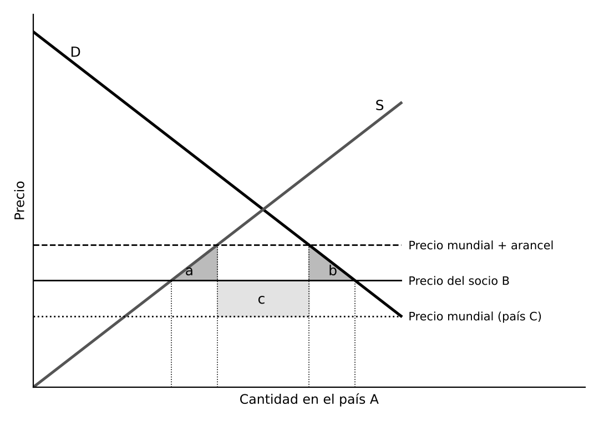

# 1. INTRODUCCIÓN

La liberalización del comercio avanza desde la Segunda Guerra Mundial por dos vías: la multilateral (GATT y, desde 1995, la **OMC**), que reduce las barreras para todos por igual, y la regional o preferencial, con ventajas que un grupo de países no extiende al resto, el **regionalismo**. Según la OMC hay más de 350 acuerdos regionales en vigor. Con la Ronda de Doha estancada son la principal forma de liberalización, y plantean si conducen a un comercio más libre o lo fragmentan en bloques.

# 2. LA INTEGRACIÓN ECONÓMICA: CONCEPTO Y FASES

## 2.1. Concepto de integración

Para **Balassa (1961)** la cooperación reduce la discriminación entre países, mientras que la integración suprime algunas formas de ella, como las barreras al comercio entre miembros. Desde las relaciones internacionales, es el proceso por el que los Estados renuncian a decidir solos sobre ciertas políticas y las toman conjuntamente o las delegan en órganos comunes. La teoría funcionalista lo explica por el efecto de desbordamiento: la cooperación en un sector crea intereses comunes que llevan a cooperar en otros, como desde la CECA de 1951. Los procesos son voluntarios, graduales y suelen empezar por lo económico.

## 2.2. Las fases de la integración económica

Balassa las clasificó de menor a mayor profundidad:

- **Acuerdo preferencial.** Rebajas arancelarias recíprocas sin eliminarlas. Hoy se usa sobre todo para ventajas unilaterales a países en desarrollo, como el SPG
- **Zona de libre comercio.** Eliminan aranceles y restricciones cuantitativas entre miembros, y cada uno mantiene su arancel frente a terceros. Las reglas de origen evitan la triangulación. Ejemplos: EFTA y T-MEC
- **Unión aduanera.** Añade un arancel exterior común, sin reglas de origen internas, con negociación en bloque y reparto de ingresos aduaneros. La Unión Europea lo es desde 1968, y Mercosur o la Comunidad Andina de forma imperfecta
- **Mercado común.** Añade la libre circulación de personas, servicios y capitales, que con las mercancías forman las cuatro libertades. Exige armonizar legislaciones y reglas de competencia comunes
- **Unión económica.** Añade la coordinación de políticas económicas. Con moneda única y banco central es unión económica y monetaria, como la zona del euro, con 21 Estados miembros desde 2026 tras la entrada de Bulgaria
- **Integración económica total.** Unifica políticas económicas, sociales y, al final, exteriores y de defensa, bajo una autoridad supranacional

Las **reglas de origen** exigen una transformación o un porcentaje mínimo de valor añadido en la zona, y condicionan el aprovechamiento de los acuerdos. La acumulación permite usar insumos de varios socios, como la diagonal paneuromediterránea de la Unión Europea. Muchos acuerdos de **integración profunda** incluyen desde el inicio servicios, inversiones, contratación pública, propiedad intelectual, comercio digital y desarrollo sostenible.

# 3. LOS EFECTOS ECONÓMICOS DE LA INTEGRACIÓN

## 3.1. Los efectos estáticos: creación y desviación de comercio

**Viner (1950)** mostró que una unión aduanera no aumenta necesariamente el bienestar, aunque suponga más libre comercio entre sus miembros. Distinguió dos efectos:

- **Creación de comercio.** Un país sustituye producción nacional más cara por importaciones más baratas de un socio. Es positivo, porque la producción pasa al productor más eficiente
- **Desviación de comercio.** Con el arancel exterior común, el país deja de importar del productor más eficiente del mundo y pasa a importar de un socio de mayor coste que no paga arancel. Es negativo, porque la producción pasa a un productor menos eficiente y el Estado pierde ingresos arancelarios

En el país A, antes de la unión importa del país C pagando arancel. Al formar la unión con B importa de B sin arancel y a menor precio. Las áreas a y b son la ganancia por creación de comercio, y el área c, la pérdida por desviación, porque A paga a B más que a C.

La creación tiende a dominar cuanto mayor es el comercio previo entre socios y mayor la unión, más elásticas son la oferta y la demanda, más alto era el arancel inicial entre socios y más bajo el exterior común, y más competitivas y no complementarias son sus economías. **Meade** añadió el efecto consumo. **Kemp y Wan (1976)** demostraron que siempre se puede formar una unión que mejore a sus miembros sin perjudicar a terceros, si el arancel exterior común mantiene el comercio con el resto del mundo.

## 3.2. La medición de la integración

Se mide por la proporción del comercio intrarregional sobre el total: en la Unión Europea ronda el **60 %** del comercio de bienes, en la ASEAN una quinta parte y en Mercosur menos. Refleja la profundidad de la integración y la estructura productiva: las economías exportadoras de materias primas comercian poco entre sí.

## 3.3. Los efectos dinámicos

Son los más importantes y se producen a largo plazo:

- **Economías de escala.** Un mercado mayor reduce costes. **Corden** distinguió el efecto de reducción de costes (las empresas que ya abastecían el mercado producen más) y el de supresión de comercio (la protección común permite alcanzar escala eficiente y sustituir importaciones de terceros)
- **Competencia.** Reduce el poder de mercado, obliga a mejorar o salir a las menos eficientes y amplía la variedad, pues gran parte del comercio entre países desarrollados es intraindustrial
- **Innovación y crecimiento.** Según **Rivera-Batiz y Romer (1991)**, la integración puede elevar de forma permanente el crecimiento si permite circular ideas y conocimientos
- **Inversión extranjera.** Un mercado más amplio atrae inversión
- **Factores.** Trabajo y capital se mueven hacia donde se remuneran más, lo que tiende a igualar rendimientos, aunque puede concentrar la actividad en regiones dinámicas

El **Informe Cecchini (1988)** estimó que completar el mercado único daría ganancias del **4 % al 6 %** del PIB comunitario, sobre todo por estos efectos.

## 3.4. Los costes de la integración

Hay reajustes con pérdida de empleo en los sectores menos competitivos, y las ganancias pueden concentrarse en las regiones ricas, lo que justifica políticas de cohesión. La integración monetaria obliga a renunciar al tipo de cambio y a la política monetaria propia, y según **Mundell (1961)** solo compensa si los países son similares, sus factores móviles o hay transferencias fiscales.

# 4. EL REGIONALISMO Y EL SISTEMA MULTILATERAL

## 4.1. El marco jurídico en la OMC

Los acuerdos regionales excepcionan la no discriminación y la cláusula de la nación más favorecida, y la OMC los admite con condiciones:

- **Artículo XXIV del GATT.** Permite zonas de libre comercio y uniones aduaneras si eliminan los aranceles y demás restricciones en lo esencial de los intercambios, en un plazo razonable, y no elevan en conjunto la protección frente a terceros. Si una unión eleva el arancel de algún miembro, los terceros afectados pueden pedir compensaciones
- **Artículo V del AGCS.** Condiciones similares para la integración en servicios
- **Cláusula de Habilitación (1979).** Permite preferencias entre países en desarrollo y preferencias unilaterales de los desarrollados, como el SPG

Los acuerdos se notifican a la OMC y los examina el Comité de Acuerdos Comerciales Regionales, con un control poco exigente en la práctica.

## 4.2. Las oleadas del regionalismo

- **Viejo regionalismo** (años cincuenta y sesenta). CEE (1957), EFTA (1960) e intentos en América Latina y África basados en la sustitución de importaciones, con resultados modestos fuera de Europa
- **Nuevo regionalismo** (desde finales de los ochenta). Mercado único europeo, TLCAN, Mercosur y ASEAN. Acuerdos entre países desarrollados y en desarrollo, regionalismo abierto y ámbitos más allá de los aranceles
- **Acuerdos megarregionales** de la última década. Grandes economías e integración más profunda, como CPTPP y RCEP

## 4.3. El regionalismo en los países en desarrollo

En América Latina y África se concibió en los sesenta, siguiendo a la CEPAL, como complemento de la industrialización por sustitución de importaciones. Intentos como la ALALC de 1960, antecesora de la ALADI, tuvieron resultados limitados por la escasa complementariedad, la inestabilidad macroeconómica y la resistencia a ceder soberanía. Desde los noventa predomina el **regionalismo abierto** y los acuerdos Norte-Sur, que dan acceso a grandes mercados a cambio de compromisos en inversión, propiedad intelectual y estándares laborales y ambientales.

El SPG de la Unión Europea tiene tres modalidades:

- Régimen general
- **SPG+**, con preferencias adicionales para quienes aplican convenios sobre derechos humanos, laborales, ambientales y buena gobernanza
- **Todo Menos Armas**, acceso libre de aranceles y contingentes para los países menos adelantados salvo armas

## 4.4. ¿Bloques de construcción o de obstáculo?

El debate central es si el regionalismo favorece o perjudica la liberalización multilateral:

- **Bloques de construcción (building blocks).** Avanzan más rápido entre afines, sirven de laboratorio de normas que luego se multilateralizan y se amplían. **Krugman** añadió que los acuerdos entre socios naturales, cercanos y con mucho comercio previo crean más comercio del que desvían
- **Bloques de obstáculo (stumbling blocks).** Para **Bhagwati** desvían comercio, restan interés por la negociación multilateral y crean el plato de espaguetis (spaghetti bowl) de reglas de origen, que eleva los costes, sobre todo de las pequeñas empresas

La evidencia sugiere que los acuerdos modernos crean más comercio del que desvían, porque los aranceles exteriores son ya bajos, pero el regionalismo ha avanzado en paralelo al estancamiento multilateral.

# 5. LOS PRINCIPALES PROCESOS DE INTEGRACIÓN

## 5.1. Europa

La **Unión Europea** es el proceso más avanzado: 27 Estados miembros, mercado único, política comercial común y 21 con el euro. El Reino Unido salió el 31 de enero de 2020 y desde 2021 se rige por un Acuerdo de Comercio y Cooperación. Sus etapas: CECA (1951), CEE (Roma, 1957), unión aduanera (1968), Acta Única (1986), Maastricht (1992) y euro (1999), con el mercado único completado en 1993. El Informe Letta (2024) advirtió de que sigue incompleto en energía, telecomunicaciones y servicios financieros.

Tiene la mayor red de acuerdos del mundo, con **44 acuerdos preferenciales** con 76 países a finales de 2025, que cubren cerca de la mitad de su comercio exterior. Destacan el EEE, la unión aduanera con Turquía, CETA, Japón, Corea del Sur, Singapur, Vietnam y Nueva Zelanda, y los de nueva generación de 2026 con Mercosur (acuerdo interino aplicado de forma provisional desde mayo de 2026), México, India y Australia. El Acuerdo de Samoa (2023) sustituyó al de Cotonú.

## 5.2. América

- **T-MEC.** Sustituyó en julio de 2020 al TLCAN (1994). En la revisión del 1 de julio de 2026 no hubo consenso para prorrogarlo, por lo que sigue en vigor con revisiones anuales y vencimiento previsto en 2036
- **Mercosur** (1991). Unión aduanera imperfecta de Argentina, Brasil, Paraguay y Uruguay, con Venezuela suspendida desde 2016 y Bolivia miembro de pleno derecho desde 2024
- **Comunidad Andina** (1969). Bolivia, Colombia, Ecuador y Perú
- **Otros.** Mercado Común Centroamericano, Alianza del Pacífico (2011) y ALADI como marco general

## 5.3. Asia y el Pacífico

- **ASEAN** (1967). Once miembros con Timor Oriental desde 2025. Zona de libre comercio en 1992 y Comunidad Económica en 2015
- **RCEP.** En vigor desde 2022, reúne a la ASEAN con China, Japón, Corea del Sur, Australia y Nueva Zelanda. Es el mayor acuerdo comercial por población y PIB y el primero que une a China, Japón y Corea del Sur
- **CPTPP.** En vigor desde 2018 tras la retirada de EEUU del acuerdo original, con once países y el Reino Unido desde diciembre de 2024
- **APEC.** Foro de cooperación, no acuerdo comercial, basado en el regionalismo abierto

## 5.4. Otras regiones

- **AfCFTA** (en vigor desde 2019). Aspira a un mercado único africano, apoyado en comunidades como la CEDEAO y la Comunidad de África Oriental
- **Unión Económica Euroasiática** (2015). Varios países de la antigua Unión Soviética en torno a Rusia
- **Consejo de Cooperación del Golfo** (1981). Seis monarquías de la península arábiga

## 5.5. Las relaciones entre la Unión Europea y Estados Unidos

El **TTIP** se paralizó en 2016 y en 2019 el Consejo declaró obsoletas sus directrices. Desde entonces hay disputas, como los aranceles de 2018 al acero y al aluminio o Airbus y Boeing, en tregua desde 2021.

En 2025 EEUU impuso aranceles generalizados. La Declaración Conjunta del **21 de agosto de 2025** fija un arancel máximo del **15 %** para la mayoría de las exportaciones europeas, aplicada por la Unión mediante reglamentos de junio de 2026. En febrero de 2026 el Tribunal Supremo declaró que la ley de emergencia en que se basaban parte de los aranceles no permitía imponerlos, y la Administración los sustituyó por otros instrumentos.

## 5.6. Las nuevas tendencias del regionalismo

- **Geopolítica.** Pesa en la elección de socios fiables para asegurar bienes estratégicos, como materias primas críticas y semiconductores
- **Acuerdos sectoriales y de nueva generación.** Complementan los de libre comercio: comercio digital, materias primas e inversiones sostenibles
- **Cooperación entre bloques.** La Unión Europea dialoga con el CPTPP y la ASEAN para reforzar un comercio basado en reglas
- **Desarrollo sostenible.** Capítulos vinculantes laborales y medioambientales y referencias al Acuerdo de París

# 6. CONCLUSIÓN

La integración regional amplía mercados, aprovecha economías de escala, aumenta la competencia y refuerza la posición negociadora, pero sus efectos dependen de que la creación de comercio supere a la desviación, y sus mayores ganancias son dinámicas. El reto es que los acuerdos sean compatibles con la OMC y base de una apertura más amplia, no de bloques rivales.

Para España, la integración en la Unión Europea (Acuerdo Preferencial de 1970 y adhesión de 1986) ha sido decisiva para su apertura y modernización. La Unión concentra la mayor parte de su comercio exterior y los acuerdos que negocia la Comisión abren mercados, sobre todo en América Latina, con Mercosur y México.
