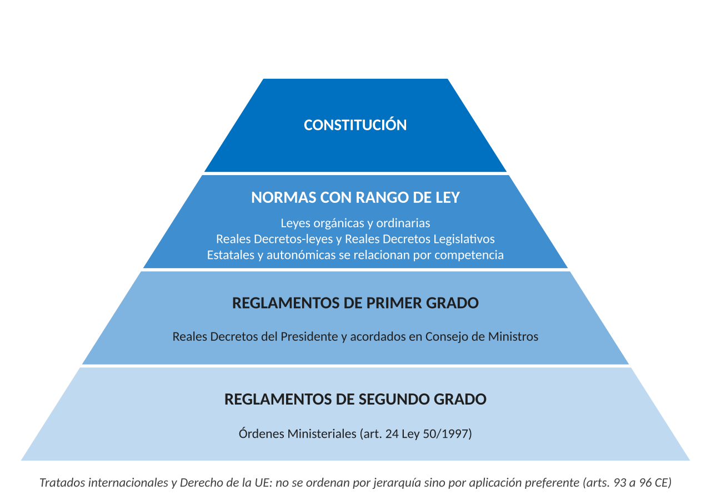

# 1. INTRODUCCIÓN

El **Derecho Administrativo** es el conjunto de normas de Derecho público que regulan la organización de las Administraciones públicas, su actividad y sus relaciones con los ciudadanos. Lo distingue el **principio de legalidad**: la Administración solo puede actuar cuando una norma la habilita, porque el art. 103.1 CE le exige sometimiento pleno a la ley y al Derecho.

# 2. LAS FUENTES DEL DERECHO ADMINISTRATIVO

## 2.1. Concepto y clases de fuentes

Las **fuentes del Derecho** aluden al origen de las normas. En sentido material son los sujetos con poder para crearlas, y en sentido formal los tipos de normas que producen. El art. 1 del Código Civil enumera la ley, la costumbre y los principios generales, pero hoy el sistema está en la Constitución de 1978 (CE). La doctrina distingue:

- Fuentes escritas: Constitución, normas con rango de ley, tratados internacionales, Derecho de la Unión Europea y reglamentos
- Fuentes no escritas: costumbre y principios generales del Derecho
- Fuentes complementarias: jurisprudencia (art. 1.6 CC)

## 2.2. Los principios que ordenan las fuentes

El art. 9.3 CE garantiza, entre otros, la legalidad, la jerarquía normativa, la publicidad de las normas, la seguridad jurídica y la interdicción de la arbitrariedad.

**Jerarquía normativa.** Las normas de rango superior prevalecen sobre las de rango inferior, y la que las contradiga es nula. Ordena las fuentes de forma piramidal.

**Competencia.** En un Estado compuesto la jerarquía no basta. Una ley autonómica y una estatal tienen el mismo rango, y el conflicto se resuelve preguntando cuál es competente. Solo cuando la materia no es de competencia exclusiva autonómica entra la cláusula de prevalencia del Derecho estatal (art. 149.3 CE).

**Reserva de ley.** Ciertas materias deben regularse por ley y no por reglamento: los derechos y libertades del Capítulo II del Título I (art. 53.1), los tributos y prestaciones patrimoniales públicas (arts. 31.3 y 133) y las infracciones y sanciones (art. 25.1). Es absoluta cuando la ley debe regular toda la materia y relativa cuando basta con que fije sus elementos esenciales.

## 2.3. Las fuentes no escritas y la jurisprudencia

- **Costumbre.** Uso reiterado con convicción de obligatoriedad, rige solo en defecto de ley (art. 1.3 CC). Su papel es muy reducido y casi limitado al régimen local
- **Principios generales.** Se aplican en defecto de ley o costumbre e informan todo el ordenamiento (art. 1.4 CC). Sirven sobre todo para controlar las potestades discrecionales. Muchos están positivados, como la buena fe, la confianza legítima y la lealtad institucional (art. 3.1 Ley 40/2015)
- **Jurisprudencia.** No crea normas en sentido estricto, pero los tribunales han construido buena parte de las instituciones. Se suma la doctrina del Tribunal Constitucional, que vincula a todos los jueces (art. 5.1 LOPJ)

No son fuentes el precedente administrativo, aunque la Administración debe motivar cuándo se aparta de él (art. 35.1.c Ley 39/2015), ni la doctrina del Consejo de Estado.

# 3. LA CONSTITUCIÓN

## 3.1. La Constitución como norma jurídica

La Constitución es la norma suprema y una **norma jurídica** que vincula directamente a ciudadanos y poderes públicos (art. 9.1 CE). Para la Administración es el fundamento de sus potestades y fija sus principios: eficacia, jerarquía, descentralización, desconcentración y coordinación (art. 103.1). Todas las normas se interpretan conforme a ella (art. 5.1 LOPJ).

## 3.2. La supremacía formal: la reforma constitucional

La Constitución es **rígida**: solo se modifica por procedimientos más exigentes que los legislativos.

- **Ordinario** (art. 167). Exige tres quintos de cada Cámara. Si no hay acuerdo, una Comisión paritaria propone un texto y, si tampoco se aprueba, el Congreso puede aprobarlo por dos tercios siempre que el Senado lo haya aprobado por mayoría absoluta. Solo hay referéndum si lo pide una décima parte de los miembros de cualquiera de las Cámaras en los quince días siguientes
- **Agravado** (art. 168). Para la revisión total y la reforma del Título Preliminar, de la Sección 1.ª del Capítulo II del Título I y del Título II. Exige dos tercios de cada Cámara, disolución de las Cortes, ratificación por dos tercios de las nuevas Cámaras y referéndum obligatorio

La iniciativa corresponde al Gobierno, al Congreso, al Senado y a las Asambleas autonómicas, y queda excluida la popular (art. 166). No puede iniciarse en tiempo de guerra ni durante los estados de alarma, excepción o sitio (art. 169).

## 3.3. Las garantías de la supremacía

Ninguna norma puede contradecir la Constitución, y su garante es el **Tribunal Constitucional**, que controla las normas con rango de ley mediante:

- Recurso de inconstitucionalidad, en el plazo general de tres meses, por el Presidente del Gobierno, el Defensor del Pueblo, cincuenta diputados, cincuenta senadores y los órganos ejecutivos y legislativos autonómicos
- Cuestión de inconstitucionalidad, que plantean los jueces cuando dudan de la constitucionalidad de una ley aplicable al caso (art. 163 CE)

Los jueces ordinarios no pueden inaplicar una ley por inconstitucional, porque el Tribunal tiene el monopolio de rechazo de las normas con rango de ley. Sí pueden inaplicar los reglamentos ilegales. El recurso de amparo defiende los derechos fundamentales.

# 4. LA LEY

## 4.1. Concepto y clases

La **ley** es la norma aprobada por el Parlamento (art. 66 CE) o por los Parlamentos autonómicos en su ámbito. Tiene fuerza activa, que le permite modificar o derogar cualquier norma de rango igual o inferior, y fuerza pasiva, que impide que la modifiquen normas inferiores.

- **Leyes orgánicas** (art. 81 CE). Solo regulan las materias reservadas: desarrollo de los derechos fundamentales y libertades públicas, Estatutos de Autonomía, régimen electoral general y las demás previstas en la Constitución. Exigen mayoría absoluta del Congreso en una votación final sobre el conjunto. Con la ordinaria no hay jerarquía sino competencia
- **Leyes ordinarias**. Se aprueban por mayoría simple. Las Cámaras pueden delegar su aprobación en las Comisiones, salvo en reforma constitucional, cuestiones internacionales, leyes orgánicas y de bases y Presupuestos Generales del Estado (art. 75.3 CE)

## 4.2. El procedimiento legislativo

La **iniciativa** (arts. 87 a 89 CE) corresponde al Gobierno (proyectos de ley), al Congreso y al Senado (proposiciones de ley), a las Asambleas autonómicas y a los ciudadanos con al menos 500.000 firmas, que no cabe en materias de ley orgánica, tributarias, internacionales ni de prerrogativa de gracia.

El Senado dispone de dos meses, o de veinte días naturales si hay urgencia, para aprobar el texto, enmendarlo por mayoría simple u oponer un veto por mayoría absoluta. El Congreso levanta el veto por mayoría absoluta o, pasados dos meses, por mayoría simple (art. 90 CE). El Rey sanciona la ley en quince días, la promulga y ordena su publicación (art. 91). Entra en vigor a los veinte días de su publicación en el BOE si no dispone otra cosa (art. 2.1 CC).

## 4.3. Las leyes autonómicas y las leyes del artículo 150 CE

Las leyes autonómicas tienen el mismo rango que las estatales y se relacionan con ellas por competencia. El art. 150 CE prevé tres leyes estatales que modulan el reparto:

- Leyes marco: atribuyen a las Comunidades la facultad de legislar en materias estatales dentro de las bases del Estado
- Leyes de transferencia o delegación, que son orgánicas
- Leyes de armonización: fijan principios cuando lo exige el interés general, apreciado por mayoría absoluta de cada Cámara

# 5. LOS DECRETOS-LEYES

## 5.1. Concepto y presupuesto habilitante

El **Decreto-ley** es una disposición legislativa provisional que dicta el Gobierno en caso de extraordinaria y urgente necesidad (art. 86.1 CE). Tiene rango de ley desde su publicación, pero su permanencia depende de que el Congreso lo convalide. En el Estado adopta la forma de Real Decreto-ley.

La extraordinaria y urgente necesidad es un concepto jurídico indeterminado que aprecia el Gobierno, pero que puede controlarse (SSTC 29/1982 y 6/1983). El Gobierno debe razonar la situación de necesidad y debe existir conexión de sentido entre ella y las medidas adoptadas.

## 5.2. Límites materiales

No puede afectar al ordenamiento de las instituciones básicas del Estado, a los derechos, deberes y libertades del Título I, al régimen de las Comunidades Autónomas ni al Derecho electoral general (art. 86.1 CE). El verbo afectar se interpreta de forma restrictiva (STC 111/1983): lo prohibido es regular el régimen general de esos derechos o ir contra su contenido esencial. Tampoco puede invadir materias reservadas a la ley orgánica.

## 5.3. Convalidación y tramitación como ley

El Congreso debe pronunciarse sobre la convalidación o derogación, tras debate y votación de totalidad, en los **treinta días** siguientes a la promulgación y por mayoría simple (art. 86.2 CE). Si no se convalida, queda derogado, y la doctrina mayoritaria entiende que se mantienen los efectos producidos mientras estuvo vigente.

En ese mismo plazo, las Cortes pueden tramitarlo como proyecto de ley por urgencia, lo que permite enmendarlo (art. 86.3 CE). Su elaboración solo exige una memoria abreviada de impacto normativo (art. 26.11 Ley 50/1997). Muchos Estatutos reformados desde 2006 han extendido la figura a los Gobiernos autonómicos, lo que admitió la STC 93/2015 con límites equivalentes a los del art. 86 CE.

# 6. LA DELEGACIÓN LEGISLATIVA

## 6.1. Concepto y requisitos

La **delegación legislativa** habilita al Gobierno, por las Cortes Generales, para dictar normas con rango de ley sobre una materia determinada (arts. 82 a 85 CE). La norma resultante es el Decreto legislativo, que adopta la forma de Real Decreto Legislativo. A diferencia del Decreto-ley, la iniciativa parte del Parlamento, que fija antes los límites. La delegación:

- No puede referirse a materias de ley orgánica (art. 82.1)
- Debe ser expresa, para una materia concreta y con plazo. Se agota con su uso y no puede ser implícita ni por tiempo indeterminado (art. 82.3)
- Se otorga al Gobierno y no puede subdelegarse (art. 82.3)

## 6.2. Textos articulados y textos refundidos

- **Textos articulados**. Desarrollan una ley de bases, que delimita el objeto, alcance, principios y criterios de la delegación (art. 82.4). No puede autorizar a modificarla ni a dictar normas retroactivas (art. 83). Es una técnica hoy poco utilizada
- **Textos refundidos**. Reúnen normas legales dispersas a partir de una ley ordinaria, que precisa si se trata de una mera formulación de un texto único o si permite además regularizar, aclarar y armonizar los textos (art. 82.5). Es la modalidad más frecuente

## 6.3. El control de los Decretos legislativos

Los proyectos requieren dictamen del Pleno del Consejo de Estado (art. 21 Ley Orgánica 3/1980). El art. 82.6 CE prevé su control sin perjuicio de la competencia de los tribunales y permite fórmulas adicionales en la ley de delegación. El Tribunal Constitucional controla su constitucionalidad. Los tribunales contencioso-administrativos pueden controlarlos cuando excedan los límites de la delegación (art. 1.1 LJCA), porque en lo que se excede el Gobierno no actúa como legislador delegado y la norma no tiene rango de ley (tesis del *ultra vires*).

# 7. LOS TRATADOS INTERNACIONALES Y EL DERECHO DE LA UNIÓN EUROPEA

## 7.1. Los tratados internacionales

Los tratados válidamente celebrados forman parte del ordenamiento interno una vez publicados oficialmente en España, y solo se derogan, modifican o suspenden en la forma prevista en ellos o en el Derecho internacional (art. 96.1 CE). Requieren:

- Autorización por ley orgánica, los que atribuyen a una organización internacional competencias derivadas de la Constitución (art. 93)
- Autorización de las Cortes, los de carácter político o militar, los que afecten a la integridad territorial o a los derechos del Título I, los que impliquen obligaciones financieras y los que modifiquen leyes (art. 94.1). Del resto basta con informar a las Cámaras (art. 94.2)

Si un tratado contradice la Constitución, debe reformarse antes esta (art. 95). La Ley 25/2014 establece que los tratados prevalecen sobre cualquier norma interna salvo las constitucionales (art. 31), y la STC 140/2018 permite a cualquier juez inaplicar una ley contraria a un tratado.

## 7.2. El Derecho de la Unión Europea

Forma parte del ordenamiento español desde 1986. El **Derecho originario** son los Tratados (TUE y TFUE) y la Carta de los Derechos Fundamentales. El **Derecho derivado** son los actos del art. 288 TFUE:

- Reglamento: obligatorio y directamente aplicable sin norma nacional
- Directiva: obliga en cuanto al resultado y exige transposición
- Decisión: obligatoria para sus destinatarios
- Recomendaciones y dictámenes: no vinculantes

Sus relaciones con el Derecho nacional descansan en el **efecto directo** (Van Gend en Loos, 1963), que permite invocar ante los jueces las normas europeas claras e incondicionales, y en la **primacía** (Costa contra ENEL, 1964), que obliga a jueces y Administraciones a inaplicar la norma interna contraria. El Tribunal Constitucional (Declaración 1/2004) la distinguió de la supremacía de la Constitución. La Unión tiene competencia exclusiva, entre otras, en la unión aduanera y la política comercial común (art. 3 TFUE).

# 8. CONCLUSIÓN

En la cúspide del sistema está la Constitución, norma directamente aplicable. Por debajo se sitúa la ley, junto a las normas con rango de ley que dicta el Gobierno por urgencia (Decretos-leyes) o por encargo del Parlamento (Decretos legislativos), sometidas a límites y controles estrictos. La jerarquía se combina con la competencia y con la aplicación preferente de los tratados y del Derecho de la Unión. La Administración, sujeta al principio de legalidad, debe apoyar toda su actuación en una norma aplicable y respetar su rango.
