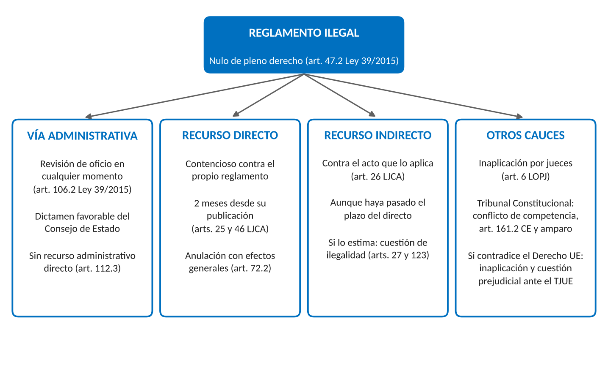

# 1. INTRODUCCIÓN

Las leyes fijan las reglas esenciales de cada materia, pero rara vez bastan para aplicarlas. Los reglamentos, dictados por la propia Administración, concretan plazos, requisitos, procedimientos y órganos. Como obligan a todos, plantean un problema de legitimidad y de límites: quién puede dictarlos, cómo, qué materias le están vedadas y qué ocurre cuando vulneran esos límites.

# 2. EL REGLAMENTO: CONCEPTO Y CARACTERÍSTICAS

## 2.1. Concepto

**Reglamento.** Según García de Enterría, toda norma escrita dictada por la Administración. Es una norma jurídica y no un acto, porque forma parte del ordenamiento y obliga también a la Administración que lo dicta. Es escrita y debe publicarse para producir efectos. Procede de la Administración y no del Parlamento, por lo que su rango es inferior a la ley. La Ley 39/2015 usa como sinónimos reglamentos y disposiciones administrativas de carácter general.

## 2.2. Fundamento y caracteres

El Parlamento no puede ni debe regular los detalles técnicos de cada materia, porque carece del conocimiento especializado y su procedimiento es lento. Así, la Ley 35/2006 del IRPF fija los elementos esenciales del tributo y el Real Decreto 439/2007 aprueba el Reglamento que desarrolla su aplicación.

La ley expresa la voluntad de los representantes elegidos por el pueblo. El reglamento tiene una legitimidad democrática indirecta, que deriva de la confianza parlamentaria y de la sujeción a la ley. De ahí su posición subordinada y estos caracteres:

- Sometimiento a la Constitución, a las leyes y a los reglamentos de rango superior (art. 128.3 Ley 39/2015)
- Publicación en el diario oficial para entrar en vigor (art. 131)
- Vigencia indefinida mientras no lo modifique o derogue otra norma de igual o superior rango, salvo que él mismo fije un plazo
- **Inderogabilidad singular.** Las resoluciones de carácter particular no pueden vulnerar un reglamento, aunque procedan de un órgano de igual o superior jerarquía al que lo dictó (art. 37.1)

## 2.3. Clases de reglamentos

**Por el órgano que los dicta**, son estatales, autonómicos, locales (ordenanzas y reglamentos municipales y provinciales) y de otros entes públicos con potestad atribuida por ley. Entre ellos no hay jerarquía sino competencia: el reglamento estatal no prevalece sobre el autonómico o local por ser estatal, sino según la Administración competente en la materia.

**Por sus destinatarios:**

- Organizativos o ad intra, que regulan la estructura y el funcionamiento internos y no afectan directamente a los derechos de los ciudadanos
- Normativos o ad extra, que establecen derechos y obligaciones para los ciudadanos

**Por su relación con la ley:**

- Ejecutivos, que desarrollan o completan una ley concreta. Son los más frecuentes y exigen dictamen del Consejo de Estado
- Independientes, dictados sin ley previa que desarrollen. La posición mayoritaria los admite en el ámbito organizativo, pero no en el normativo, que exige al menos una ley de cobertura
- De necesidad, dictados en emergencias ante un peligro grave e inminente. Su validez depende de la habilitación legal y dura lo que la situación (art. 21.1.m Ley 7/1985). Los decretos del estado de alarma tienen valor de ley (STC 83/2016) y no se controlan como reglamentos

# 3. LA POTESTAD REGLAMENTARIA

## 3.1. Concepto y fundamento

**Potestad reglamentaria.** Poder que el ordenamiento atribuye a determinados órganos para dictar reglamentos. Su fundamento es el art. 97 CE: el Gobierno ejerce la función ejecutiva y la potestad reglamentaria de acuerdo con la Constitución y las leyes. El art. 128.1 de la Ley 39/2015 la atribuye al Gobierno de la Nación, a los órganos de gobierno de las Comunidades Autónomas según sus Estatutos y a los órganos de gobierno locales.

Es originaria la que atribuye directamente la Constitución o el bloque de constitucionalidad, y derivada la que una ley confiere expresamente a otros órganos u organismos.

## 3.2. Titulares de la potestad reglamentaria

- **Administración General del Estado.** El Gobierno, mediante reales decretos, y los Ministros en las materias de su departamento, mediante órdenes ministeriales (art. 4.1.b Ley 50/1997 y art. 61.a Ley 40/2015). Los órganos inferiores no la tienen salvo que una norma con rango de ley se la atribuya
- **Comunidades Autónomas.** Los Consejos de Gobierno y, según cada Estatuto, los consejeros
- **Entidades locales.** Ordenanzas aprobadas por el Pleno (arts. 4.1.a, 22.2.d y 49 Ley 7/1985)
- **Organismos y autoridades independientes**, cuando su ley se la atribuye. Las circulares del Banco de España, la CNMV y la CNMC son verdaderos reglamentos porque innovan el ordenamiento con habilitación legal
- **Órganos constitucionales** como el Tribunal Constitucional, el Consejo General del Poder Judicial o el Tribunal de Cuentas, sobre su propio funcionamiento. Los Reglamentos de las Cámaras tienen rango de ley

## 3.3. Forma y jerarquía de los reglamentos estatales

Según el art. 24 de la Ley 50/1997, las disposiciones reglamentarias adoptan la forma de Real Decreto del Presidente del Gobierno, Real Decreto acordado en Consejo de Ministros u Orden Ministerial. Si afectan a varios departamentos, la de Orden del Ministro de la Presidencia, a propuesta de los ministros interesados.

La jerarquía tiene dos niveles, primero los reales decretos y después las órdenes ministeriales, de modo que una orden no puede contradecir un real decreto. Entre órdenes ministeriales no hay jerarquía sino reparto de materias por departamentos.

## 3.4. El procedimiento de elaboración

La potestad se ejerce conforme a los principios de buena regulación del Título VI de la Ley 39/2015: necesidad, eficacia, proporcionalidad, seguridad jurídica, transparencia y eficiencia (art. 129). La STC 55/2018 limitó la aplicación de buena parte de este Título a las Comunidades Autónomas, por lo que rige plenamente para el Estado.

El procedimiento estatal se regula en el art. 26 de la Ley 50/1997:

- **Planificación.** Plan Anual Normativo (art. 25)
- **Consulta pública previa** en el portal web del departamento, con plazo no inferior a quince días naturales y excepciones como las normas organizativas o presupuestarias
- **Redacción** por el centro directivo competente, con Memoria del Análisis de Impacto Normativo (oportunidad, contenido jurídico, competencias, impacto económico y presupuestario, cargas administrativas, género y cambio climático)
- **Informes.** Siempre el de la Secretaría General Técnica del ministerio proponente. Aprobación previa del ministerio de función pública si afecta a organización, personal o procedimientos de la AGE, e informe del de política territorial si puede afectar al reparto de competencias con las Comunidades Autónomas
- **Audiencia e información pública** si afecta a derechos e intereses legítimos, con plazo mínimo de quince días hábiles, reducible de forma motivada a siete días hábiles
- **Dictamen del Consejo de Estado**, cuando sea preceptivo, en particular para los reglamentos ejecutivos de las leyes (art. 22.3 Ley Orgánica 3/1980)
- **Aprobación y publicación en el BOE.** Si imponen nuevas obligaciones a quienes ejercen una actividad económica o profesional, entran en vigor con carácter general el 2 de enero o el 1 de julio siguientes (art. 23 Ley 50/1997)

# 4. LOS REGLAMENTOS ILEGALES

## 4.1. Los límites de la potestad reglamentaria

Un reglamento es ilegal cuando traspasa los límites de la potestad reglamentaria, formales y materiales.

**Límites formales:**

- Competencia: solo es válido el dictado por un órgano con potestad reglamentaria y competencia sobre la materia
- Jerarquía: ningún reglamento puede vulnerar otro de rango superior (art. 128.3)
- Procedimiento: según la jurisprudencia, omitir el dictamen preceptivo del Consejo de Estado o la audiencia obligatoria determina la nulidad

**Límites materiales:**

- Respeto a la Constitución y a la ley
- Reserva de ley: los reglamentos no pueden tipificar delitos, faltas o infracciones administrativas, establecer penas o sanciones, ni crear tributos, exacciones parafiscales u otras prestaciones personales o patrimoniales de carácter público (art. 128.2)
- Principios generales del Derecho: el art. 9.3 CE prohíbe la retroactividad de las disposiciones sancionadoras no favorables o restrictivas de derechos individuales y la arbitrariedad de los poderes públicos
- Inderogabilidad singular

## 4.2. La nulidad del reglamento ilegal

A diferencia de los actos, que pueden ser nulos o anulables, los reglamentos ilegales son **nulos de pleno derecho**. El art. 47.2 de la Ley 39/2015 declara nulas las disposiciones que vulneren la Constitución, las leyes u otras disposiciones de rango superior, las que regulen materias reservadas a la ley y las que establezcan la retroactividad de disposiciones sancionadoras no favorables o restrictivas de derechos individuales. El vicio no se convalida con el tiempo y puede alegarse en cualquier momento.

## 4.3. Las vías de reacción frente al reglamento ilegal

El ordenamiento ofrece varios cauces para depurar los reglamentos ilegales, que resume la figura.

**Vía administrativa.** La Administración puede declarar la nulidad de oficio en cualquier momento, previo dictamen favorable del Consejo de Estado u órgano consultivo autonómico equivalente (art. 106.2). Los ciudadanos no pueden interponer recursos administrativos contra un reglamento (art. 112.3), pero sí recurrir un acto que lo aplica alegando su nulidad. Al declarar la nulidad subsisten los actos firmes dictados en su aplicación (art. 106.4).

**Vía contencioso-administrativa** (Ley 29/1998, LJCA):

- Recurso directo contra el propio reglamento, en el plazo de dos meses desde su publicación (arts. 25 y 46.1). La anulación produce efectos para todas las personas afectadas y se publica en el mismo diario oficial (art. 72.2)
- Recurso indirecto contra un acto de aplicación, basado en que el reglamento no es conforme a Derecho (art. 26). Cabe aunque no se recurriera el reglamento en plazo o se desestimara el recurso directo. Es la vía más habitual

**Cuestión de ilegalidad** (arts. 27 y 123 a 126 LJCA). Si el juez del acto estima el recurso por considerar ilegal el reglamento, anula el acto y plantea la cuestión ante el tribunal competente para el recurso directo, que decide con efectos generales. Si el juez del acto es también competente para conocer del reglamento, o se trata del Tribunal Supremo, declara directamente su validez o nulidad.

La anulación no afecta por sí misma a los actos y sentencias firmes que lo aplicaron, salvo que suponga la exclusión o reducción de sanciones aún no ejecutadas por completo (art. 73 LJCA).

**Otros cauces:**

- Los jueces y tribunales deben inaplicar los reglamentos contrarios a la Constitución, a la ley o a la jerarquía normativa (art. 6 LOPJ), sin acudir al Tribunal Constitucional
- El Tribunal Constitucional solo conoce de reglamentos en los conflictos positivos de competencia, en la impugnación por el Gobierno de disposiciones autonómicas, que produce su suspensión (art. 161.2 CE), y en el recurso de amparo
- Si es contrario al Derecho de la Unión Europea, se inaplica por primacía y el juez puede plantear cuestión prejudicial ante el TJUE

# 5. ACTOS ADMINISTRATIVOS GENERALES, CIRCULARES E INSTRUCCIONES

## 5.1. Los actos administrativos generales

**Actos administrativos generales.** Actos con destinatarios plurales e indeterminados que no innovan el ordenamiento, como la convocatoria de pruebas selectivas o de una línea de subvenciones.

Según el Tribunal Supremo, el reglamento se integra en el ordenamiento, lo innova y se aplica una y otra vez sin agotarse, mientras que el acto general se agota con su cumplimiento. La distinción no depende del número de destinatarios.

El acto general se publica cuando se dirige a una pluralidad indeterminada de personas (art. 45.1.a Ley 39/2015), pero sigue el régimen de los actos: puede recurrirse en vía administrativa y estar afectado por simple anulabilidad. Las bases de una convocatoria vinculan a la Administración y a los participantes (la ley del concurso).

## 5.2. Las circulares y las instrucciones

**Instrucciones y órdenes de servicio.** Medio por el que los órganos dirigen la actividad de sus órganos jerárquicamente dependientes (art. 6 Ley 40/2015). Se publican en el boletín oficial cuando una disposición lo establezca o se considere conveniente, sin perjuicio de la Ley 19/2013, que obliga a publicar las que supongan una interpretación del Derecho o tengan efectos jurídicos. Su incumplimiento no afecta por sí solo a la validez de los actos, sin perjuicio de la responsabilidad disciplinaria.

Las circulares son una denominación tradicional de las instrucciones de contenido general y se rigen por el mismo precepto. No manifiestan la potestad reglamentaria sino el principio de jerarquía, y no crean derechos ni obligaciones para los ciudadanos. Suelen clasificarse en informativas, interpretativas y organizativas.

Cuando una instrucción oculta un verdadero reglamento, al imponer a los ciudadanos obligaciones que no derivan de ninguna norma, la jurisprudencia admite su impugnación y la declara nula si no se siguió el procedimiento de elaboración de los reglamentos o el órgano carecía de potestad reglamentaria.

Los reales decretos y los decretos autonómicos no son actos generales ni instrucciones, sino formas que pueden revestir reglamentos o actos singulares. Lo decisivo es el contenido, no la forma.

# 6. CONCLUSIÓN

El reglamento es la norma escrita que dicta la Administración. Está por debajo de la Constitución y de la ley, pero es indispensable para aplicarlas. Solo pueden dictarlo los órganos con potestad reglamentaria, con un procedimiento que enfatiza la planificación, la evaluación de impactos y la participación, y sin invadir las materias reservadas a la ley. El que traspasa esos límites es nulo de pleno derecho y puede depurarlo la Administración, los tribunales contencioso-administrativos y, en ciertos casos, el Tribunal Constitucional. Los actos generales se agotan con su cumplimiento, y las circulares e instrucciones son instrumentos de dirección interna que no obligan a los ciudadanos.
