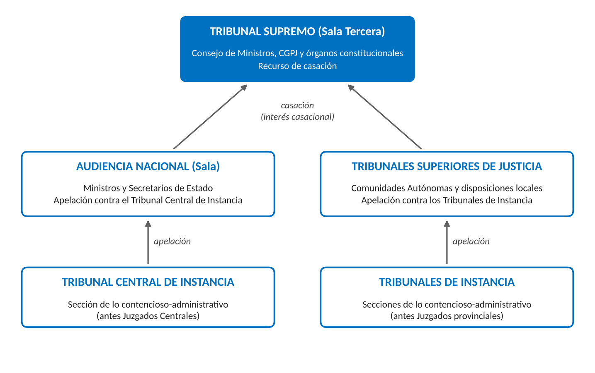

# 1. INTRODUCCIÓN

Los privilegios de la Administración tienen como contrapeso el control judicial. El **art. 106.1 CE** dispone que los tribunales controlan la potestad reglamentaria y la legalidad de la actuación administrativa, y el **art. 24 CE** reconoce la tutela judicial efectiva también frente a la Administración.

Lo ejerce la jurisdicción contencioso-administrativa, regulada por la **Ley 29/1998 (LJCA)**. Sus reformas más relevantes son la **Ley Orgánica 7/2015** (actual casación), los **Reales Decretos-leyes 5/2023 y 6/2023** y la **Ley Orgánica 1/2025**, que ha transformado la planta judicial.

# 2. LA JURISDICCIÓN CONTENCIOSO-ADMINISTRATIVA

## 2.1. Naturaleza y caracteres

Es uno de los cuatro órdenes jurisdiccionales, junto al civil, el penal y el social. Es **ordinaria**, porque la ejercen jueces y magistrados del Poder Judicial, y **especializada** por razón de la materia. Sus caracteres:

- **Revisora**: normalmente enjuicia una actuación administrativa previa, pero hoy cabe impugnar también la inactividad y la vía de hecho
- **Improrrogable**: no se le pueden someter ni sustraer asuntos (art. 5 LJCA)
- **Plena**: puede anular, reconocer situaciones jurídicas, condenar a actuar o indemnizar y adoptar medidas cautelares
- La **ejecución** de las sentencias corresponde exclusivamente a jueces y tribunales (art. 117.3 CE y art. 103.1 LJCA)

## 2.2. Los órganos de la jurisdicción

La Ley Orgánica 1/2025 sustituyó los juzgados unipersonales por **Tribunales de Instancia**. En este orden la transformación se completó el 31 de diciembre de 2025: los Juzgados de lo Contencioso-administrativo son secciones de los Tribunales de Instancia y los Juzgados Centrales se integraron en la sección del **Tribunal Central de Instancia**, con jurisdicción en toda España.

La figura muestra los órganos del orden y sus recursos.

Competencias principales (arts. 8 a 12 LJCA):

- **Tribunales de Instancia**: buena parte de los actos de las entidades locales y algunos autonómicos
- **Tribunal Central de Instancia**: determinados actos de órganos centrales de la Administración General del Estado
- **Salas de los TSJ**: actos y disposiciones de las Comunidades Autónomas, disposiciones generales locales y apelaciones contra los Tribunales de Instancia
- **Sala de la Audiencia Nacional**: actos de ministros y secretarios de Estado y apelaciones contra el Tribunal Central de Instancia
- **Sala Tercera del Tribunal Supremo**: actos del Consejo de Ministros, Comisiones Delegadas y Consejo General del Poder Judicial, y sobre todo la casación

# 3. EXTENSIÓN Y LÍMITES

## 3.1. Ámbito de la jurisdicción

El **art. 1 LJCA** le atribuye las pretensiones relativas a la actuación de las Administraciones públicas sujeta al Derecho Administrativo, a las disposiciones generales de rango inferior a la ley y a los Decretos legislativos que excedan la delegación. El **art. 2** incluye, entre otras materias:

- Derechos fundamentales, elementos reglados e indemnizaciones de los actos del Gobierno, lo que limita el «acto político»
- Contratos administrativos y preparación y adjudicación de los demás contratos de las Administraciones
- Actos de las corporaciones de Derecho público en funciones públicas
- Control de la Administración concedente sobre los concesionarios de servicios públicos
- Responsabilidad patrimonial de las Administraciones, que no puede demandarse ante los órdenes civil o social

## 3.2. Límites

El **art. 3** excluye:

- Las cuestiones atribuidas a los órdenes civil, penal y social, como las relaciones laborales del personal laboral o la propiedad de bienes
- El recurso contencioso-disciplinario militar
- Los conflictos de jurisdicción entre tribunales y Administración y los de atribuciones entre órganos de una misma Administración
- Los recursos contra las Normas Forales fiscales vascas, que corresponden al Tribunal Constitucional

El juez puede resolver cuestiones prejudiciales de otros órdenes, salvo las penales, sin efectos fuera del proceso (art. 4).

## 3.3. Objeto del recurso y pretensiones

Cabe recurso contra cuatro actuaciones (arts. 25 a 30):

- Disposiciones de carácter general
- Actos expresos y presuntos que pongan fin a la vía administrativa, definitivos o de trámite cualificados
- Inactividad, si la Administración debe una prestación concreta a personas determinadas o no ejecuta sus actos firmes, previa reclamación del interesado
- Vía de hecho: actuación material sin acto que la ampare o excediéndose de él

Se puede pretender la anulación, el reconocimiento de una situación jurídica individualizada con su restablecimiento e indemnización, la condena a cumplir una obligación o el cese de la vía de hecho (arts. 31 y 32).

# 4. LAS PARTES DEL PROCEDIMIENTO

## 4.1. Capacidad y legitimación activa

Tienen **capacidad procesal** quienes la tengan según la Ley de Enjuiciamiento Civil, los menores para derechos que puedan ejercer sin asistencia y los grupos de afectados cuando una ley lo declare (art. 18). La **legitimación** es la relación entre el recurrente y el objeto del proceso. Están legitimados, entre otros (art. 19):

- Quienes ostenten un derecho o interés legítimo, entendido como cualquier ventaja o beneficio que obtendría el recurrente si prosperara el recurso
- Corporaciones, asociaciones, sindicatos y grupos habilitados para defender intereses colectivos
- Las Administraciones frente a actos de otras que afecten a su autonomía, y la autora de un acto previa declaración de lesividad
- El Ministerio Fiscal, en los procesos que determine la ley
- Cualquier ciudadano por acción popular, solo en los casos previstos por la ley, como urbanismo o medio ambiente

No pueden recurrir los órganos de la Administración autora del acto ni los miembros de sus órganos colegiados, salvo que una ley lo autorice, ni las entidades de Derecho público dependientes frente a la Administración de la que dependen (art. 20).

## 4.2. La parte demandada

Es la Administración autora de la actuación impugnada. Son **codemandados** las personas cuyos derechos o intereses pudieran quedar afectados si se estimara el recurso y, en responsabilidad patrimonial, las aseguradoras (art. 21).

## 4.3. Representación y defensa

Ante órganos colegiados se actúa con procurador y abogado. Ante órganos unipersonales, la representación puede conferirse al propio abogado (art. 23). Los **Abogados del Estado** defienden a la Administración del Estado (Ley 52/1997). Comunidades Autónomas y entidades locales tienen sus propios letrados (art. 24 LJCA).

# 5. EL PROCEDIMIENTO EN SÍNTESIS

## 5.1. Requisitos previos y plazos

El particular debe haber agotado la vía administrativa. La Administración que quiera anular un acto propio favorable debe declararlo antes lesivo. Plazos de interposición:

- **Dos meses** desde la publicación de la disposición o la notificación del acto expreso (art. 46.1)
- Frente al silencio negativo no rige el plazo de seis meses de la ley, según el Tribunal Constitucional (STC 52/2014)
- Vía de hecho: **diez días** desde que se desatienda el requerimiento o **veinte días** si no se formuló
- Lesividad: dos meses desde su declaración

## 5.2. Procedimientos y medidas cautelares

El **procedimiento ordinario** comienza con el escrito de interposición. Se reclama el expediente, y demanda y contestación se formulan en **veinte días**. Si hay hechos controvertidos hay prueba, luego vista o conclusiones y sentencia.

El **procedimiento abreviado** se aplica a asuntos de cuantía no superior a **30.000 euros** y a ciertas materias, como personal o extranjería (art. 78). Es oral y más rápido. Tras la Ley Orgánica 1/2025, la vista ya no es automática y se permiten sentencias orales. El de protección de los derechos fundamentales es especial, preferente y sumario, con plazo de diez días (arts. 114 a 122).

El recurso no suspende la ejecución del acto, por lo que cabe adoptar **medidas cautelares** en cualquier estado del proceso (arts. 129 a 136). Proceden cuando la ejecución podría hacer perder al recurso su finalidad legítima, tras ponderar los intereses en conflicto, y pueden denegarse si perturban gravemente los intereses generales o de terceros.

# 6. LA SENTENCIA

## 6.1. Contenido

Se dicta en **diez días** desde que el pleito queda concluso (art. 67). El fallo puede ser (arts. 68 a 71):

- **Inadmisibilidad**: falta de jurisdicción, capacidad, representación o legitimación, actuación no impugnable, cosa juzgada, litispendencia o presentación fuera de plazo (art. 69)
- **Desestimación**: la actuación es conforme a Derecho
- **Estimación**: cualquier infracción del ordenamiento, incluida la **desviación de poder**, ejercicio de potestades para fines distintos de los fijados por el ordenamiento (art. 70.2)

La estimatoria anula la actuación u ordena su cese o modificación, reconoce la situación jurídica pedida y declara el derecho a indemnización. El tribunal no puede sustituir a la Administración: ni redactar los preceptos de un reglamento ni determinar el contenido discrecional de los actos que anula (art. 71.2).

## 6.2. Efectos y costas

La de inadmisibilidad o desestimatoria solo produce efectos entre las partes. La que anula una disposición o un acto los produce para todos los afectados, y si es un reglamento se publica en el mismo diario oficial (art. 72). Por excepción, en materia tributaria, de personal y de unidad de mercado, una sentencia firme puede extenderse a otras personas en idéntica situación que lo soliciten en **un año** (art. 110).

Las **costas** en primera o única instancia se imponen a quien vea rechazadas todas sus pretensiones, salvo serias dudas de hecho o de derecho. En los recursos, al recurrente si se desestima totalmente (art. 139).

## 6.3. Ejecución

La Administración debe cumplir en **dos meses** desde la comunicación. Si no, cualquier parte puede instar la ejecución forzosa (art. 104). El tribunal puede imponer multas coercitivas y deducir testimonio para exigir responsabilidad penal (art. 112). Los actos dictados para eludir el cumplimiento son nulos de pleno derecho (art. 103.4). Si el cumplimiento es material o legalmente imposible, fija indemnización (art. 105).

# 7. LOS RECURSOS

## 7.1. Recursos contra providencias y autos

Los no susceptibles de apelación o casación admiten **reposición** ante el mismo órgano en **cinco días** (art. 79). Determinados autos de los Tribunales de Instancia, como los que inadmiten el recurso, deciden sobre medidas cautelares o se dictan en ejecución, son además apelables (art. 80).

## 7.2. El recurso de apelación

Un órgano superior revisa hechos y derecho de las sentencias en primera instancia de los Tribunales de Instancia y del Tribunal Central de Instancia. Conocen las Salas de los TSJ y de la Audiencia Nacional, respectivamente. Se interpone en **quince días** ante el órgano que dictó la sentencia (arts. 81 a 85).

No son apelables las de cuantía no superior a 30.000 euros ni las electorales. Son siempre apelables, sea cual sea la cuantía, las de inadmisibilidad, las de derechos fundamentales, las de litigios entre Administraciones, las de impugnación indirecta de reglamentos y las susceptibles de extensión de efectos (art. 81.2).

## 7.3. El recurso de casación

No es una tercera instancia: fija jurisprudencia y garantiza la aplicación uniforme del Derecho. Solo se admite si el Tribunal Supremo aprecia **interés casacional objetivo** (arts. 86 a 93), por ejemplo ante doctrina contradictoria entre tribunales o ausencia de jurisprudencia sobre la norma. Se presume en el apartamiento deliberado de la jurisprudencia.

- **Recurribles**: sentencias de la Audiencia Nacional y los TSJ y, en casos excepcionales, las de los Tribunales de Instancia con doctrina gravemente dañosa para los intereses generales y susceptibles de extensión de efectos
- **Tramitación**: se prepara en **treinta días** ante el tribunal que dictó la sentencia, que justifica el interés casacional. Una sección especial del Supremo decide la admisión
- Si se funda en normas autonómicas, conoce una sección especial del TSJ

## 7.4. El recurso de revisión

Procede contra **sentencias firmes** por motivos tasados (art. 102): documentos decisivos no aportados por fuerza mayor o por obra de la parte favorecida, falsedad de documentos o testimonios, o sentencia dictada mediante cohecho, prevaricación, violencia u otra maquinación fraudulenta. También si el Tribunal Europeo de Derechos Humanos declara violado un derecho del Convenio. Se rige por la Ley de Enjuiciamiento Civil.

# 8. CONCLUSIÓN

La jurisdicción contencioso-administrativa es la garantía judicial frente a la Administración. Es plena: controla reglamentos, inactividad y vías de hecho, reconoce derechos, condena y ejecuta sus sentencias. La sentencia no puede sustituir a la Administración en sus decisiones discrecionales. Caben apelación, casación y revisión, y las reformas recientes buscan una justicia más ágil.
