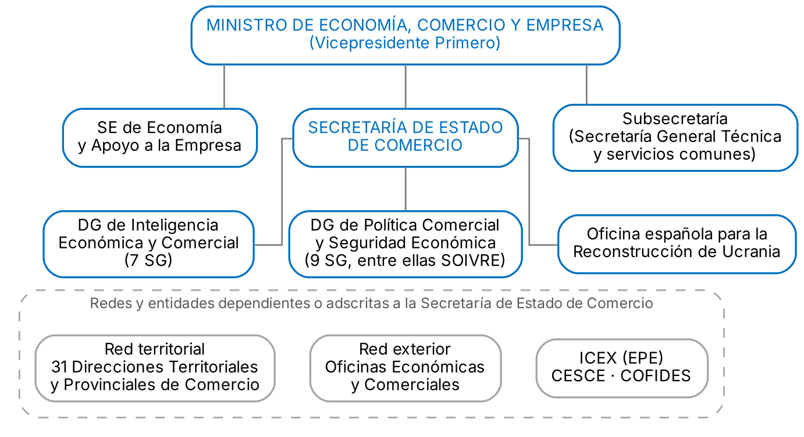

# 1. INTRODUCCIÓN

El **Real Decreto 829/2023** creó el Ministerio de Economía, Comercio y Empresa (MECE), que reúne las competencias de política económica y de política comercial. Su estructura orgánica básica se desarrolla en el **Real Decreto 410/2024**, modificado por el **Real Decreto 867/2025** (refuerzo de la Secretaría de Estado de Comercio) y por el **Real Decreto 65/2026**. Su titular es Carlos Cuerpo Caballero, también Vicepresidente Primero del Gobierno desde marzo de 2026.

# 2. ORGANIZACIÓN Y COMPETENCIAS DEL MINISTERIO

## 2.1. Competencias y organización general

El MECE propone, coordina y ejecuta la política económica del Gobierno mediante reformas que mejoran la competitividad, el apoyo a la empresa y el crecimiento potencial. Dirige también la política comercial y de internacionalización y la supervisión de las inversiones y transacciones exteriores. Su titular preside la Comisión Delegada del Gobierno para Asuntos Económicos. Según el art. 1 del Real Decreto 410/2024, se organiza así:

- Órganos superiores: la Secretaría de Estado de Economía y Apoyo a la Empresa y la Secretaría de Estado de Comercio
- Subsecretaría de Economía, Comercio y Empresa
- Gabinete del Ministro, como órgano de apoyo inmediato
- Dependen también del Ministro la Subdirección General de Fondos Europeos y la Autoridad Macroprudencial Consejo de Estabilidad Financiera (AMCESFI), órgano colegiado adscrito que él preside

## 2.2. La Secretaría de Estado de Economía y Apoyo a la Empresa

Dirige la política económica, el análisis de la coyuntura, la financiación del Estado, la regulación financiera y de seguros y las relaciones económicas y financieras internacionales. Sus órganos directivos son:

- **Secretaría General del Tesoro y Financiación Internacional**, con rango de Subsecretaría, con las Direcciones Generales del Tesoro y Política Financiera y de Financiación Internacional
- **Dirección General de Política Económica**, de reformas estructurales
- **Dirección General de Análisis Económico**, de coyuntura y previsiones macroeconómicas
- **Dirección General de Seguros y Fondos de Pensiones**

Por esta Secretaría de Estado se adscriben al Ministerio el INE, el ICO, la CNMC, la CNMV y el FROB.

## 2.3. La Subsecretaría

Ostenta la representación ordinaria del Ministerio y dirige los servicios comunes, como recursos humanos, gestión presupuestaria, contratación y administración electrónica. Elabora la propuesta anual de presupuesto y ejerce la potestad disciplinaria, salvo la separación del servicio. De ella depende la Secretaría General Técnica (producción normativa, informes jurídicos y recursos administrativos).

# 3. LA SECRETARÍA DE ESTADO DE COMERCIO: COMPETENCIAS Y ORGANIZACIÓN

## 3.1. Competencias

La **Secretaría de Estado de Comercio** (SEC), cuya titular es María Amparo López Senovilla, define, desarrolla y ejecuta la política comercial del Estado (art. 9 del Real Decreto 410/2024). Sus competencias abarcan:

- El comercio exterior, incluido el intracomunitario, y la defensa de los intereses comerciales españoles en la Unión Europea y en los foros multilaterales
- La estrategia de internacionalización y la promoción de las empresas en el exterior
- Las inversiones y transacciones exteriores, incluido el control de las inversiones extranjeras
- El comercio interior, en coordinación con las comunidades autónomas
- La seguridad económica en su vertiente comercial

El Real Decreto 867/2025 la reorganizó ante las tensiones comerciales y geopolíticas, renombró sus dos direcciones generales y creó la Oficina española para la Reconstrucción de Ucrania.

## 3.2. Estructura

De la Secretaría de Estado dependen tres órganos directivos: la Dirección General de Inteligencia Económica y Comercial, la Dirección General de Política Comercial y Seguridad Económica y la Oficina española para la Reconstrucción de Ucrania, con rango de dirección general. Dependen directamente de ella un Gabinete y una Abogacía del Estado.

Su titular preside varios órganos colegiados:

- Junta Superior Arancelaria
- Comisiones Interministeriales para las negociaciones en la OMC y para la participación española en la UNCTAD
- Comisión de Riesgos por cuenta del Estado, en materia de seguro de crédito a la exportación
- Junta Interministerial Reguladora del Comercio Exterior de Material de Defensa y de Doble Uso (JIMDDU)

Están adscritos o vinculados a ella:

- **ICEX España Exportación e Inversiones, E.P.E.**, presidido por la persona titular de la Secretaría de Estado
- **CESCE**, sobre cuya gestión y sobre la cobertura por cuenta del Estado la Secretaría ejerce funciones de tutela y supervisión
- **COFIDES**, cuya actividad coordina y supervisa la Dirección General de Inteligencia Económica y Comercial

# 4. SERVICIOS CENTRALES DE LA SECRETARÍA DE ESTADO

## 4.1. Dirección General de Inteligencia Económica y Comercial

Según el art. 10, recopila y trata la inteligencia económica y comercial de las redes exterior y territorial, define el programa de trabajo de las Oficinas Económicas y Comerciales, dirige la política comercial bilateral y gestiona el apoyo financiero oficial a la internacionalización, en particular el Fondo para la Internacionalización de la Empresa (FIEM). Elabora estudios y estadísticas de comercio exterior y tutela las Cámaras de Comercio de España en el extranjero. Tiene siete subdirecciones generales:

- Oficinas Económicas y Comerciales en el Exterior y de Red Territorial de Comercio
- Europa, Asia y Oceanía, América, y Países Mediterráneos, África y Oriente Medio
- Estudios y Prospección Comercial, con las estadísticas de comercio exterior como DataComex
- Estrategia Comercial
- Instrumentos Financieros para la Internacionalización

## 4.2. Dirección General de Política Comercial y Seguridad Económica

Según el art. 11, representa los intereses españoles en la política comercial común de la Unión Europea y en la OMC, la OCDE y la UNCTAD. Gestiona la defensa comercial, el arancel, la inspección y control de productos objeto de comercio exterior, el comercio interior, el material de defensa y doble uso y las inversiones exteriores. Su titular preside la Junta de Inversiones Exteriores. Tiene nueve subdirecciones generales:

- Política Comercial Multilateral y Seguridad Económica
- Comercio Internacional de Mercancías
- Comercio Internacional de Servicios y Comercio Digital
- Defensa Comercial y Política Arancelaria
- Inspección, Certificación y Asistencia Técnica del Comercio Exterior (SOIVRE)
- Regulación y Apoyo al Comercio Interior
- Comercio Internacional de Material de Defensa y Doble Uso
- Inversiones Exteriores
- Regulación de Inversiones, que aplica el control de inversiones extranjeras directas por motivos de seguridad y orden público

## 4.3. El SOIVRE

El **Servicio Oficial de Inspección, Vigilancia y Regulación de las Exportaciones** (SOIVRE) se articula en torno a la Subdirección General de Inspección, Certificación y Asistencia Técnica del Comercio Exterior, que coordina los Servicios de Inspección SOIVRE de la red territorial y la red de laboratorios. Sus funciones principales son:

- Control de calidad comercial de los productos agroalimentarios, conforme a la **Orden PRE/3026/2003** y sus modificaciones, incluidas las normas de comercialización de frutas y hortalizas frescas de la Unión
- Control de los productos ecológicos importados de terceros países antes de su despacho a libre práctica, conforme al **Reglamento (UE) 2018/848**
- Control de la seguridad de productos industriales importados de terceros países, como juguetes o material eléctrico, conforme al **Real Decreto 330/2008** y al **Reglamento (UE) 2023/988**
- Control en frontera de especies protegidas (CITES), por encomienda de gestión del Ministerio para la Transición Ecológica y el Reto Demográfico, al que corresponde la Autoridad Administrativa CITES desde el **Real Decreto 986/2021**
- Certificación voluntaria y asistencia técnica a las empresas exportadoras

La red analítica se compone de 17 laboratorios: uno Central en Madrid y 16 periféricos.

## 4.4. La Oficina española para la Reconstrucción de Ucrania

Creada por el Real Decreto 867/2025 con rango de dirección general, actúa como ventanilla única para las empresas españolas interesadas en la reconstrucción de Ucrania. Se apoya en las Oficinas Económicas y Comerciales de Kiev y Varsovia.

# 5. SERVICIOS TERRITORIALES: LA RED TERRITORIAL DE COMERCIO

Las **Direcciones Territoriales y Provinciales de Comercio**, 31 en todo el territorio nacional, se regulan en el **Real Decreto 1456/2005**. Dependen orgánicamente del Ministerio a través de la Secretaría de Estado de Comercio y funcionalmente de los órganos directivos competentes por razón de la materia. No están integradas en las Delegaciones del Gobierno. Sus directores actúan también como directores del ICEX en su demarcación. Sus funciones, entre otras, son:

- Gestión, tramitación y resolución de expedientes de comercio exterior, incluido el intracomunitario, y de material de defensa y doble uso
- Inspección y control de calidad comercial y de seguridad, que desarrollan los Servicios de Inspección SOIVRE, y expedición de certificados
- Estudio de los efectos del arancel y recogida de datos sobre la distribución comercial
- Actividades del ICEX e información y asesoramiento a empresas
- Tramitación de los procedimientos sancionadores previstos en su normativa

# 6. SERVICIOS EN EL EXTERIOR

## 6.1. Las Oficinas Económicas y Comerciales

Son órganos técnicos de las Misiones Diplomáticas, regulados por el **Real Decreto 2827/1998**. Dependen orgánicamente del MECE a través de la Secretaría de Estado de Comercio y funcionalmente de los órganos directivos por razón de la materia, sin perjuicio de la dependencia jerárquica del Jefe de Misión (Ley 2/2014). Las dirigen los Consejeros Económicos y Comerciales, normalmente del Cuerpo de Técnicos Comerciales y Economistas del Estado, que actúan también como directores del ICEX. La red cuenta con casi un centenar de oficinas. Sus funciones tienen dos vertientes:

- Representación oficial ante las autoridades del país en materia económica y comercial, seguimiento de su política comercial y de las barreras que afectan a las empresas españolas, y elaboración de inteligencia económica y comercial
- Apoyo a las empresas con información sobre mercados, normativa, aranceles y licitaciones, búsqueda de socios y apoyo a la promoción comercial y a la atracción de inversiones

## 6.2. ICEX España Exportación e Inversiones

**ICEX** es una entidad pública empresarial adscrita al MECE a través de la Secretaría de Estado de Comercio, cuya titular la preside. Promueve la internacionalización de las empresas españolas y atrae inversión extranjera a España a través de Invest in Spain. Presta sus servicios por medio de la red territorial y de las Oficinas Económicas y Comerciales. Sus servicios principales son:

- Información sobre mercados, oportunidades de negocio y licitaciones internacionales
- Formación en internacionalización, a través del CECO y de las Becas de Internacionalización
- Asesoramiento a empresas que inician su salida al exterior, como el programa ICEX Next
- Promoción comercial: ferias, misiones comerciales y planes sectoriales
- Atracción y acompañamiento de la inversión extranjera

ICEX se coordina con COFIDES y CESCE a través de Ventana Global, punto único de información sobre los instrumentos públicos de apoyo. Su actividad se enmarca en la Estrategia de Internacionalización de la Economía Española 2017-2027.

# 7. CONCLUSIÓN

El MECE concentra la política económica y la política comercial. La Secretaría de Estado de Comercio gestiona la política comercial, la internacionalización, las inversiones exteriores y el comercio interior, y el Real Decreto 867/2025 refleja el peso creciente de la seguridad económica y de la inteligencia comercial. Las redes territorial y exterior, conectadas con ICEX, acompañan a las empresas desde su provincia hasta el mercado de destino, y el SOIVRE garantiza la calidad y la seguridad de los productos que entran y salen del mercado de la Unión por las fronteras españolas.
