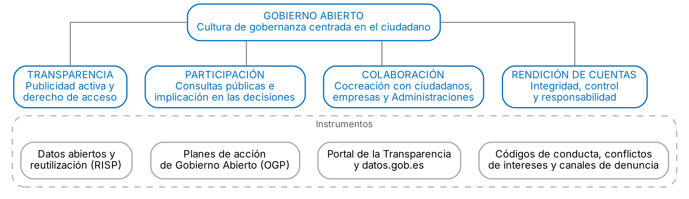

# 1. INTRODUCCIÓN

Al modelo burocrático clásico se sumó la nueva gestión pública, que importó técnicas del sector privado para ganar eficiencia. Desde comienzos de este siglo se ha impuesto la gobernanza pública, que entiende que los problemas complejos exigen la implicación de ciudadanos, empresas, organizaciones sociales y otras Administraciones.

En ese marco surge el **Gobierno Abierto**, una relación más horizontal entre poderes públicos y ciudadanía basada en la transparencia, la participación, la colaboración y la rendición de cuentas.

# 2. GOBERNANZA PÚBLICA Y GOBIERNO ABIERTO

## 2.1. La gobernanza pública

**Gobernanza.** Forma de gobernar basada en la interacción y la cooperación entre los poderes públicos y los actores privados y sociales, en redes y en varios niveles territoriales. No sustituye a la autoridad del Estado, pero la ejerce de forma más abierta y negociada. El Libro Blanco sobre la Gobernanza Europea (2001) identificó cinco principios de la buena gobernanza: apertura, participación, responsabilidad, eficacia y coherencia.

En España, la **Ley 40/2015** (art. 3) impone a todas las Administraciones los principios de servicio efectivo a los ciudadanos, participación, objetividad y transparencia, planificación y evaluación de las políticas públicas, responsabilidad por la gestión y cooperación entre Administraciones. En la AGE, la **Dirección General de Gobernanza Pública** coordina los planes de Gobierno Abierto.

## 2.2. Concepto y origen del Gobierno Abierto

Su difusión actual arranca del Memorando sobre Transparencia y Gobierno Abierto de Barack Obama, de 21 de enero de 2009, que formuló el compromiso de un gobierno transparente, participativo y colaborativo. En 2011 se creó la **Alianza para el Gobierno Abierto** (OGP), iniciativa multilateral en la que gobiernos y sociedad civil asumen compromisos concretos. España se incorporó ese mismo año.

La Recomendación del Consejo de la OCDE sobre Gobierno Abierto (2017) lo define como una cultura de gobernanza que promueve los principios de transparencia, integridad, rendición de cuentas y participación de las partes interesadas en apoyo de la democracia y el crecimiento inclusivo. No consiste en usar tecnologías para comunicar lo mismo de siempre, sino en cambiar la forma de decidir y de gestionar, incorporando las aportaciones de la ciudadanía.

## 2.3. Principios informadores

- **Transparencia.** El gobierno proporciona información sobre lo que hace, de forma accesible, completa y comprensible, para que los ciudadanos controlen su gestión. Se articula mediante la publicidad activa, que difunde información sin necesidad de solicitud, y el derecho de acceso a la información pública, que permite obtener la no publicada.
- **Participación.** Reconoce el derecho de los ciudadanos a intervenir en la elaboración de las políticas públicas. Requiere procesos abiertos, con plazos razonables, información completa y una respuesta motivada sobre cómo se han tenido en cuenta las aportaciones. Su base constitucional está en los arts. 9.2, 23 y 105 CE.
- **Colaboración.** Implica a ciudadanos, empresas, organizaciones sociales y otras Administraciones en el propio trabajo público, desde el diseño hasta la prestación de servicios, mediante cocreación y colaboración público privada.
- **Rendición de cuentas.** Exige normas y mecanismos que permitan exigir responsabilidad a los responsables públicos por sus decisiones y por el uso de los recursos. Incluye códigos de conducta, prevención de conflictos de intereses, declaraciones de bienes, regulación de los grupos de interés, transparencia en la contratación pública, protección de los denunciantes y órganos de control independientes.

Estos principios se concretan en dos líneas de actuación: la apertura de datos públicos (*open data*) y la apertura de procesos de participación y colaboración (*open action*). La figura muestra los cuatro pilares y los instrumentos que los desarrollan.

# 3. DATOS ABIERTOS Y REUTILIZACIÓN

## 3.1. Los datos abiertos

**Datos abiertos.** Datos que cualquier persona puede acceder, utilizar, reutilizar y redistribuir libremente, con la única exigencia, en su caso, de citar la fuente. Deben estar disponibles de forma completa, preferentemente descargables y en formatos legibles por máquina y abiertos, y ser utilizables por todos sin discriminación de personas ni de finalidades, incluidas las comerciales.

La **Carta Internacional de Datos Abiertos** (OGP, 2015) fija seis principios: datos abiertos por defecto, oportunos y exhaustivos, accesibles y utilizables, comparables e interoperables, orientados a mejorar la gobernanza y la participación ciudadana y al desarrollo incluyente y la innovación.

Aportan transparencia, eficiencia, porque evitan duplicar esfuerzos, e innovación, porque son materia prima de nuevos productos y servicios.

## 3.2. La reutilización de la información del sector público

**Reutilización.** Uso, por personas físicas o jurídicas, de los documentos que obran en poder del sector público, con fines comerciales o no comerciales, distintos del propósito inicial del servicio público para el que se produjeron. Su regulación procede del Derecho de la Unión:

- **Directiva (UE) 2019/1024**, de datos abiertos y reutilización de la información del sector público, que sustituyó a la Directiva 2003/98/CE. Refuerza la gratuidad como regla general, incorpora los datos dinámicos, que deben ofrecerse en tiempo real mediante API, y los datos de investigación financiados con fondos públicos, y crea los conjuntos de datos de alto valor
- **Reglamento de Ejecución (UE) 2023/138**, que identifica esos conjuntos en seis categorías: geoespaciales, observación de la Tierra y medio ambiente, meteorológicos, estadísticos, sociedades y propiedad de sociedades y movilidad
- **Reglamento (UE) 2022/868**, de Gobernanza de Datos, y **Reglamento (UE) 2023/2854**, de Datos, sobre datos protegidos del sector público y datos de productos conectados

En España, la norma básica es la **Ley 37/2007**, modificada por la Ley 18/2015 y por el Real Decreto-ley 24/2021, que transpuso la Directiva de 2019. Se desarrolla por el **Real Decreto 1495/2011** y la Norma Técnica de Interoperabilidad de reutilización de recursos de información. Sus reglas principales son:

- Reutilización autorizada con carácter general, preferentemente sin condiciones o con licencias tipo abiertas, que no pueden restringir la competencia
- No discriminación y prohibición de acuerdos exclusivos, salvo excepciones justificadas
- Gratuita como regla general, aunque pueden cobrarse tarifas limitadas a los costes marginales de reproducción, puesta a disposición y difusión
- No alcanza a documentos con derechos de propiedad intelectual de terceros, afectados por la protección de datos personales o excluidos del derecho de acceso

La **Iniciativa Aporta** (2009) impulsa la cultura de la reutilización y gestiona el portal **datos.gob.es**, que desde 2011 alberga el Catálogo de Información Pública y federa los catálogos autonómicos y locales.

# 4. EL MARCO JURÍDICO Y LOS PLANES DE GOBIERNO ABIERTO EN ESPAÑA

## 4.1. Marco jurídico

El Gobierno Abierto no tiene en España una ley propia, sino que se apoya en un conjunto de normas:

- **Constitución**: participación de todos en la vida política, económica, cultural y social (art. 9.2), derecho de participación en los asuntos públicos (art. 23) y audiencia de los ciudadanos en la elaboración de disposiciones administrativas y acceso a archivos y registros (art. 105)
- **Ley 19/2013**, de transparencia, acceso a la información pública y buen gobierno, que crea el Consejo de Transparencia y Buen Gobierno
- **Participación en la elaboración de normas**: consulta pública previa, audiencia e información pública (art. 133 Ley 39/2015 y art. 26 Ley 50/1997) y Plan Anual Normativo. La STC 55/2018 declaró contrarios al orden constitucional de competencias varios apartados del art. 133, que por ello no se aplican plenamente a las comunidades autónomas
- **Integridad y rendición de cuentas**: la **Ley 3/2015**, del alto cargo, con la Oficina de Conflictos de Intereses, y la **Ley 2/2023**, de protección de las personas que informen sobre infracciones, que transpone la Directiva (UE) 2019/1937, obliga a las Administraciones y a las empresas de 50 o más trabajadores a tener un sistema interno de información y crea la Autoridad Independiente de Protección del Informante
- **Reutilización y datos abiertos**: la Ley 37/2007 y su desarrollo
- **Normas autonómicas y locales**: leyes de transparencia, participación o Gobierno Abierto de numerosas comunidades autónomas y ordenanzas de muchas entidades locales

La gobernanza del Gobierno Abierto en la AGE se apoya en la Dirección General de Gobernanza Pública, en el **Foro de Gobierno Abierto**, órgano paritario de Administraciones y sociedad civil (Orden HFP/134/2018), y en la **Comisión Sectorial de Gobierno Abierto**, que coordina a la AGE, las comunidades autónomas y las entidades locales.

## 4.2. La Alianza para el Gobierno Abierto y los planes de acción

Los miembros de la OGP, que agrupa a más de setenta países y a numerosos gobiernos locales, deben suscribir la Declaración de Gobierno Abierto, elaborar planes de acción con compromisos concretos cocreados con la sociedad civil y someterse a una evaluación independiente por el Mecanismo de Revisión Independiente (IRM). España ha aprobado cinco planes:

- **I Plan (2012-2014)**: integridad pública, gestión eficaz de los recursos y mejora de los servicios. Impulsó la Ley 19/2013
- **II Plan (2014-2016)**: transparencia y datos abiertos, con la puesta en marcha del Portal de la Transparencia
- **III Plan (2017-2019)**: 20 medidas en cinco ejes (colaboración, participación, transparencia, rendición de cuentas y formación). Creó el Foro de Gobierno Abierto
- **IV Plan (2020-2024)**: 10 compromisos sobre transparencia y rendición de cuentas, participación, integridad y sensibilización, con las tres Administraciones territoriales
- **V Plan (2025-2029)**: aprobado en octubre de 2025, con 10 compromisos y 218 medidas sobre participación y espacio cívico, transparencia y acceso a la información, integridad, administración abierta, gobernanza digital e inteligencia artificial, y apertura fiscal e información veraz, entre otros ámbitos

El IV Plan, en el marco de la Agenda 2030, buscó impulsar la participación, profundizar en la transparencia, los datos abiertos y la rendición de cuentas, construir un sistema de integridad pública y sensibilizar a la sociedad. El V Plan lo amplía a la gobernanza de los datos y de la inteligencia artificial, la lucha contra la desinformación y la apertura de los presupuestos y de la contratación pública.

# 5. CONCLUSIÓN

El Gobierno Abierto es la expresión más reciente de la gobernanza pública. Sus cuatro principios, transparencia, participación, colaboración y rendición de cuentas, buscan una Administración que no solo actúe conforme a la ley y con eficiencia, sino que explique lo que hace, escuche a los ciudadanos y responda de sus decisiones.

En España el modelo se ha construido sobre la Ley 19/2013, las normas de participación, las leyes de integridad y la regulación de la reutilización, y los planes de acción de la OGP han permitido avanzar de forma gradual. Su éxito depende de un cambio de cultura administrativa en el que la apertura deje de ser una obligación formal y se convierta en una forma ordinaria de trabajar.
